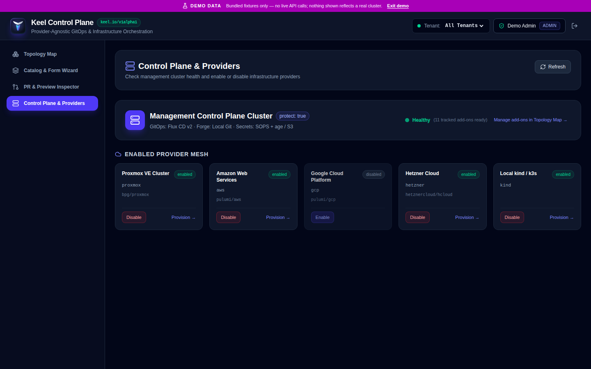
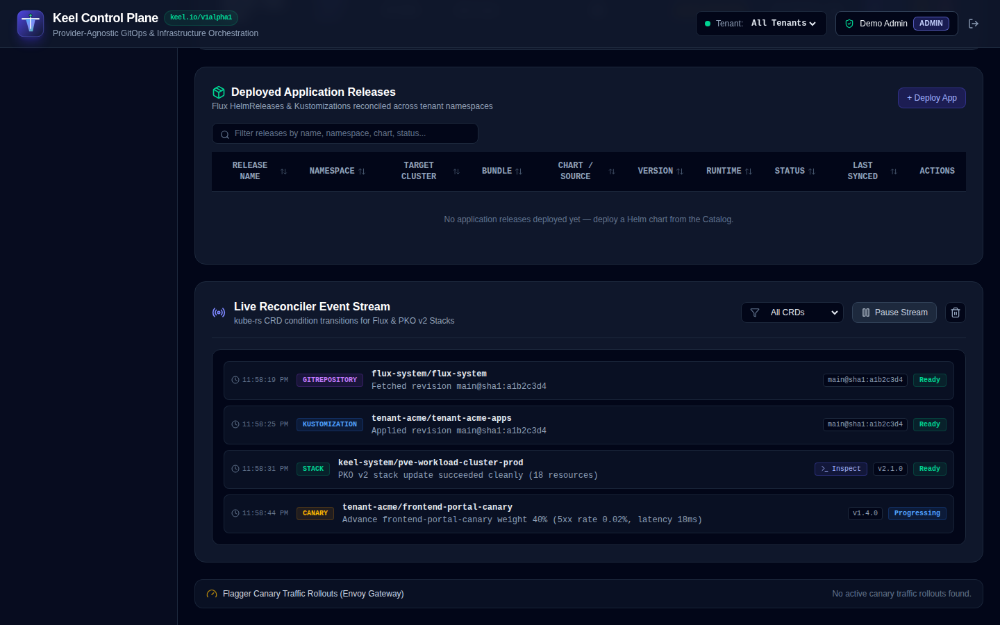
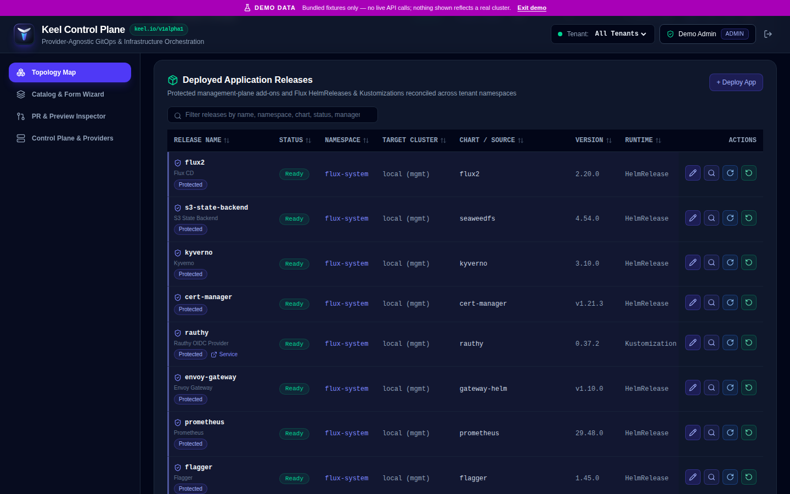

<p align="center">
  
</p>

# Keel

**Lay down your infrastructure and apps from one stateless binary—without custom CRDs, external databases, or blind `apply`s.**

Keel is a single-binary **Rust** control plane and **React** web portal that bootstraps from `localhost` onto **`kind`**, an **existing Kubernetes cluster (`k3s`/`Talos`/managed K8s)**, **Proxmox VE**, or a **public cloud (`AWS`, `GCP`, `Azure`, `Hetzner`)**—and grows into a self-hosted, multi-tenant GitOps platform.

> **Why "Keel"?** In shipbuilding, the keel is the first structural piece laid down—the backbone that gives a vessel stability before anything else is built on top of it. In the maritime Kubernetes ecosystem (*Kubernetes*, *Helm*, and friends), Keel is the foundational control plane you lay down first.

---

## Live Demo (`kind` + Forgejo + Rauthy + Flux + PKO v2)


*Recorded directly from the live `kind` E2E workflow: Rauthy OIDC login → CLI & GUI PR proposals → PKO v2 diff & merge → provisioning a workload `kind` cluster + canary `podinfo` → live Topology Map & Event Stream.*

---

## The Problem Keel Solves

Building an internal platform usually forces a bad trade-off:

* **Heavyweight developer portals** require a Postgres database, bespoke plugins, and a dedicated team just to keep the portal running.
* **Raw GitOps repos** leave every developer copy-pasting Helm `values.yaml` files and guessing what a change will actually do to live infrastructure.
* **Custom Kubernetes IaC controllers** invent proprietary CRDs or lock you into a subset of cloud resources.

**Keel takes a practical middle path:** Git is the sole source of desired state, Kubernetes Secrets hold runtime/auth state (zero external databases), and every change flows through a Pull Request with a real pre-merge diff—wrapped in a clean self-service UI and CLI.

---

## What Makes Keel Different

* **Provider-agnostic Stage 0.** One `keel bootstrap init` gives you the same seed control plane on `kind`, an existing cluster, Proxmox VE, AWS, GCP, Azure, or Hetzner. It then escrows its own Pulumi state to versioned S3.
* **Every change is a PR with a real pre-merge preview.** After Stage 0, Keel never commits to `main`. Pulumi-backed changes get an actual `pulumi preview` in an ephemeral PKO v2 `Stack` before merge, and simulated diffs are always labelled as such.
* **Schema-driven forms for unmodified upstream charts.** A thin `catalog.yaml` JSON Schema becomes a form, and the form becomes a plain `values.yaml`. Upstream charts are never forked.
* **Strict least-privilege multi-tenancy.** Each tenant gets its own namespace, a scoped S3 state identity, Flux impersonation, and Kyverno confinement. Tenants can't fetch Flux `source-controller` artifacts or change the objects the platform writes for them, and they never see control-plane credentials. Tenants with their own Git source (today the Stage 0 `default` tenant) clone it with a read-only token; tenants created through the API don't get one yet, so they can install Helm apps but not Pulumi Stacks or Flux manifest apps.
* **Break-glass recovery.** `keel bootstrap recover` re-applies the control plane from escrowed S3 state when Git, the forge, or the API is down.

---

## Everyday Solutions, Out of the Box

### 1. Zero-to-Control-Plane in One Command
Run `keel bootstrap init` from your laptop to stand up an identical seed control plane—complete with **Flux CD** (self-managed), **Pulumi Kubernetes Operator (PKO v2)**, **SeaweedFS S3**, **SOPS + `age`**, **Rauthy** OIDC (or external OIDC), **Kyverno**, **cert-manager**, **Envoy Gateway + Prometheus + Flagger**, and optional in-cluster **Forgejo** (`--with-forge`) and **keel-server** (`--with-keel-server`)—whether you start on local `kind`, an existing `kubeconfig`, Proxmox VE, or a public cloud. When the GitOps repository is reachable over the network (not a local-path repo), Flux reconciles every component after Stage 0 as a protected management add-on (`clusters/management/core-addons/`) that cluster admins upgrade and roll back through PRs.

### 2. No More Blind Merges: Pre-Merge Infrastructure Previews
Outside of initial bootstrap, Keel **never** commits directly to `main`. Every infrastructure or application change opens a Pull Request (`Forgejo/Gitea`, `GitHub`, `GitLab`, or local Git). Pulumi-backed changes then run a real `pulumi preview` in an ephemeral PKO v2 `preview: true` stack in `keel-previews`, and the `+ Create`, `~ Update`, `- Delete`, and `! Replace` results are posted to the PR, the web portal, and the CLI before anything touches production. Flux-only changes get a diff synthesized from the manifests, which is clearly marked as simulated. See [Pre-Merge PKO Previews](./docs/getting-started/previews.md).

### 3. Self-Service Forms for Helm, Kustomize & Raw Manifest Templates
Upstream Helm charts, Kustomize bases, and **raw Kubernetes manifests & parameterized `${var}` YAML templates** work seamlessly without structural forks. Thin `catalog.yaml` sidecars provide JSON Schemas that render dynamically in React (`@rjsf/core` + Shadcn UI) and serialize straight into standard `values.yaml` overrides or Pulumi `Stack` configs. For raw Kubernetes manifests, the Catalog Wizard can **auto-extract `${var}` placeholders** into JSON Schema form fields with a single click and allows choosing between **Flux CD** (`Kustomization` + `postBuild.substituteFrom`) or **Pulumi PKO v2** (`kubernetes:yaml/v2:ConfigGroup` with pre-merge resource diffs) as the actioning engine. Need to deploy a database, DNS record, and app together? Chain them in a **Multi-Item Bundle** directly from the GUI via a Git PR.

Bootstrap seeds starter self-service apps into `catalog/apps/`: **Podinfo** (canary demo), **cert-manager**, **Dex**, a tenant **Rauthy OIDC Provider** (raw manifest template with SOPS-encrypted secrets, exposed on the shared `keel-ingress` Gateway), a tenant **Forgejo** Git forge and tenant **SeaweedFS** S3 storage (upstream Helm charts with SOPS-encrypted secret values, restricted Pod Security and optional `keel-ingress` routes), workload-cluster **Kyverno**, **Pulumi Kubernetes Operator** and **Flux CD** installs, and a workload-cluster **Keel Control Plane** (`keel-server`) for a team's own GitOps repository and OIDC client. These apps are separate from Keel's own Rauthy IdP, Forgejo, SeaweedFS state backend, Kyverno, PKO, Flux and keel-server (`catalog/core/`), which are protected management add-ons managed from the Topology Map; each pair pins the same version.

### 4. Homelab to Multi-Cloud—Plus Any OpenTofu/Terraform Provider
Provision VMs and clusters on **Proxmox VE**, **AWS**, **GCP**, **Azure**, **Hetzner**, and **Cloudflare**—or enable any registry provider dynamically through Pulumi's OpenTofu/Terraform bridge (`terraform-provider`) without recompiling Keel. Includes ready-to-use VM blueprints (defaulting to free-tier sizes) for AWS (`aws-vm`), Azure (`azure-vm`), and GCP (`gcp-vm`).

### 5. Direct VM SSH Access (Web Portal & CLI)
Inspect connection details and access provisioned cloud or on-premises VMs with zero friction:
* **Web Portal:** Click **SSH** on any VM card or stack inspector to open the Connection Info modal with one-click copyable `ssh` commands, or click **"Launch Browser Terminal"** for an opt-in interactive in-browser terminal session (rendered with [wterm](https://wterm.dev), a small WASM terminal core with a selectable, screen-reader-friendly DOM renderer, over an authenticated WebSocket bridge, with SSH host-key fingerprint display) using decrypted profile or ephemeral SSH keys.
* **Keel CLI:** Run `keel infra ssh <stack>` to print connection metadata and copy-ready `ssh` commands by default (`--output table|command|json`), or add `--exec` to launch an interactive SSH session directly in your terminal via safe direct process execution.

### 6. Safe Rollouts, Tenant Isolation & Break-Glass Recovery
* **Progressive Delivery:** Opt-in **Flagger + Envoy Gateway** canary rollouts with Prometheus metric rollback for HTTP/gRPC workloads.
* **Multi-Tenancy & Secret Hygiene:** Namespace-per-tenant isolation (`tenant-<id>`), Flux multitenancy lockdown, no tenant access to `source-controller` artifacts (tenant and preview Stacks clone only the tenant's own Git source), Kyverno-protected platform-owned tenant objects, egress-restricted PKO workspaces, per-tenant SeaweedFS identities scoped to `tenants/<id>/`, read-only tenant Git tokens, per-tenant `age` + SOPS encryption in Git, `AES-256-GCM` credential encryption at rest, and Kyverno `restricted` Pod Security Standards. See [Security & Tenancy](./docs/operations/security-and-tenancy.md).
* **Anti-Lockout Protection:** Control-plane resources carry `protect: true`. Stage 0 state is escrowed to versioned S3, and `keel bootstrap recover` re-applies it if the cluster add-ons or the Git forge go down. See [Break-Glass Recovery](./docs/operations/break-glass-recovery.md).

---

## Web Portal

| Topology Map | Catalog & Form Wizard |
| :---: | :---: |
|  |  |

| PR & Preview Inspector | Control Plane & Providers |
| :---: | :---: |
|  |  |

| Live Reconciler Event Stream (Topology) | Deployed Application Releases (Topology) |
| :---: | :---: |
|  |  |

---

## Quick Start: Localhost Walkthrough (`kind` + `keel` CLI)

Try the full workflow locally on `localhost`: bootstrap a `kind` management cluster, provision a second `kind` workload cluster via PR + live diff, and deploy a canary application.

### 1. Obtain the `keel` Binary

```bash
# Option A: Download prebuilt release binary (Linux amd64 example)
curl -fsSL https://github.com/rdylanwalker/keel/releases/latest/download/keel-linux-amd64.tar.gz \
  | tar -xz -C ~/.local/bin keel

# Option B: Build from source (see CONTRIBUTING.md for prerequisites)
just build
```

### 2. Stage 0: Bootstrap the `kind` Management Cluster
Ensure `docker`, `pulumi`, `helm`, `kubectl`, and `git` are installed on `localhost`, then run `keel bootstrap init` (`--local-dev-docker-socket-exception` adds the Kyverno `PolicyException` that lets PKO v2 workspace pods talk to the local Docker daemon to create workload `kind` clusters):

```bash
keel bootstrap init \
  --target kind \
  --cluster-name keel-mgmt \
  --local-dev-docker-socket-exception \
  --repo-dir ./keel-gitops
```

Save the **Admin Username** and **Admin Password** printed in the bootstrap summary (or pass `--admin-username` / `--admin-password` / `KEEL_ADMIN_PASSWORD`, or `--oidc-issuer`). Add `--with-forge` (an in-cluster Forgejo) or `--git-url <https-url>` (an external remote) so Flux CD can pull-poll the GitOps repository from inside `kind`. With only a local `--repo-dir`, the management add-ons stay Stage 0-only: Flux does not reconcile them, and you cannot upgrade or roll them back from the portal. To run `keel-server` in the cluster as a Flux-managed add-on, also add `--with-keel-server`. It needs exactly one of `--with-forge` or an HTTP(S) `--git-url` (see [Running keel-server In-Cluster](./docs/operations/in-cluster-server.md)).

Stage 0 keeps its Pulumi state in `~/.config/keel/stage0/keel-mgmt/` and escrows it to S3. **On the first run it prints a one-time notice about the generated Pulumi passphrase: store that passphrase in your vault.**

### 3. Start the Control Plane & Authenticate

Add the Stage 0 ingress hosts to `/etc/hosts` (or `C:\Windows\System32\drivers\etc\hosts` on Windows):

```text
127.0.0.1 idp.keel.local forgejo.keel.local
```

```bash
keel serve --repo-dir ./keel-gitops      # binds 127.0.0.1:8080 by default
```

When a cluster is reachable, `keel serve` automatically port-forwards **Envoy Gateway**, which serves Rauthy at `https://idp.keel.local:8888` (and Forgejo at `https://forgejo.keel.local:8888` with `--with-forge`). The ingress uses a self-signed Stage 0 CA, so expect a browser certificate warning unless you import `ca.crt` from `keel-system/keel-wildcard-tls`. The server prints:

```text
Keel Control Plane listening on http://127.0.0.1:8080
```

Open `http://127.0.0.1:8080` in your browser, or log in from the CLI. The CLI opens your browser and receives the result on a `127.0.0.1` loopback callback (RFC 8252):

```bash
export KEEL_SERVER=http://127.0.0.1:8080
keel auth login          # --no-browser prints the URL instead
keel auth status
```

Stage 0 creates the `default` tenant. Access is granted through IdP groups `tenant-<id>` (member) and `tenant-<id>-admin` (admin). The Stage 0 admin is in `keel-admins`.

### 4. Provision a Workload Cluster & Deploy a Canary App (PR-Driven)
Every mutation validates inputs against `catalog.yaml` JSON Schemas, encrypts secrets with SOPS + `age`, opens a Pull Request, and triggers a PKO v2 preview:

```bash
# Propose a new workload kind cluster
cat <<'EOF' > workload-values.yaml
clusterName: workload-dev
kubernetesVersion: v1.35.8
workerCount: 1
EOF

keel infra provision \
  --blueprint kind-cluster \
  --tenant default \
  --values-file ./workload-values.yaml

# Watch the pre-merge PKO resource diff (+ Create / ~ Update / - Delete)
keel preview status --pr 1 --tenant default --watch

# Merge (requires keel-admins or tenant-default-admin; pinned to the reviewed head SHA).
# PR numbers are per repository: --tenant names the repository (`management` = platform).
keel proposal list
keel proposal merge 1 --tenant default

# Install podinfo with canary delivery:
cat <<'EOF' > podinfo-values.yaml
replicaCount: 2
ingressHost: podinfo.keel.local
apiToken: demo-podinfo-token
EOF

keel app install \
  --app podinfo \
  --tenant default \
  --values-file ./podinfo-values.yaml \
  --canary
```

> **Handling Provider Credentials (`writeOnly` Fields):** Non-secret form values are written to `Stack.spec.config`, while fields marked `"writeOnly": true` (such as `GOOGLE_CREDENTIALS`) are encrypted with SOPS + `age` into `secret.enc.yaml` and injected into the PKO v2 workspace pod via `Stack.spec.envRefs`. Enable cloud/hypervisor providers on **Control Plane & Providers** (or in `providers/registry.yaml`) before provisioning.

### 5. Break-Glass Recovery & Teardown

* **Recover from S3 (break-glass):**
  ```bash
  kubectl -n keel-system port-forward svc/s3-state-backend-seaweedfs-s3 8333:8333 &
  export AWS_ACCESS_KEY_ID=... AWS_SECRET_ACCESS_KEY=...   # from keel-system/s3-state-backend-seaweedfs-s3-secret
  keel bootstrap recover --s3-endpoint http://127.0.0.1:8333 --cluster-name keel-mgmt --dry-run
  keel bootstrap recover --s3-endpoint http://127.0.0.1:8333 --cluster-name keel-mgmt
  ```
  Full runbook: [Break-Glass Recovery](./docs/operations/break-glass-recovery.md).
* **Teardown Resources (GitOps PR):** Remove the resource directory under `tenants/<tenant-id>/infra/<stack-name>/` or `tenants/<tenant-id>/apps/<release-name>/` and merge the PR. Flux prunes the Kubernetes resources and non-protected PKO v2 `Stack`s run `pulumi destroy` before finalizing.
* **Stage 0 Teardown Caveat:** Stage 0 control-plane resources carry `protect: true`, so `pulumi destroy` on the Stage 0 stacks fails until you explicitly run `pulumi state unprotect --all` for that stack. Deleting the whole cluster (below) bypasses this.
* **Teardown Local `kind` Cluster:**
  ```bash
  kind delete cluster --name keel-mgmt
  # kind delete cluster --name workload-dev
  rm -rf ./keel-gitops
  ```

---

## How It Works


---

## How Keel Compares

Several great open-source tools solve individual slices of this problem—developer portals, GitOps dashboards, IaC PR runners, or PaaS platforms. Keel combines Stage 0 bootstrapping, Flux CD GitOps, schema-driven app catalogs, and pre-merge Pulumi/OpenTofu PR previews in one stateless binary:

| Project | Category | Stage 0 Bootstrap | GitOps Engine | Self-Service App Catalog UI | Multi-Cloud & On-Prem IaC | Pre-Merge IaC Diff Previews | Stateless (No External DB) |
| :--- | :--- | :--- | :--- | :--- | :--- | :--- | :--- |
| **Keel** | Unified GitOps & IaC Control Plane | **Yes** (`kind`, `kubeconfig`, Proxmox, Cloud) | **Flux CD** | **Yes** (JSON Schema → `values.yaml`, no app CRDs) | **Yes** (PKO v2 + OpenTofu/TF providers) | **Yes** (ephemeral PKO `preview: true`) | **Yes** (Git + K8s Secrets) |
| [**Backstage**](https://backstage.io/) | Internal Developer Portal | No | Bring your own (plugins) | **Yes** (Software Templates) | Via CI/plugins | No (CI-dependent) | No (Postgres) |
| [**Cyclops**](https://github.com/cyclops-ui/cyclops) | Kubernetes App UI | No | CRD-based (`Module`) | **Yes** (JSON Schema → Helm) | No | No | **Yes** (K8s CRDs) |
| [**Argo CD**](https://argoproj.github.io/cd/) | GitOps Engine & UI | No | **Argo CD** | No | No (K8s manifests only) | K8s diffs via external/PR tools | **Yes** (K8s CRDs + Redis) |
| [**Weave GitOps**](https://github.com/weaveworks/weave-gitops) / [**Capacitor**](https://github.com/gimlet-io/capacitor) | Flux CD Dashboard | No | **Flux CD** | No (read/ops UI) | Via Tofu Controller | No | **Yes** (K8s CRDs) |
| [**Crossplane**](https://www.crossplane.io/) | K8s-Native IaC | No | Paired with Flux/Argo | No | **Yes** (Custom CRDs / XRDs) | No native PR diff | **Yes** (K8s CRDs) |
| [**Atlantis**](https://www.runatlantis.io/) / [**Digger**](https://github.com/diggerhq/digger) | IaC PR Automation | No | PR-driven runner | No | **Yes** (Terraform / OpenTofu) | **Yes** (`plan` on PR) | Atlantis: **Yes** / Digger: DB |
| [**Tofu Controller**](https://github.com/flux-iac/tofu-controller) | Flux IaC Controller | No | **Flux CD** | No | **Yes** (OpenTofu / Terraform) | Plan/drift via Flux | **Yes** (K8s CRDs) |
| [**Cozystack**](https://cozystack.io/) | K8s PaaS-in-a-Box | **Yes** (Talos-based) | **Flux CD** | **Yes** (managed PaaS catalog) | In-cluster KubeVirt/VMs | No | **Yes** (K8s CRDs) |
| [**Coolify**](https://coolify.io/) / [**Dokploy**](https://dokploy.com/) | Self-Hosted PaaS | **Yes** (VPS/Docker) | Imperative / webhooks | **Yes** (Docker app templates) | No | App previews only (no IaC diff) | No (external DB) |

---

## Alpha Status & Support Matrix

> **Early Alpha Notice:** Keel is in active early alpha. The local `kind` + in-cluster Forgejo/Rauthy workflow is continuously tested end-to-end in CI, while cloud/hypervisor targets and external forges are implemented and ready for early-adopter testing. Feedback and real-world test reports on any ⚠️ target are especially welcome!

**Legend:** ✅ Tested in Live E2E &nbsp;|&nbsp; ⚠️ Implemented / Experimental (Unit-Tested, Needs Real-World Testing)

### Stage 0 Bootstrap Targets (`keel bootstrap init`)

| Target | Driver / Template | Status | Notes |
| :--- | :--- | :---: | :--- |
| **Local `kind`** | `deploy/bootstrap/kind/Pulumi.yaml` (`tehcyx/kind`) | ✅ | Primary dev & CI live-E2E path (`--local-dev-docker-socket-exception`) |
| **Existing Cluster (`kubeconfig`)** | `KubeconfigBootstrapTarget` (`k3d`/`k3s`, `Talos`, managed K8s) | ✅ / ⚠️ | `k3d` (`k3s`) tested in live E2E; `Talos`/managed K8s ready for community testing |
| **Proxmox VE** | `deploy/bootstrap/proxmox/Pulumi.yaml` (`bpg/proxmox`) | ⚠️ | Template & `PulumiBootstrapTarget` wired; needs real PVE cluster validation |
| **Hetzner Cloud** | `deploy/bootstrap/hetzner/Pulumi.yaml` (`pulumi/hcloud`) | ⚠️ | Template & `PulumiBootstrapTarget` wired; needs live account validation |
| **AWS** | `deploy/bootstrap/aws/Pulumi.yaml` (`pulumi/aws`) | ⚠️ | Template & `PulumiBootstrapTarget` wired; free-tier `t3.micro`/`t2.micro` supported; tested via opt-in live E2E (`pnpm --dir e2e test:live:cloud`) |
| **GCP** | `deploy/bootstrap/gcp/Pulumi.yaml` (`pulumi/gcp`) | ⚠️ | Template & `PulumiBootstrapTarget` wired; Always-Free `e2-micro` supported; tested via opt-in live E2E (`pnpm --dir e2e test:live:cloud`) |
| **Azure** | `deploy/bootstrap/azure/Pulumi.yaml` (`pulumi/azure-native`) | ⚠️ | Template & `PulumiBootstrapTarget` wired; free-tier `Standard_B1s` supported; tested via opt-in live E2E (`pnpm --dir e2e test:live:cloud`) |

### Default Day-1 Infrastructure Providers (`deploy/seed/providers/registry.yaml`)

| Provider | Plugin | Default State | Status | Notes |
| :--- | :--- | :--- | :---: | :--- |
| **kind** | `tehcyx/kind` (TF bridge) | Enabled | ✅ | Provisions workload `kind` clusters in live E2E |
| **Proxmox VE** | `bpg/proxmox` (TF bridge) | Disabled | ⚠️ | Enable via **Control Plane & Providers**; needs PVE feedback |
| **AWS** | `pulumi/aws` | Disabled | ⚠️ | Enable via **Control Plane & Providers**; includes `aws-vm` blueprint; tested in live cloud E2E (`pnpm --dir e2e test:live:cloud`) |
| **GCP** | `pulumi/gcp` | Disabled | ⚠️ | Enable via **Control Plane & Providers**; includes `gcp-vm` blueprint; tested in live cloud E2E (`pnpm --dir e2e test:live:cloud`) |
| **Azure** | `pulumi/azure-native` | Disabled | ⚠️ | Enable via **Control Plane & Providers**; includes `azure-vm` blueprint; tested in live cloud E2E (`pnpm --dir e2e test:live:cloud`) |
| **Hetzner Cloud** | `pulumi/hcloud` | Disabled | ⚠️ | Enable via **Control Plane & Providers**; needs live testing |
| **Cloudflare** | `pulumi/cloudflare` | Disabled | ⚠️ | Enable via **Control Plane & Providers**; needs live testing |
| **Custom OpenTofu / TF** | `terraform-provider` bridge | Added on demand | ✅ | Tested live (`hashicorp/random`); add dynamically via UI/API/Git PR without recompiling Keel |

### Git Forges (`ForgeProvider`)

| Forge | Mode | Status | Notes |
| :--- | :--- | :---: | :--- |
| **Forgejo / Gitea** | In-cluster (`--with-forge`) or external | ✅ | Tested in live `kind` E2E |
| **Local Bare Git** | Local filesystem (`--repo-dir`) | ✅ | Default when `--with-forge` is omitted (no PRs/Flux remote polling) |
| **GitHub** | External API + HTTPS/SSH | ✅ | Tested in live E2E (Stage 0 push, Flux polling, PR create/preview/merge) |
| **GitLab** | External API + HTTPS/SSH | ✅ | Tested in live E2E (Stage 0 push, Flux polling, MR create/preview/merge) |

**Tried one of the ⚠️ targets?** [Open a Bootstrap or Provider Feedback issue](https://github.com/rdylanwalker/keel/issues/new/choose) and let us know what worked or where it broke.

---

## Documentation & Contributing

* **[Online Documentation (GitHub Pages)](https://rdylanwalker.github.io/keel/):** Rendered mdBook user & operations guide.
* **[CLI Reference](./docs/reference/cli.md):** Every `keel` command and flag.
* **[`CONTRIBUTING.md`](./CONTRIBUTING.md):** Local build instructions, prerequisites, quality gates, repository layout, and PR conventions.
* **[Issue Templates](https://github.com/rdylanwalker/keel/issues/new/choose):** Submit [Feature Requests](https://github.com/rdylanwalker/keel/issues/new?template=feature-request.yml), [Bug Reports](https://github.com/rdylanwalker/keel/issues/new?template=bug-report.yml), [Bootstrap Friction Reports](https://github.com/rdylanwalker/keel/issues/new?template=bootstrap-friction.yml), or [Provider & Catalog Feedback](https://github.com/rdylanwalker/keel/issues/new?template=provider-catalog-feedback.yml).
* **[Pull Request Template](./.github/pull_request_template.md):** Pre-flight architectural checklist and verification requirements for PR submissions.
* **[`SDD.md`](./SDD.md):** Complete architectural specification, sequence diagrams, Git repository schema, API/CLI contracts, and Non-Functional Requirements.
* **[`AGENTS.md`](./AGENTS.md):** Architectural invariants, security prohibitions, and verification rules for AI coding assistants.
