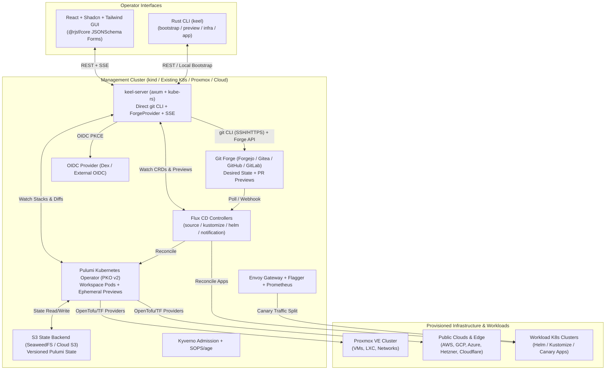

# Keel

**Self-Service, GitOps-Driven Infrastructure & Application Control Plane**

Keel is a single-binary **Rust** control plane and **React** web portal that bootstraps from `localhost`—onto a local **`kind`** cluster, an **existing Kubernetes cluster (`k3s`/`Talos`)**, **Proxmox VE**, or a **public cloud (`AWS`, `GCP`, `Azure`, `Hetzner`)**—and evolves into a self-hosted, multi-tenant GitOps platform. Using Git as the sole source of desired state and Kubernetes-native resources for runtime state (zero external databases), Keel orchestrates infrastructure across on-premises hypervisors and public clouds alongside unmodified upstream Kubernetes applications.

---

## Core Capabilities

* **Provider-Agnostic Zero-to-Cloud Self-Bootstrapping:** Start from a compiled `keel` binary on `localhost` using `kind`, an existing `kubeconfig`, Proxmox VE, or a public cloud to initialize a seed management cluster complete with **Flux CD**, **Pulumi Kubernetes Operator (PKO v2)**, **SeaweedFS S3**, **SOPS + `age`**, **Dex** OIDC (or external OIDC), and optional in-cluster **Forgejo**.
* **PR-First GitOps with Pre-Merge Previews:** Every infrastructure or application mutation after bootstrap opens a Pull Request (`Forgejo/Gitea`, `GitHub`, `GitLab`, or local Git) and spawns an ephemeral PKO v2 `preview: true` stack—surfacing exact resource diffs (`+ Create`, `~ Update`, `- Delete`, `! Replace`) in both the GUI and CLI before merge.
* **Self-Service Catalog & Multi-Item Bundles:** Thin `catalog.yaml` sidecars supply JSON Schemas rendered dynamically in React (`@rjsf/core` + Shadcn UI) into standard `values.yaml` overrides. Add or edit Apps, Infrastructure Blueprints (including `Pulumi.yaml` programs), and dependency-chained Multi-Item Bundles directly in the GUI via Git PRs.
* **Multi-Cloud & Arbitrary OpenTofu/Terraform Providers:** Manage **Proxmox VE** (`bpg/proxmox`), **AWS**, **GCP**, **Azure**, **Hetzner**, and **Cloudflare**—or enable any future registry provider dynamically via Pulumi's OpenTofu/Terraform bridge without recompiling Keel.
* **Progressive Delivery:** Opt-in **Flagger + Envoy Gateway** canary rollouts with Prometheus metric rollback for stateless Kubernetes services.
* **Multi-Tenant Isolation & Anti-Lockout Guardrails:** Namespace-per-tenant boundaries, per-tenant `age` encryption keys, **Kyverno** admission policies, `protect: true` control-plane stacks, and break-glass S3 recovery (`keel bootstrap recover`).

---

## System Architecture



---

## Quick Start: Localhost Workflow (`kind` + `keel` CLI)

This end-to-end walkthrough runs entirely on `localhost` using a local `kind` management cluster to provision a second `kind` workload cluster and deploy an application.

### 1. Obtain the `keel` Binary
Either download the latest release binary from **GitHub Releases** (or build from source):

```bash
# Option A: Download prebuilt release binary (Linux amd64 example)
curl -fsSL https://github.com/OWNER/keel/releases/latest/download/keel-linux-amd64.tar.gz \
  | tar -xz -C ~/.local/bin keel

# Option B: Build from source
just build
# Binary is at ./target/debug/keel (or ./target/release/keel with `cargo build --release --bin keel`)
```

### 2. Stage 0: Bootstrap the `kind` Management Cluster
Run `keel bootstrap init` on `localhost` with `--local-dev-docker-socket-exception` (explicitly adding the Kyverno `PolicyException` that lets PKO v2 workspace pods talk to the local Docker daemon to create workload `kind` clusters):

```bash
keel bootstrap init \
  --target kind \
  --cluster-name keel-mgmt \
  --local-dev-docker-socket-exception \
  --repo-dir ./keel-gitops
```

Copy the single-use **256-bit Stage 0 bootstrap token** printed to stdout.

### 3. Start the Control Plane & Authenticate
Start `keel serve` (or `just serve` for a clean local repo / `just serve-demo` for a pre-seeded demo catalog):

```bash
keel serve --bind 127.0.0.1:8080 --repo-dir ./keel-gitops
```

When `keel serve` (or `keel bootstrap init`) starts in Stage 0 bootstrap mode, it generates a **single-use 256-bit bootstrap token** and prints it directly to stdout:

```text
Keel Control Plane listening on http://127.0.0.1:8080
Stage 0 Bootstrap Token: <64-character-hex-token>
```

> **Note:** Only the SHA-256 hash of the token is stored (in `keel-system/bootstrap-token`), and it is invalidated immediately after its first successful login. If you need a new token while running locally in Stage 0, restart `keel serve` and copy the newly printed token from stdout.

Authenticate your CLI session and/or open `http://127.0.0.1:8080` in your browser, click **Bootstrap Token Login**, and paste the token:

```bash
keel auth login --server http://127.0.0.1:8080 --bootstrap-token <TOKEN>
```

### 4. Provision a Second `kind` Workload Cluster & Deploy an App (PR-Driven)
Every mutation after Stage 0 validates inputs against `catalog.yaml` JSON Schemas, encrypts secrets with SOPS + `age`, opens a Pull Request, and triggers a PKO v2 preview:

```bash
# Open a PR to provision a workload kind cluster from the management cluster
keel infra provision \
  --blueprint kind-cluster \
  --tenant platform-team \
  --values-file ./deploy/catalog/infra/kind-cluster/values.example.yaml \
  --server http://127.0.0.1:8080

# Inspect the pre-merge PKO resource diff (+ Create / ~ Update / - Delete)
keel preview status --pr 1 --watch --server http://127.0.0.1:8080

# Merge the PR in the GUI (PR & Preview Inspector) or via Git, then install an app:
keel app install \
  --app podinfo \
  --tenant platform-team \
  --values-file ./deploy/catalog/apps/podinfo/upstream/values.yaml \
  --canary \
  --server http://127.0.0.1:8080
```

> **Cloud Provider Credentials (`writeOnly` Fields):** For `CatalogInfraBlueprint` items, non-secret form values are written to `Stack.spec.config`, while fields marked `"writeOnly": true` (such as `GOOGLE_CREDENTIALS`) are encrypted with SOPS + `age` into `secret.enc.yaml` (`<instance>-secrets`) and injected into the PKO v2 workspace pod via `Stack.spec.envRefs`. Enable the target provider under **Topology → Providers** (or `providers/registry.yaml`) before provisioning.

### 5. Break-Glass Recovery
If the management cluster or in-cluster Git forge ever becomes unreachable, restore control-plane state directly from versioned S3 object storage:

```bash
keel bootstrap recover \
  --s3-endpoint https://s3.infra.local \
  --bucket pulumi-state \
  --stack management-cluster-core
```

### 6. Teardown & Cleanup

* **Provisioned Infrastructure & Apps (GitOps PR):** Remove the resource directory under `tenants/<tenant-id>/infra/<stack-name>/` or `tenants/<tenant-id>/apps/<release-name>/` in your GitOps repository and merge the PR. Flux prunes the Kubernetes resources, and non-protected PKO v2 `Stack`s (`destroyOnFinalize: true`) run `pulumi destroy` against the underlying provider before finalizing (generated `<instance>-secrets` carry `kustomize.toolkit.fluxcd.io/prune: disabled` so credentials remain available until `pulumi destroy` completes).
* **Local `kind` Management Cluster:** Tear down the local management cluster (and any orphaned workload `kind` clusters) with:

```bash
kind delete cluster --name keel-mgmt
# Also remove any provisioned workload kind clusters if management was deleted first:
# kind delete cluster --name <workload-cluster-name>
# Optional: remove local GitOps working directory
rm -rf ./keel-gitops
```

---

## Repository Layout

```text
keel/
├── crates/
│   ├── keel-core/          # Domain models, BootstrapTarget, JSONSchema validator, catalog, SOPS/age
│   ├── keel-git/           # Direct git CLI runner (SSH/HTTPS) & ForgeProvider trait adapters
│   ├── keel-pko/           # PKO v2 Stack generator, ephemeral PR preview controller, diff parser
│   ├── keel-kube/          # kube-rs CRD watchers, SSE telemetry stream, tenant RBAC, K8s Secret state
│   ├── keel-server/        # Stateless axum HTTP/SSE server, OIDC PKCE auth, embedded SPA assets
│   └── keel-cli/           # clap CLI entrypoint (bootstrap, auth, infra, app, preview, serve)
├── ui/                     # React + TypeScript + Shadcn UI + Tailwind CSS + @rjsf/core
├── e2e/                    # Playwright end-to-end test suite & kind/Gitea test harness
├── deploy/                 # Stage 0 target templates & seed Flux, PKO v2, Kyverno, Envoy, Flagger manifests
├── .github/workflows/      # GitHub Actions CI, Playwright E2E, and semantic-release pipelines
├── .releaserc.json         # Automated SemVer release & artifact publishing config
├── renovate.json           # Weekly automated dependency updates with auto-merge
├── justfile                # Common developer build, lint, test, and server tasks
├── SDD.md                  # Full Spec-Driven Development & Non-Functional Requirements
└── AGENTS.md               # Engineering rules, security invariants & verification gates for AI agents
```

---

## Development & Testing

### Prerequisites
* **Rust** (latest stable toolchain with `clippy`, `rustfmt`, and `cargo-llvm-cov`)
* **Node.js** (`24+`) & **pnpm** (`12+`)
* **Task Runner (recommended):** [`just`](https://github.com/casey/just)
* **CLI Tools:** `git`, `sops`, `age`, `pulumi`, `kubectl`, `kind`, and `docker`

### Build & Run Locally

Using `just`:

```bash
# Install UI and E2E dependencies
just install

# Build frontend assets (embedded via rust-embed) and Rust workspace
just build

# Start the control-plane server locally on 127.0.0.1:8080
just serve
```

Or run the underlying commands directly:

```bash
# Build frontend assets and Rust workspace
pnpm --dir ui install && pnpm --dir ui build
cargo build --workspace

# Start the control-plane server locally
cargo run --bin keel -- serve --bind 127.0.0.1:8080
```

### Quality Gates (Enforced in CI)
All pull requests must pass formatting, linting, **at least 80% unit test coverage**, and **Playwright end-to-end tests**. Run the entire suite locally with:

```bash
just check
```

Or run individual gates:

```bash
# Formatting & lints across Rust, UI, and E2E
just fmt-check
just lint

# Rust formatting, lints & unit tests
cargo fmt --all -- --check
cargo clippy --workspace --all-targets -- -D warnings
cargo test --workspace
cargo llvm-cov --workspace --fail-under-lines 80

# React formatting, lints, typecheck & unit tests
pnpm --dir ui format:check
pnpm --dir ui lint
pnpm --dir ui typecheck
pnpm --dir ui test:unit --coverage

# Playwright E2E formatting, lints & tests (requires built ui/dist and keel binary)
pnpm --dir e2e install
pnpm --dir e2e format:check
pnpm --dir e2e lint
pnpm --dir e2e typecheck
pnpm --dir e2e test
```

### Releases & Dependency Hygiene
* **Versioning:** Governed by [Conventional Commits](https://www.conventionalcommits.org/) and `semantic-release` (`feat:`, `fix:`, `BREAKING CHANGE:`). Merging to `main` automatically tags a SemVer release, cross-compiles static binaries (`linux/amd64`, `linux/arm64`, `darwin/arm64`, `windows/amd64`), builds signed multi-arch OCI images (`Cosign`), and attaches a CycloneDX SBOM.
* **Dependencies:** Initialized with latest compatible stable versions and kept current via **Renovate** running weekly every Monday at 04:00 UTC with auto-merge enabled for passing non-major updates.

---

## Documentation
* **[`SDD.md`](./SDD.md):** Complete architectural specification, sequence diagrams, Git repository schema, API/CLI contracts, and Non-Functional Requirements (`NFR-SEC`, `NFR-REL`, `NFR-PERF`, `NFR-OBS`, `NFR-EXT`, `NFR-QA`).
* **[`AGENTS.md`](./AGENTS.md):** Mandatory architectural invariants, security prohibitions, commit conventions, and testing rules for AI coding assistants.