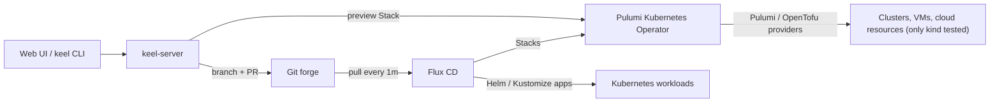

<p align="center">
  
</p>

# Keel

**Want every infrastructure and app change on your homelab or small platform to go through a reviewed pull request, with a real plan of what will change before you merge, and a form UI on top so you don't hand-write YAML?** Keel is one `keel` binary (CLI, API server and web UI) that sets up a GitOps control plane on Kubernetes for exactly that. Flux deploys what is merged; Pulumi runs the infrastructure and previews it on the PR.

> **Alpha software.** Expect bugs and breaking changes. Releases marked breaking in the [changelog](./CHANGELOG.md) have **no upgrade path**: you re-bootstrap a fresh cluster and repository. Only the local `kind` path below is tested end to end; see [what is tested](#maturity-what-is-tested) and [Known Limitations](./docs/reference/known-limitations.md).


*Recorded from the live `kind` E2E run: OIDC login, CLI and GUI pull requests, PKO preview and merge, a workload `kind` cluster plus a `podinfo` canary, and the live topology view.*

## Who it's for

- **For:** homelab users and small platform teams who want PR-gated GitOps (Flux) and infrastructure as code (Pulumi / OpenTofu providers) behind a self-service form UI, and who are happy to try alpha software on a throwaway cluster.
- **Not for (yet):** production, multi-cluster HA, anyone who needs upgrades between releases, or anyone who needs a supported Proxmox, Hetzner or cloud bootstrap.

Common questions (why Flux, why Pulumi, footprint, AI-assisted development, license) are answered in the [FAQ](./docs/reference/faq.md).

## What it does

- **Bootstraps a control plane from your laptop.** `keel bootstrap init` ("Stage 0", the one-time setup) creates a local `kind` cluster, or attaches to an existing one, and installs the components listed under [What gets installed](#what-gets-installed). [Details](./docs/getting-started/bootstrap.md)
- **Every change after bootstrap is a pull request.** Keel itself never commits to `main`; your forge's branch protection decides whether anyone else can. Infrastructure changes run as `Stack`s in the Pulumi Kubernetes Operator (PKO) and get a real `pulumi preview` in a short-lived preview `Stack` before merge; Flux-only changes get a diff synthesized from the manifests, and it is labelled as simulated. [Previews](./docs/getting-started/previews.md)
- **Forms for unmodified Helm charts and infrastructure blueprints** (a blueprint is a catalog entry that wraps a Pulumi program). A small `catalog.yaml` with a JSON Schema becomes a form in the UI, and the form becomes a plain `values.yaml`. Upstream charts are not forked. [Catalog](./docs/catalog/overview.md)
- **Tenants.** Each tenant gets a namespace, its own Git repository with a read-only credential, a scoped S3 identity and Kyverno guardrails. This is verified live on the in-cluster Forgejo; other forges have gaps. **The Quick Start's `--local-dev-docker-socket-exception` flag breaks this isolation** (see the warning in step 3). [Security & Tenancy](./docs/operations/security-and-tenancy.md)
- **No database of its own.** `keel-server` keeps no state: desired state is in Git, sessions and credentials are in Kubernetes Secrets. The bundled components (Forgejo, Rauthy, SeaweedFS, Prometheus) do keep their own storage, and Keel adds no CRDs of its own but installs those of Flux, PKO, Kyverno, cert-manager, Flagger and Gateway API.

## Requirements

Measured on a single v0.12.0 Quick Start run (management cluster plus one workload `kind` cluster); your numbers will vary:

| Resource | Recommended | Measured |
| :--- | :--- | :--- |
| CPU | 8 cores (4 minimum) | peaks around 7 cores during bootstrap, under 2 at rest |
| Memory | 16 GB host, 12 GB free | management node peak 7.1 GiB (steady 6.6 GiB), workload cluster about 0.9 GiB |
| Disk | 30 GB free | about 17 GB of images in the management node, 1.5 GB for the workload cluster, 1.3 GB node image |
| Network | about 6 GB to download | includes the 3.5 GB `pulumi/pulumi` image that PKO pulls for the first preview |

- **OS:** Linux x86_64 or Windows with WSL2 (the tested setups). Release binaries also exist for Linux arm64, macOS arm64 and Windows x86_64, but these are not tested. There is no macOS Intel build.
- **Tools on `PATH`:** `docker`, `kind`, `pulumi`, `helm`, `kubectl`, `git`, `sops` and `age-keygen` (from `age`). Without `kind`, bootstrap silently skips its stale-state cleanup and registry-mirror setup. Versions used for the measurement: docker 29.9, kind 0.33, kubectl 1.35, pulumi 3.216, helm 3.19, git 2.53, sops 3.13, age 1.3.
- **Free host ports:** `8080` (web UI and API; change it with `keel serve --bind`) and `8888` (HTTPS ingress for Rauthy, Forgejo and apps; must be free, because the IdP URL contains it). Keel prefers `3000` for the Forgejo port-forward and falls back to a random free port if it is taken.
- **Docker Desktop and WSL2 memory:** WSL2 gets half of the host RAM by default and Docker Desktop has its own limit, so a 16 GB host may leave the cluster only about 8 GB. Raise it (for WSL2, `memory=12GB` under `[wsl2]` in `%UserProfile%\.wslconfig`, then `wsl --shutdown`).
- **inotify limits on Linux:** two `kind` clusters with about 40 pods can hit `too many open files`. If pods crash with that error, raise the limits as described in the [kind known issues](https://kind.sigs.k8s.io/docs/user/known-issues/#pod-errors-due-to-too-many-open-files).
- **Admin rights once**, to add host names to `/etc/hosts`.

### What gets installed

Flux CD (GitOps), the Pulumi Kubernetes Operator (infrastructure), SeaweedFS (S3 storage for Pulumi state), Kyverno (admission policies), cert-manager, Envoy Gateway (ingress), Prometheus and Flagger (canary rollouts), Rauthy (a small OIDC identity provider for login; skip it with `--oidc-provider none` or use your own with `--oidc-issuer`) and, with `--with-forge`, Forgejo (Git forge). The rest are a fixed part of the control plane in this release.

## Quick Start (local `kind`)

This follows the path the live E2E suite tests: `e2e/tests/09-readme-quickstart.spec.ts` runs the commands of this section exactly as written, from a fresh home directory. It takes about 10 minutes plus downloads. **Use a throwaway machine or VM** (see the warning in step 3). If you tried Keel before, run the [clean-up](#clean-up) commands first, or old state is reused.

<!-- quickstart:begin  (the marked blocks up to quickstart:end are executed by e2e/tests/09-readme-quickstart.spec.ts; keep the markers in place) -->

**1. Install the binary (Linux x86_64).** This README describes v0.12.1, so the commands pin that release; for a newer release, read the docs at its tag. Other platforms: see the [release page](https://github.com/rdylanwalker/keel/releases/tag/v0.12.1).

<!-- quickstart:step install install -->
```bash
mkdir -p ~/.local/bin && cd "$(mktemp -d)"
base=https://github.com/rdylanwalker/keel/releases/download/v0.12.1
curl -fsSL -O "$base/keel-linux-amd64.tar.gz" -O "$base/SHA256SUMS"
sha256sum -c SHA256SUMS --ignore-missing   # macOS: shasum -a 256 -c SHA256SUMS --ignore-missing
tar -xzf keel-linux-amd64.tar.gz -C ~/.local/bin keel
keel --version        # ~/.local/bin must be on your PATH
```

Optionally verify the Sigstore signature too (needs `cosign`), in the same directory:

<!-- quickstart:step cosign optional -->
```bash
curl -fsSL -O "$base/keel-linux-amd64.tar.gz.sigstore.json"
cosign verify-blob --bundle keel-linux-amd64.tar.gz.sigstore.json \
  --certificate-identity-regexp '^https://github.com/rdylanwalker/keel/.github/workflows/release.yml@refs/heads/main$' \
  --certificate-oidc-issuer https://token.actions.githubusercontent.com \
  keel-linux-amd64.tar.gz
```

To build from source instead, run `just build` (see [CONTRIBUTING.md](./CONTRIBUTING.md)).

**2. Add the local host names.** Both your browser and the `keel serve` process must resolve them, so add them to `/etc/hosts` (with WSL2 and a Windows browser, also to `C:\Windows\System32\drivers\etc\hosts`):

<!-- quickstart:step hosts hosts -->
```bash
echo '127.0.0.1 idp.keel.local forgejo.keel.local podinfo.keel.local' | sudo tee -a /etc/hosts
```

**3. Bootstrap the management cluster** (about 3 minutes) from a working directory of your choice:

<!-- quickstart:step bootstrap run -->
```bash
mkdir -p ~/keel-try && cd ~/keel-try
keel bootstrap init \
  --target kind \
  --cluster-name keel-mgmt \
  --local-dev-docker-socket-exception \
  --with-forge \
  --repo-dir ./keel-gitops
```

- `--with-forge` runs Forgejo in the cluster so Flux can pull the repository and pull requests work. Without it (or an external `--git-url`), Flux cannot read the repository and nothing you merge is deployed.
- `--local-dev-docker-socket-exception` lets PKO create more `kind` clusters through your Docker daemon.

> **Warning: this flag gives up host and tenant isolation.** It deploys `flux-system/keel-docker-proxy`, which exposes your host Docker socket on port 2375 without authentication. Every PKO workspace pod, and any tenant pod that sets the workspace label, can reach it, and access to the Docker API amounts to root on the host. Use it only on a throwaway machine, and do not treat tenants as isolated while it is enabled. Leave it out if you do not need nested `kind` clusters.
- The summary prints the **admin username and password** in plain text. Save them, and save the Pulumi passphrase from the one-time notice in a password manager.

**4. Start the server** in a second terminal (in the same directory) and leave it running:

<!-- quickstart:step serve serve -->
```bash
keel serve --repo-dir ./keel-gitops     # http://127.0.0.1:8080
```

Stop it with **Ctrl+C**; it also stops the `kubectl port-forward` processes it started.

**5. Log in.** The CLI prints the login URL and tries to open your browser (on WSL2 through `wslview`; otherwise open the printed URL in your Windows browser, or pass `--no-browser`). Sign in with the admin credentials. The IdP uses a self-signed certificate, so expect a browser warning for `https://idp.keel.local:8888`.

<!-- quickstart:step login login -->
```bash
export KEEL_SERVER=http://127.0.0.1:8080
keel auth login
```

**6. Provision a workload cluster through a PR:**

<!-- quickstart:step workload run -->
```bash
printf 'clusterName: workload-dev\nkubernetesVersion: v1.35.8\nworkerCount: 1\n' > workload-values.yaml
keel infra provision --blueprint kind-cluster --tenant default --values-file workload-values.yaml

keel preview status --pr 1 --tenant default --watch   # real pulumi preview; use the PR number printed above
keel proposal merge 1 --tenant default
kind get clusters                                      # workload-dev appears about a minute after the merge
```

The first preview can sit silently for a few minutes while the cluster pulls the 3.5 GB `pulumi/pulumi` image.

**7. Deploy `podinfo` with a canary rollout** into the same tenant on the management cluster. The catalog fills in every value you leave out (two replicas, the host name `podinfo.keel.local` and a restricted security context), so the values file only needs the API token, which has no default.

<!-- quickstart:step podinfo run -->
```bash
printf 'apiToken: demo-podinfo-token\n' > podinfo-values.yaml
keel app install --app podinfo --tenant default --values-file podinfo-values.yaml --canary
keel proposal merge 2 --tenant default                 # use the PR number printed above
```

Flux deploys it within a minute or two, then Flagger initializes the canary. Repeat these until `podinfo` shows `Ready` and `curl` prints its version (it is served over HTTPS only, through the port-forward of `keel serve`):

<!-- quickstart:step podinfo-check poll -->
```bash
keel app list --tenant default
curl -fsk https://podinfo.keel.local:8888/version
```

Next: use the web UI, drive a live canary traffic rollout and create tenants in [Things to Try](./docs/getting-started/things-to-try.md).

### Clean up

<!-- quickstart:step cleanup teardown -->
```bash
# Stop keel serve with Ctrl+C first.
keel auth logout                                    # removes the stored session token
kind delete cluster --name workload-dev
kind delete cluster --name keel-mgmt
rm -rf ~/keel-try ~/.config/keel/stage0/keel-mgmt   # repos and Stage 0 state
```

<!-- quickstart:end -->

Remove both: a later bootstrap with the same names otherwise reuses the old bare repository, its history and the Stage 0 state. To remove a single stack or app instead, click **Delete** on it in the web UI and merge the removal PR. Flux then prunes it, and PKO runs `pulumi destroy`.

## Maturity: what is tested

The live E2E suite (`e2e/tests/07-kind-live-e2e.spec.ts`) and a literal run of the Quick Start above (`e2e/tests/09-readme-quickstart.spec.ts`) run on every push to `main`, not on pull requests. Together they cover: `kind` bootstrap with in-cluster Forgejo and Rauthy, CLI and GUI login, PR plus real PKO preview plus merge, a workload `kind` cluster through the OpenTofu/Terraform provider bridge, `podinfo` canaries on the management and workload clusters, tenant isolation, per-tenant repositories and `recover --dry-run`.

| Area | Status |
| :--- | :--- |
| Stage 0 on local `kind` | **Tested** (live E2E) |
| Stage 0 on an existing cluster (`--target kubeconfig`, for example k3d, k3s, Talos, managed Kubernetes) | Experimental: implemented, not covered by E2E. A k3d example is documented. |
| Stage 0 on AWS / GCP / Azure | Experimental: installs single-node k3s on a 4 GB VM (`t3.medium`, `e2-medium`, `Standard_B2s`; not free tier), which is likely too small given the memory figures above. Never run in CI; only the program files are checked. |
| Stage 0 on Proxmox VE / Hetzner | **VM only.** Creates the VM, installs no Kubernetes, then stops with an error. Install k3s yourself and use `--target kubeconfig`. |
| In-cluster Forgejo (`--with-forge`) | **Tested.** Its storage is ephemeral by default. |
| GitHub, GitLab, external Forgejo | Experimental: integration-tested against a mock forge only. |
| Gitea | Works for the platform repository; **not supported** for per-tenant repositories. |
| Local Git only (`--repo-dir` without a forge) | UI testing only: Flux cannot read it, and it has no tenant isolation. |
| Workload `kind` clusters (`kind-cluster` blueprint, Terraform bridge) | **Tested** |
| Cloud VM blueprints (`aws-vm`, `gcp-vm`, `azure-vm`, free-tier defaults) | Experimental: a manual, opt-in live test exists (`pnpm --dir e2e test:live:cloud`) but does not run in CI. |
| EKS / GKE / AKS, Proxmox and other blueprints | Untested. The Proxmox blueprint creates a VM only. Hetzner and Cloudflare are provider entries with doc examples. |
| Adding other OpenTofu/Terraform providers | Implemented; only the bundled `tehcyx/kind` provider is exercised live. |
| Flagger canaries | Deploys and initializes in E2E; traffic shifting, promotion and rollback are not tested. |
| `keel bootstrap recover` | Dry run in E2E; a real run succeeded in a manual v0.12.0 test. |

**Tried an experimental target?** [Open a Bootstrap or Provider Feedback issue](https://github.com/rdylanwalker/keel/issues/new/choose) and tell us what worked or where it broke.

## How it works



Git holds the desired state. `keel-server` writes changes on a branch, opens a PR through the forge API and starts a preview `Stack` with `spec.preview: true`. After the merge, Flux reconciles the change and PKO runs `pulumi up`. Flux pulls the repository every minute, so clusters behind NAT need no inbound webhooks. The full design is in [`SDD.md`](./SDD.md).

## Related projects

Keel overlaps with several mature tools. Depending on what you need, one of them may be a better fit:

- **[Backstage](https://backstage.io/)**: a full developer portal with a large plugin ecosystem. It needs a database and integration work. Keel's catalog is much narrower.
- **[Kratix](https://kratix.io/)**: a platform framework on Kubernetes where platform teams publish "Promises" that tenants request. It is the closest open-source analogue to Keel's catalog, with more flexibility and more to build yourself.
- **[Port](https://www.port.io/)**: a hosted (SaaS) developer portal. Keel is self-hosted only.
- **[Argo CD](https://argo-cd.readthedocs.io/)**: the other major GitOps engine. Keel uses Flux instead; see [why Flux](./docs/reference/faq.md#why-flux-and-not-argo-cd).
- **[Cyclops](https://github.com/cyclops-ui/cyclops)**: JSON Schema forms for Helm charts, without the GitOps PR flow or infrastructure provisioning.
- **[Tofu Controller](https://github.com/flux-iac/tofu-controller)**: Flux-native OpenTofu/Terraform with plans on pull requests (Branch Planner). It is the closest fit if you want Flux plus Terraform without Keel's UI.
- **[Atlantis](https://www.runatlantis.io/) / [Digger](https://github.com/diggerhq/digger)**: mature `plan` on pull request for Terraform/OpenTofu.
- **Pulumi Deployments review stacks**: pre-merge Pulumi previews, as a commercial Pulumi Cloud feature.
- **[Crossplane](https://www.crossplane.io/)**: infrastructure as Kubernetes CRDs. Keel uses Pulumi programs instead: no custom controllers or composition CRDs to write, OpenTofu/Terraform providers through Pulumi's bridge, and a real `pulumi preview` on each PR. [More](./docs/reference/faq.md#why-pulumi-and-not-crossplane-or-plain-terraform)
- **[Cozystack](https://cozystack.io/)**, **[Coolify](https://coolify.io/)**: complete platforms or PaaS with their own bootstrap, and more established than Keel.

## Documentation and contributing

- [Documentation (GitHub Pages)](https://rdylanwalker.github.io/keel/) and the [CLI reference](./docs/reference/cli.md)
- [FAQ](./docs/reference/faq.md) and [Known Limitations](./docs/reference/known-limitations.md)
- [`CONTRIBUTING.md`](./CONTRIBUTING.md): build, test and PR conventions
- [`SECURITY.md`](./SECURITY.md): how to report a vulnerability (privately, please)
- [`CODE_OF_CONDUCT.md`](./CODE_OF_CONDUCT.md)
- [Issues](https://github.com/rdylanwalker/keel/issues/new/choose): bug reports, bootstrap friction reports, provider feedback and feature requests
- [`SDD.md`](./SDD.md): architecture specification; [`AGENTS.md`](./AGENTS.md): rules for AI coding assistants used on this project

## How it is built

Keel has a single maintainer. It is developed with heavy AI assistance: much of the code is written with AI coding agents (commits carry a `Co-Authored-By: Claude` trailer) against the [`SDD.md`](./SDD.md) specification and the rules in [`AGENTS.md`](./AGENTS.md). Every change has to pass the same gates: `rustfmt`, `clippy -D warnings`, Rust and UI unit tests with at least 80% line coverage, ESLint and type checks, the mocked Playwright suite, and, on `main`, the live `kind` E2E run described [above](#maturity-what-is-tested). That is also why the project grew quickly; treat it as the alpha it is.

Keel sends no telemetry or analytics. Its network traffic goes to your cluster, your forge and your identity provider, plus the upstream chart, image and provider registries during installation.

## License

MIT; see [`LICENSE`](./LICENSE).
