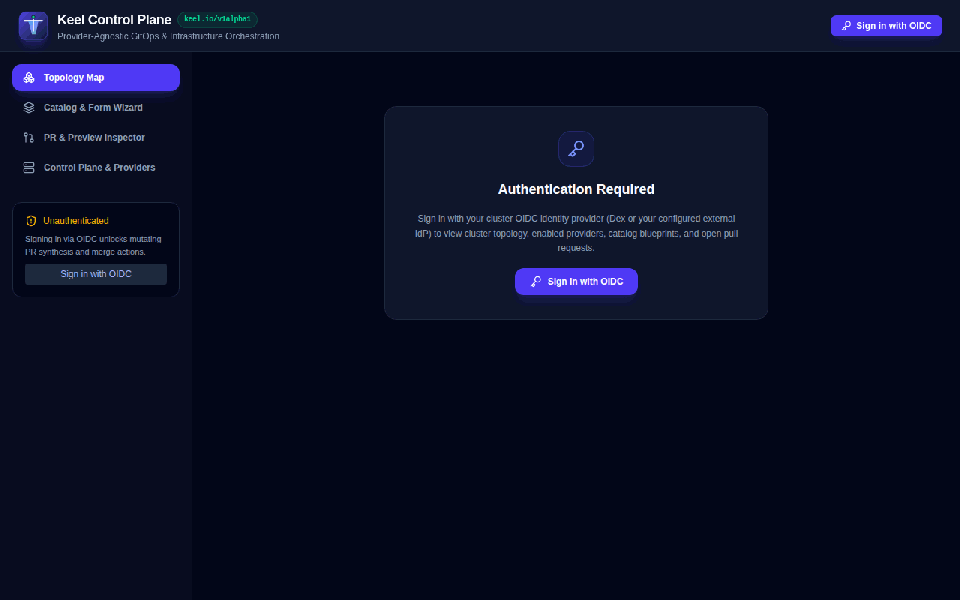
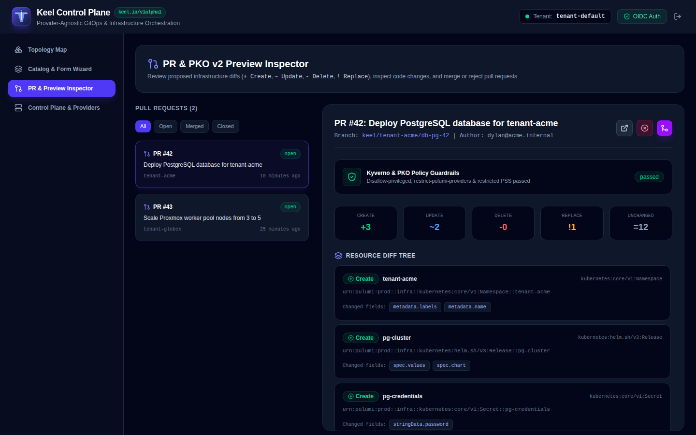

<p align="center">
  
</p>

# Keel

**Self-Service, GitOps-Driven Infrastructure & Application Control Plane**

Keel is a single-binary **Rust** control plane and **React** web portal that bootstraps from `localhost`—onto a local **`kind`** cluster, an **existing Kubernetes cluster (`k3s`/`Talos`)**, **Proxmox VE**, or a **public cloud (`AWS`, `GCP`, `Azure`, `Hetzner`)**—and evolves into a self-hosted, multi-tenant GitOps platform. Using Git as the sole source of desired state and Kubernetes-native resources for runtime state (zero external databases), Keel orchestrates infrastructure across on-premises hypervisors and public clouds alongside unmodified upstream Kubernetes applications.

> **Why "Keel"?** In shipbuilding, the keel is the first structural piece laid down—the backbone that gives a vessel stability before anything else is built on top of it. The name also fits naturally within the maritime Kubernetes ecosystem (*Kubernetes* / "helmsman", *Helm*, and friends), reflecting Keel's role as the foundational control plane you lay down first.

---

## Live Demo (`kind` + Forgejo + Dex + Flux + PKO v2)

<p align="center">
  
</p>

*Recorded directly from the live `kind` E2E workflow (`pnpm --dir e2e demo:gif`): OIDC login → CLI & GUI PR proposals → PKO v2 diff & merge → provisioning a workload `kind` cluster + canary `podinfo` → live Topology Map.*

---

## Core Capabilities

* **Provider-Agnostic Zero-to-Cloud Self-Bootstrapping:** Start from a compiled `keel` binary on `localhost` using `kind`, an existing `kubeconfig`, Proxmox VE, or a public cloud to initialize a seed management cluster complete with **Flux CD**, **Pulumi Kubernetes Operator (PKO v2)**, **SeaweedFS S3**, **SOPS + `age`**, **Rauthy** OIDC (or external OIDC), and optional in-cluster **Forgejo**.
* **PR-First GitOps with Pre-Merge Previews:** Every infrastructure or application mutation after bootstrap opens a Pull Request (`Forgejo/Gitea`, `GitHub`, `GitLab`, or local Git) and spawns an ephemeral PKO v2 `preview: true` stack—surfacing exact resource diffs (`+ Create`, `~ Update`, `- Delete`, `! Replace`) in both the GUI and CLI before merge.
* **Self-Service Catalog & Multi-Item Bundles:** Thin `catalog.yaml` sidecars supply JSON Schemas rendered dynamically in React (`@rjsf/core` + Shadcn UI) into standard `values.yaml` overrides. Add or edit Apps, Infrastructure Blueprints (including `Pulumi.yaml` programs), and dependency-chained Multi-Item Bundles directly in the GUI via Git PRs.
* **Multi-Cloud & Arbitrary OpenTofu/Terraform Providers:** Manage **Proxmox VE** (`bpg/proxmox`), **AWS**, **GCP**, **Azure**, **Hetzner**, and **Cloudflare**—or enable any future registry provider dynamically via Pulumi's OpenTofu/Terraform bridge without recompiling Keel.
* **Progressive Delivery:** Opt-in **Flagger + Envoy Gateway** canary rollouts with Prometheus metric rollback for stateless Kubernetes services.
* **Multi-Tenant Isolation & Anti-Lockout Guardrails:** Namespace-per-tenant boundaries, per-tenant `age` encryption keys, **Kyverno** admission policies, `protect: true` control-plane stacks, and break-glass S3 recovery (`keel bootstrap recover`).

---

## Alpha Status & Support Matrix

> **Early Alpha Notice:** Keel is in active early alpha. The local `kind` + in-cluster Forgejo/Dex workflow is continuously tested end-to-end in CI, while cloud/hypervisor targets and external forges are implemented and ready for early-adopter testing. Feedback, bug reports, and real-world test reports on any ⚠️ target are especially welcome!

**Legend:** ✅ Tested in Live E2E &nbsp;|&nbsp; ⚠️ Implemented / Experimental (Unit-Tested, Needs Real-World Testing) &nbsp;|&nbsp; ❌ Not Yet Supported

### Stage 0 Bootstrap Targets (`keel bootstrap init`)

| Target | Driver / Template | Status | Notes |
| :--- | :--- | :---: | :--- |
| **Local `kind`** | `deploy/bootstrap/kind/Pulumi.yaml` (`tehcyx/kind`) | ✅ | Primary dev & CI live-E2E path (`--local-dev-docker-socket-exception`) |
| **Existing Cluster (`kubeconfig`)** | `KubeconfigBootstrapTarget` (`k3s`, `Talos`, managed K8s) | ⚠️ | Unit-tested; ready for community testing on `k3s` / `Talos` / EKS / GKE |
| **Proxmox VE** | `deploy/bootstrap/proxmox/Pulumi.yaml` (`bpg/proxmox`) | ⚠️ | Template & `PulumiBootstrapTarget` wired; needs real PVE cluster validation |
| **Hetzner Cloud** | `deploy/bootstrap/hetzner/Pulumi.yaml` (`pulumi/hcloud`) | ⚠️ | Template & `PulumiBootstrapTarget` wired; needs live account validation |
| **AWS** | `deploy/bootstrap/aws/Pulumi.yaml` (`pulumi/aws`) | ⚠️ | Template & `PulumiBootstrapTarget` wired; needs live account validation |
| **GCP** | `deploy/bootstrap/gcp/Pulumi.yaml` (`pulumi/gcp`) | ⚠️ | Template & `PulumiBootstrapTarget` wired; needs live account validation |
| **Azure** | `deploy/bootstrap/azure/Pulumi.yaml` (`pulumi/azure-native`) | ⚠️ | Template & `PulumiBootstrapTarget` wired; needs live account validation |

### Default Day-1 Infrastructure Providers (`deploy/seed/providers/registry.yaml`)

| Provider | Plugin | Default State | Status | Notes |
| :--- | :--- | :--- | :---: | :--- |
| **kind** | `tehcyx/kind` (TF bridge) | Enabled | ✅ | Provisions workload `kind` clusters in live E2E |
| **Proxmox VE** | `bpg/proxmox` (TF bridge) | Disabled | ⚠️ | Enable via **Topology → Providers**; needs PVE feedback |
| **AWS** | `pulumi/aws` | Disabled | ⚠️ | Enable via **Topology → Providers**; needs live testing |
| **GCP** | `pulumi/gcp` | Disabled | ⚠️ | Enable via **Topology → Providers**; needs live testing |
| **Azure** | `pulumi/azure-native` | Disabled | ⚠️ | Enable via **Topology → Providers**; needs live testing |
| **Hetzner Cloud** | `pulumi/hcloud` | Disabled | ⚠️ | Enable via **Topology → Providers**; needs live testing |
| **Cloudflare** | `pulumi/cloudflare` | Disabled | ⚠️ | Enable via **Topology → Providers**; needs live testing |
| **Custom OpenTofu / TF** | `terraform-provider` bridge | Opt-in | ⚠️ | Add dynamically via UI/Git PR without recompiling Keel |

### Git Forges (`ForgeProvider`)

| Forge | Mode | Status | Notes |
| :--- | :--- | :---: | :--- |
| **Forgejo / Gitea** | In-cluster (`--with-forge`) or external | ✅ | Tested in live `kind` E2E |
| **Local Bare Git** | Local filesystem (`--repo-dir`) | ✅ | Default when `--with-forge` is omitted (no PRs/Flux remote polling) |
| **GitHub** | External API + SSH/HTTPS | ⚠️ | Implemented & unit-tested; needs live PR/preview feedback |
| **GitLab** | External API + SSH/HTTPS | ⚠️ | Implemented & unit-tested; needs live PR/preview feedback |

**Have you tested one of the ⚠️ targets?** [Open a Bootstrap or Provider Feedback issue](https://github.com/rdylanwalker/keel/issues/new/choose) with what worked or where it broke.

---

## Web Portal

| Topology Map | Catalog & Form Wizard |
| :---: | :---: |
|  |  |

| PR & Preview Inspector | Control Plane & Providers |
| :---: | :---: |
|  |  |

---

## System Architecture


---

## Comparison with Related Open-Source Projects

While several popular open-source tools solve individual parts of this space (developer portals, GitOps dashboards, IaC PR runners, or PaaS platforms), Keel combines zero-to-control-plane bootstrapping, Flux CD GitOps, dynamic schema-driven app catalogs, and pre-merge Pulumi/OpenTofu PR previews in a single stateless binary:

| Project | Category | Stage 0 Bootstrap | GitOps Engine | Self-Service App Catalog UI | Multi-Cloud & On-Prem IaC | Pre-Merge IaC Diff Previews | Stateless (No External DB) |
| :--- | :--- | :--- | :--- | :--- | :--- | :--- | :--- |
| **Keel** | Unified GitOps & IaC Control Plane | **Yes** (`kind`, `kubeconfig`, Proxmox, Cloud) | **Flux CD** | **Yes** (JSON Schema → `values.yaml`, no app CRDs) | **Yes** (PKO v2 + OpenTofu/TF providers) | **Yes** (ephemeral PKO `preview: true`) | **Yes** (Git + K8s Secrets) |
| [**Backstage**](https://backstage.io/) | Internal Developer Portal | No | Bring your own (plugins) | **Yes** (Software Templates) | Via CI/plugins | No (CI-dependent) | No (Postgres) |
| [**Cyclops**](https://github.com/cyclops-ui/cyclops) | Kubernetes App UI | No | CRD-based (`Module`) | **Yes** (JSON Schema → Helm) | No | No | **Yes** (K8s CRDs) |
| [**Argo CD**](https://argoproj.github.io/cd/) | GitOps Engine & UI | No | **Argo CD** | No | No (K8s manifests only) | K8s diffs via external/PR tools | **Yes** (K8s CRDs + Redis) |
| [**Weave GitOps**](https://github.com/weaveworks/weave-gitops) / [**Capacitor**](https://github.com/gimlet-io/capacitor) | Flux CD Dashboard | No | **Flux CD** | No (read/ops UI) | Via Tofu Controller | No | **Yes** (K8s CRDs) |
| [**Crossplane**](https://www.crossplane.io/) | K8s-Native IaC | No | Paired with Flux/Argo | No | **Yes** (Custom CRDs / XRDs) | No native PR diff | **Yes** (K8s CRDs) |
| [**Atlantis**](https://www.runatlantis.io/) / [**Digger**](https://github.com/diggerhq/digger) | IaC PR Automation | No | PR-driven runner | No | **Yes** (Terraform / OpenTofu) | **Yes** (`plan` on PR) | Atlantis: **Yes** / Digger: DB |
| [**Tofu Controller**](https://github.com/flux-iac/tofu-controller) | Flux IaC Controller | No | **Flux CD** | No | **Yes** (OpenTofu / Terraform) | Plan/drift via Flux | **Yes** (K8s CRDs) |
| [**Cozystack**](https://cozystack.io/) | K8s PaaS-in-a-Box | **Yes** (Talos-based) | **Flux CD** | **Yes** (managed PaaS catalog) | In-cluster KubeVirt/VMs | No | **Yes** (K8s CRDs) |
| [**Coolify**](https://coolify.io/) / [**Dokploy**](https://dokploy.com/) | Self-Hosted PaaS | **Yes** (VPS/Docker) | Imperative / webhooks | **Yes** (Docker app templates) | No | App previews only (no IaC diff) | No (external DB) |

---

## Quick Start: Localhost Workflow (`kind` + `keel` CLI)

This end-to-end walkthrough runs entirely on `localhost` using a local `kind` management cluster to provision a second `kind` workload cluster and deploy an application.

### 1. Obtain the `keel` Binary
Either download the latest release binary from **GitHub Releases** (or build from source):

```bash
# Option A: Download prebuilt release binary (Linux amd64 example)
curl -fsSL https://github.com/rdylanwalker/keel/releases/latest/download/keel-linux-amd64.tar.gz \
  | tar -xz -C ~/.local/bin keel

# Option B: Build from source
just build
# Binary is at ./target/debug/keel (or ./target/release/keel with `cargo build --release --bin keel`)
```

### 2. Stage 0: Bootstrap the `kind` Management Cluster
Ensure `docker`, `pulumi`, `helm`, `kubectl`, and `git` are installed on `localhost`, then run `keel bootstrap init` with `--local-dev-docker-socket-exception` (explicitly adding the Kyverno `PolicyException` that lets PKO v2 workspace pods talk to the local Docker daemon to create workload `kind` clusters):

```bash
keel bootstrap init \
  --target kind \
  --cluster-name keel-mgmt \
  --local-dev-docker-socket-exception \
  --repo-dir ./keel-gitops
```

Copy the generated **Admin Username** and **Admin Password** printed in the Stage 0 bootstrap summary (or use the values you supplied via `--admin-username` / `--admin-password` / `KEEL_ADMIN_PASSWORD`, or your external `--oidc-issuer`). Add `--with-forge` if you want an in-cluster Forgejo Git server so Flux CD can pull-poll inside `kind` (without `--with-forge`, Stage 0 uses a local bare Git repo and skips in-cluster `GitRepository` reconciliation).

### 3. Start the Control Plane & Authenticate
Start `keel serve` (or `just build-serve` to build, restart in the background, and print local URLs/credentials; `just serve` for foreground; `just serve-demo` for a pre-seeded demo catalog):

```bash
keel serve --bind 127.0.0.1:8080 --repo-dir ./keel-gitops
```

When a Kubernetes cluster is reachable, `keel serve` automatically port-forwards **Envoy Gateway** (`keel-ingress:8888` for in-cluster **Rauthy OIDC** at `http://idp.keel.local:8888`, and **Forgejo** if `--with-forge` was enabled) and prints:

```text
Keel Control Plane listening on http://127.0.0.1:8080
```

Ensure `127.0.0.1 idp.keel.local` is in `/etc/hosts` (or `C:\Windows\System32\drivers\etc\hosts` on Windows), then authenticate your CLI session via OIDC Authorization Code + PKCE, and/or open `http://127.0.0.1:8080` in your browser and click **Sign in with OIDC** using the printed Rauthy admin credentials:

```bash
keel auth login --server http://127.0.0.1:8080
```

### 4. Provision a Second `kind` Workload Cluster & Deploy an App (PR-Driven)
Every mutation after Stage 0 validates inputs against `catalog.yaml` JSON Schemas, encrypts secrets with SOPS + `age`, opens a Pull Request, and triggers a PKO v2 preview:

```bash
# Create a values file for the kind-cluster blueprint and open a PR
cat <<'EOF' > workload-values.yaml
clusterName: workload-dev
kubernetesVersion: v1.32.0
workerCount: 1
EOF

keel infra provision \
  --blueprint kind-cluster \
  --tenant platform-team \
  --values-file ./workload-values.yaml \
  --server http://127.0.0.1:8080

# Inspect the pre-merge PKO resource diff (+ Create / ~ Update / - Delete)
keel preview status --pr 1 --watch --server http://127.0.0.1:8080

# Merge the PR in the GUI (PR & Preview Inspector) or via Git, then install an app:
cat <<'EOF' > podinfo-values.yaml
replicaCount: 2
ingressHost: podinfo.keel.local
apiToken: demo-podinfo-token
EOF

keel app install \
  --app podinfo \
  --tenant platform-team \
  --values-file ./podinfo-values.yaml \
  --canary \
  --server http://127.0.0.1:8080
```

> **Cloud Provider Credentials (`writeOnly` Fields):** For `CatalogInfraBlueprint` items, non-secret form values are written to `Stack.spec.config`, while fields marked `"writeOnly": true` (such as `GOOGLE_CREDENTIALS`) are encrypted with SOPS + `age` into `secret.enc.yaml` (`<instance>-secrets`) and injected into the PKO v2 workspace pod via `Stack.spec.envRefs`. Enable the target provider under **Topology → Providers** (or `providers/registry.yaml`) before provisioning.

### 5. Break-Glass Recovery
If the management cluster or in-cluster Git forge ever becomes unreachable, restore control-plane state directly from versioned S3 object storage:

```bash
keel bootstrap recover \
  --s3-endpoint https://s3.infra.local \
  --bucket pulumi-state \
  --stack management-cluster-core
```

### 6. Teardown & Cleanup

* **Provisioned Infrastructure & Apps (GitOps PR):** Remove the resource directory under `tenants/<tenant-id>/infra/<stack-name>/` or `tenants/<tenant-id>/apps/<release-name>/` in your GitOps repository and merge the PR. Flux prunes the Kubernetes resources, and non-protected PKO v2 `Stack`s (`destroyOnFinalize: true`) run `pulumi destroy` against the underlying provider before finalizing (generated `<instance>-secrets` carry `kustomize.toolkit.fluxcd.io/prune: disabled` so credentials remain available until `pulumi destroy` completes).
* **Local `kind` Management Cluster:** Tear down the local management cluster (and any orphaned workload `kind` clusters) with:

```bash
kind delete cluster --name keel-mgmt
# Also remove any provisioned workload kind clusters if management was deleted first:
# kind delete cluster --name <workload-cluster-name>
# Optional: remove local GitOps working directory
rm -rf ./keel-gitops
```

---

## Repository Layout

```text
keel/
├── crates/
│   ├── keel-core/          # Domain models, BootstrapTarget, JSONSchema validator, catalog, SOPS/age
│   ├── keel-git/           # Direct git CLI runner (SSH/HTTPS) & ForgeProvider trait adapters
│   ├── keel-pko/           # PKO v2 Stack generator, ephemeral PR preview controller, diff parser
│   ├── keel-kube/          # kube-rs CRD watchers, SSE telemetry stream, tenant RBAC, K8s Secret state
│   ├── keel-server/        # Stateless axum HTTP/SSE server, OIDC PKCE auth, embedded SPA assets
│   └── keel-cli/           # clap CLI entrypoint (bootstrap, auth, infra, app, preview, serve)
├── ui/                     # React + TypeScript + Shadcn UI + Tailwind CSS + @rjsf/core
├── e2e/                    # Playwright end-to-end test suite & kind/Gitea test harness
├── deploy/                 # Stage 0 target templates & seed Flux, PKO v2, Kyverno, Envoy, Flagger manifests
├── .github/workflows/      # GitHub Actions CI, Playwright E2E, and semantic-release pipelines
├── .releaserc.json         # Automated SemVer release & artifact publishing config
├── renovate.json           # Weekly automated dependency updates with auto-merge
├── justfile                # Common developer build, lint, test, and server tasks
├── SDD.md                  # Full Spec-Driven Development & Non-Functional Requirements
└── AGENTS.md               # Engineering rules, security invariants & verification gates for AI agents
```

---

## Development & Testing

### Prerequisites
* **Rust** (latest stable toolchain with `clippy`, `rustfmt`, and `cargo-llvm-cov`)
* **Node.js** (`24+`) & **pnpm** (`12+`)
* **Task Runner (recommended):** [`just`](https://github.com/casey/just)
* **CLI Tools:** `git`, `sops`, `age`, `pulumi`, `helm`, `kubectl`, `kind`, and `docker`

### Build & Run Locally

Using `just`:

```bash
# Install UI and E2E dependencies
just install

# Build frontend assets (embedded via rust-embed) and Rust workspace
just build

# Start the control-plane server locally on 127.0.0.1:8080
just serve

# Or build, restart any previous backgrounded serve, and print URLs/credentials
# (auto-uses ./keel-gitops if present; logs to target/keel-serve.log)
just build-serve
```

Or run the underlying commands directly:

```bash
# Build frontend assets and Rust workspace
pnpm --dir ui install && pnpm --dir ui build
cargo build --workspace

# Start the control-plane server locally
cargo run --bin keel -- serve --bind 127.0.0.1:8080
```

### Quality Gates (Enforced in CI)
All pull requests must pass formatting, linting, **at least 80% unit test coverage**, and **Playwright end-to-end tests**. Run the entire suite locally with:

```bash
just check
```

Or run individual gates:

```bash
# Formatting & lints across Rust, UI, and E2E
just fmt-check
just lint

# Rust formatting, lints & unit tests
cargo fmt --all -- --check
cargo clippy --workspace --all-targets -- -D warnings
cargo test --workspace
cargo llvm-cov --workspace --fail-under-lines 80

# React formatting, lints, typecheck & unit tests
pnpm --dir ui format:check
pnpm --dir ui lint
pnpm --dir ui typecheck
pnpm --dir ui test:unit --coverage

# Playwright E2E formatting, lints & tests (requires built ui/dist and keel binary)
pnpm --dir e2e install
pnpm --dir e2e format:check
pnpm --dir e2e lint
pnpm --dir e2e typecheck
pnpm --dir e2e test

# Opt-in live kind E2E (GUI + CLI against real Docker/kind, Flux, PKO, Forgejo, Rauthy)
pnpm --dir e2e test:live                      # reuses existing kind-keel-mgmt if present
KEEL_E2E_REUSE_CLUSTER=0 pnpm --dir e2e test:live  # bootstraps a fresh kind cluster
```

### Releases & Dependency Hygiene
* **Versioning & Artifacts:** Governed by [Conventional Commits](https://www.conventionalcommits.org/) and `semantic-release` (`feat:`, `fix:`, `BREAKING CHANGE:`). Merging to `main` automatically tags a SemVer release, cross-compiles release binaries (`linux/amd64`, `linux/arm64`, `darwin/arm64`, `windows/amd64`), attaches a CycloneDX SBOM and HTML documentation archive, and publishes the mdBook documentation to **GitHub Pages**.
* **Dependencies:** Initialized with latest compatible stable versions and kept current via **Renovate** running weekly before 05:00 UTC on Mondays with auto-merge enabled for passing non-major updates.

---

## Documentation
* **[Online Documentation (GitHub Pages)](https://rdylanwalker.github.io/keel/):** Rendered mdBook user & operations guide (preview locally with `just docs`).
* **[`SDD.md`](./SDD.md):** Complete architectural specification, sequence diagrams, Git repository schema, API/CLI contracts, and Non-Functional Requirements (`NFR-SEC`, `NFR-REL`, `NFR-PERF`, `NFR-OBS`, `NFR-EXT`, `NFR-QA`).
* **[`AGENTS.md`](./AGENTS.md):** Mandatory architectural invariants, security prohibitions, commit conventions, and testing rules for AI coding assistants.