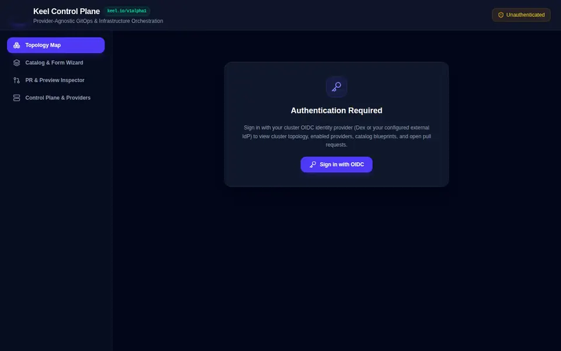
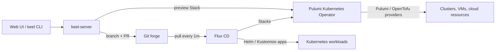

<p align="center">
  
</p>

# Keel

**Keel is a single `keel` binary (CLI, API server and web UI) that bootstraps a Flux CD + Pulumi Kubernetes Operator control plane, then turns every infrastructure or app change into a pull request with a real `pulumi preview` before merge.**

> **Alpha software.** Expect bugs and breaking changes. Releases marked breaking in the [changelog](./CHANGELOG.md) have **no upgrade path**: you re-bootstrap a fresh cluster and repository. Only the local `kind` path below is tested end to end; see [what is tested](#maturity-what-is-tested) and [Known Limitations](./docs/reference/known-limitations.md).



*Recorded from the live `kind` E2E run: OIDC login, CLI and GUI pull requests, PKO preview and merge, a workload `kind` cluster plus a `podinfo` canary, and the live topology view.*

## Who it's for

- **For:** homelab users and small platform teams who want PR-gated GitOps (Flux) and infrastructure as code (Pulumi / OpenTofu providers) behind a self-service form UI, and who are happy to try alpha software on a throwaway cluster.
- **Not for (yet):** production, multi-cluster HA, anyone who needs upgrades between releases, or anyone who needs a supported Proxmox, Hetzner or cloud bootstrap.

## What it does

- **Bootstraps a control plane from your laptop.** `keel bootstrap init` creates a `kind` cluster (or attaches to an existing one) and installs Flux CD, the Pulumi Kubernetes Operator (PKO), SeaweedFS (S3), Kyverno, cert-manager, Envoy Gateway, Prometheus, Flagger, the Rauthy OIDC provider and optionally Forgejo. [Details](./docs/getting-started/bootstrap.md)
- **Every change after bootstrap is a pull request.** Keel never commits to `main`. Pulumi-backed changes get a real `pulumi preview` in a short-lived PKO `Stack` before merge; Flux-only changes get a diff synthesized from the manifests, and it is labelled as simulated. [Previews](./docs/getting-started/previews.md)
- **Forms for unmodified Helm charts.** A small `catalog.yaml` with a JSON Schema becomes a form in the UI, and the form becomes a plain `values.yaml`. Upstream charts are not forked. [Catalog](./docs/catalog/overview.md)
- **Tenants.** Each tenant gets a namespace, its own Git repository with a read-only credential, a scoped S3 identity and Kyverno guardrails. This is verified live on the in-cluster Forgejo; other forges have gaps. [Security & Tenancy](./docs/operations/security-and-tenancy.md)
- **No database of its own.** `keel-server` keeps no state: desired state is in Git, sessions and credentials are in Kubernetes Secrets. The bundled components (Forgejo, Rauthy, SeaweedFS, Prometheus) do keep their own storage, and Keel adds no CRDs of its own but installs those of Flux, PKO, Kyverno, cert-manager, Flagger and Gateway API.

## Requirements

Measured on a v0.12.0 Quick Start run (management cluster plus one workload `kind` cluster):

| Resource | Recommended | Measured |
| :--- | :--- | :--- |
| CPU | 8 cores (4 minimum) | peaks around 7 cores during bootstrap, under 2 at rest |
| Memory | 16 GB host, 12 GB free | management node peak 7.1 GiB (steady 6.6 GiB), workload cluster about 0.9 GiB |
| Disk | 30 GB free | about 17 GB of images in the management node, 1.5 GB for the workload cluster, 1.3 GB node image |
| Network | about 6 GB to download | includes the 3.5 GB `pulumi/pulumi` image that PKO pulls for the first preview |

- **OS:** Linux x86_64 or Windows with WSL2 (the tested setups). Release binaries also exist for Linux arm64, macOS arm64 and Windows x86_64, but these are not tested. There is no macOS Intel build.
- **Tools on `PATH`:** `docker`, `pulumi`, `helm`, `kubectl`, `git`, `sops` and `age-keygen` (from `age`). `kind` is only needed to list or delete clusters. Versions used for the measurement: docker 29.9, kind 0.33, kubectl 1.35, pulumi 3.216, helm 3.19, git 2.53, sops 3.13, age 1.3.
- **Free host ports:** `8080` (web UI and API), `8888` (HTTPS ingress for Rauthy, Forgejo and apps) and `3000` (Forgejo port-forward).
- **Admin rights once**, to add host names to `/etc/hosts`.

## Quick Start (local `kind`)

This follows the path the live E2E suite tests. It takes about 10 minutes plus downloads.

**1. Install the binary (Linux x86_64).** Other platforms: see the [release page](https://github.com/rdylanwalker/keel/releases).

```bash
mkdir -p ~/.local/bin && cd "$(mktemp -d)"
base=https://github.com/rdylanwalker/keel/releases/latest/download
curl -fsSL -O "$base/keel-linux-amd64.tar.gz" -O "$base/SHA256SUMS"
sha256sum -c SHA256SUMS --ignore-missing
tar -xzf keel-linux-amd64.tar.gz -C ~/.local/bin keel
keel --version        # ~/.local/bin must be on your PATH
```

Optionally verify the Sigstore signature too (needs `cosign`), in the same directory:

```bash
curl -fsSL -O "$base/keel-linux-amd64.tar.gz.sigstore.json"
cosign verify-blob --bundle keel-linux-amd64.tar.gz.sigstore.json \
  --certificate-identity-regexp '^https://github.com/rdylanwalker/keel/.github/workflows/release.yml@refs/heads/main$' \
  --certificate-oidc-issuer https://token.actions.githubusercontent.com \
  keel-linux-amd64.tar.gz
```

To build from source instead, run `just build` (see [CONTRIBUTING.md](./CONTRIBUTING.md)).

**2. Add the local host names.** Both your browser and the `keel serve` process must resolve them, so add them to `/etc/hosts` (with WSL2 and a Windows browser, also to `C:\Windows\System32\drivers\etc\hosts`):

```text
127.0.0.1 idp.keel.local forgejo.keel.local podinfo.keel.local
```

**3. Bootstrap the management cluster** (about 3 minutes) from a working directory of your choice:

```bash
mkdir -p ~/keel-try && cd ~/keel-try
keel bootstrap init \
  --target kind \
  --cluster-name keel-mgmt \
  --local-dev-docker-socket-exception \
  --with-forge \
  --repo-dir ./keel-gitops
```

- `--with-forge` runs Forgejo in the cluster so Flux can pull the repository and pull requests work. Without it (or an external `--git-url`), Flux cannot read the repository and nothing you merge is deployed.
- `--local-dev-docker-socket-exception` lets PKO create more `kind` clusters through your Docker daemon.
- The summary prints the **admin username and password** in plain text. Save them, and save the Pulumi passphrase from the one-time notice in a password manager.

**4. Start the server** in a second terminal (in the same directory) and leave it running:

```bash
keel serve --repo-dir ./keel-gitops     # http://127.0.0.1:8080
```

Stop it with **Ctrl+C**. Other signals can leave its `kubectl port-forward` processes running.

**5. Log in.** The CLI opens your browser; sign in with the admin credentials. The IdP uses a self-signed certificate, so expect a browser warning for `https://idp.keel.local:8888`.

```bash
export KEEL_SERVER=http://127.0.0.1:8080
keel auth login
```

**6. Provision a workload cluster through a PR:**

```bash
printf 'clusterName: workload-dev\nkubernetesVersion: v1.35.8\nworkerCount: 1\n' > workload-values.yaml
keel infra provision --blueprint kind-cluster --tenant default --values-file workload-values.yaml

keel preview status --pr 1 --tenant default --watch   # real pulumi preview; use the PR number printed above
keel proposal merge 1 --tenant default
kind get clusters                                      # workload-dev appears about a minute after the merge
```

The first preview can sit silently for a few minutes while the cluster pulls the 3.5 GB `pulumi/pulumi` image.

Next: deploy `podinfo` with a canary rollout, use the web UI and create tenants in [Things to Try](./docs/getting-started/things-to-try.md). In v0.12.0, a canary app in a tenant namespace of the management cluster needs a [small RBAC workaround](./docs/reference/known-limitations.md#canary-apps-on-the-management-cluster).

### Clean up

```bash
# Stop keel serve with Ctrl+C first.
kind delete cluster --name workload-dev
kind delete cluster --name keel-mgmt
rm -rf ~/keel-try ~/.config/keel/stage0/keel-mgmt   # repos and Stage 0 state
```

Remove both: a later bootstrap with the same names otherwise reuses the old bare repository, its history and the Stage 0 state. To remove a single stack or app instead, click **Delete** on it in the web UI and merge the removal PR. Flux then prunes it, and PKO runs `pulumi destroy`.

## Maturity: what is tested

The live E2E suite (`e2e/tests/07-kind-live-e2e.spec.ts`) runs on every push to `main`, not on pull requests. It covers: `kind` bootstrap with in-cluster Forgejo and Rauthy, CLI and GUI login, PR plus real PKO preview plus merge, a workload `kind` cluster through the OpenTofu/Terraform provider bridge, `podinfo` on the workload cluster, tenant isolation, per-tenant repositories and `recover --dry-run`.

| Area | Status |
| :--- | :--- |
| Stage 0 on local `kind` | **Tested** (live E2E) |
| Stage 0 on an existing cluster (`--target kubeconfig`, for example k3d, k3s, Talos, managed Kubernetes) | Experimental: implemented, not covered by E2E. A k3d example is documented. |
| Stage 0 on AWS / GCP / Azure | Experimental: installs single-node k3s on a 4 GB VM (`t3.medium`, `e2-medium`, `Standard_B2s`; not free tier), which is likely too small given the memory figures above. Never run in CI; only the program files are checked. |
| Stage 0 on Proxmox VE / Hetzner | **VM only.** Creates the VM, installs no Kubernetes, then stops with an error. Install k3s yourself and use `--target kubeconfig`. |
| In-cluster Forgejo (`--with-forge`) | **Tested.** Its storage is ephemeral by default. |
| GitHub, GitLab, external Forgejo | Experimental: integration-tested against a mock forge only. |
| Gitea | Works for the platform repository; **not supported** for per-tenant repositories. |
| Local Git only (`--repo-dir` without a forge) | UI testing only: Flux cannot read it, and it has no tenant isolation. |
| Workload `kind` clusters (`kind-cluster` blueprint, Terraform bridge) | **Tested** |
| Cloud VM blueprints (`aws-vm`, `gcp-vm`, `azure-vm`, free-tier defaults) | Experimental: a manual, opt-in live test exists (`pnpm --dir e2e test:live:cloud`) but does not run in CI. |
| EKS / GKE / AKS, Proxmox and other blueprints | Untested. The Proxmox blueprint creates a VM only. Hetzner and Cloudflare are provider entries with doc examples. |
| Adding other OpenTofu/Terraform providers | Implemented; only the bundled `tehcyx/kind` provider is exercised live. |
| Flagger canaries | Deploys and initializes in E2E; traffic shifting, promotion and rollback are not tested. |
| `keel bootstrap recover` | Dry run in E2E; a real run succeeded in a manual v0.12.0 test. |

**Tried an experimental target?** [Open a Bootstrap or Provider Feedback issue](https://github.com/rdylanwalker/keel/issues/new/choose) and tell us what worked or where it broke.

## How it works



Git holds the desired state. `keel-server` writes changes on a branch, opens a PR through the forge API and starts a preview `Stack` with `spec.preview: true`. After the merge, Flux reconciles the change and PKO runs `pulumi up`. Flux pulls the repository every minute, so clusters behind NAT need no inbound webhooks. The full design is in [`SDD.md`](./SDD.md).

## Related projects

Keel overlaps with several mature tools. Depending on what you need, one of them may be a better fit:

- **[Backstage](https://backstage.io/)**: a full developer portal with a large plugin ecosystem. It needs a database and integration work. Keel's catalog is much narrower.
- **[Cyclops](https://github.com/cyclops-ui/cyclops)**: JSON Schema forms for Helm charts, without the GitOps PR flow or infrastructure provisioning.
- **[Tofu Controller](https://github.com/flux-iac/tofu-controller)**: Flux-native OpenTofu/Terraform with plans on pull requests (Branch Planner). It is the closest fit if you want Flux plus Terraform without Keel's UI.
- **[Atlantis](https://www.runatlantis.io/) / [Digger](https://github.com/diggerhq/digger)**: mature `plan` on pull request for Terraform/OpenTofu.
- **Pulumi Deployments review stacks**: pre-merge Pulumi previews, as a commercial Pulumi Cloud feature.
- **[Crossplane](https://www.crossplane.io/)**: infrastructure as Kubernetes CRDs. Keel deliberately uses Pulumi programs instead.
- **[Cozystack](https://cozystack.io/)**, **[Coolify](https://coolify.io/)**: complete platforms or PaaS with their own bootstrap, and more established than Keel.

## Documentation and contributing

- [Documentation (GitHub Pages)](https://rdylanwalker.github.io/keel/) and the [CLI reference](./docs/reference/cli.md)
- [Known Limitations](./docs/reference/known-limitations.md)
- [`CONTRIBUTING.md`](./CONTRIBUTING.md): build, test and PR conventions
- [`SECURITY.md`](./SECURITY.md): how to report a vulnerability (privately, please)
- [`CODE_OF_CONDUCT.md`](./CODE_OF_CONDUCT.md)
- [Issues](https://github.com/rdylanwalker/keel/issues/new/choose): bug reports, bootstrap friction reports, provider feedback and feature requests
- [`SDD.md`](./SDD.md): architecture specification; [`AGENTS.md`](./AGENTS.md): rules for AI coding assistants used on this project
