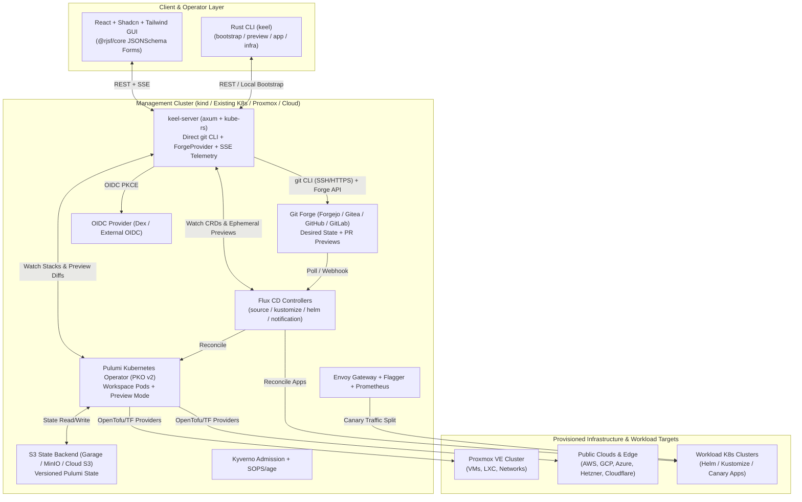
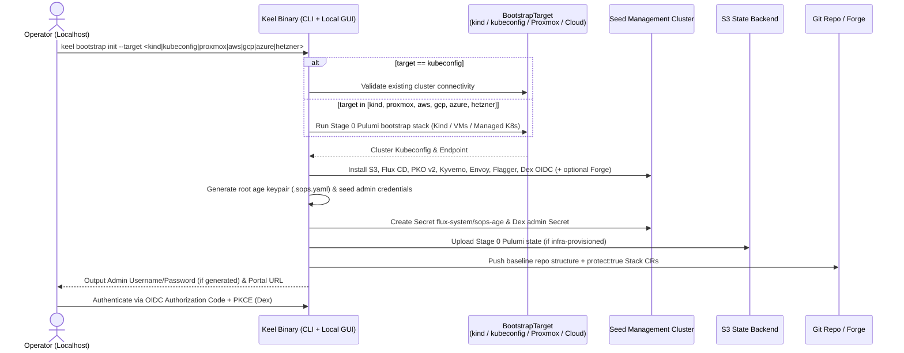
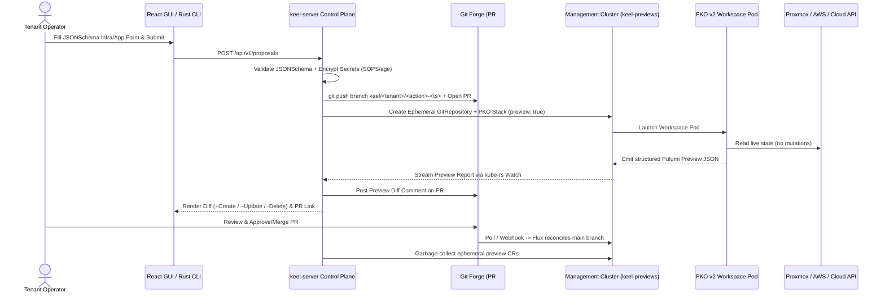
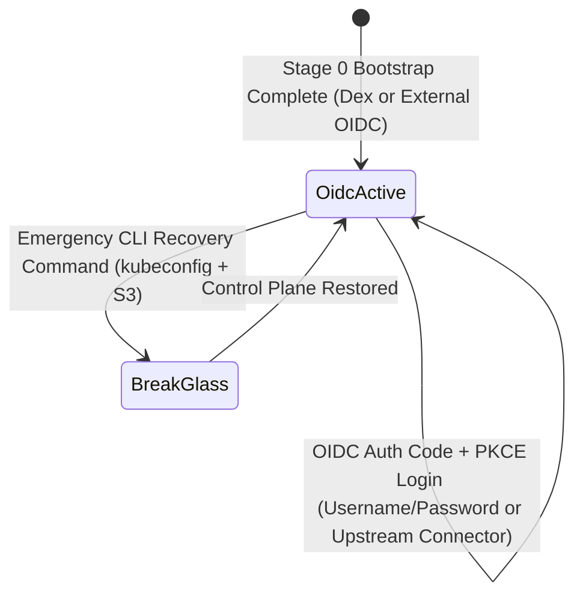
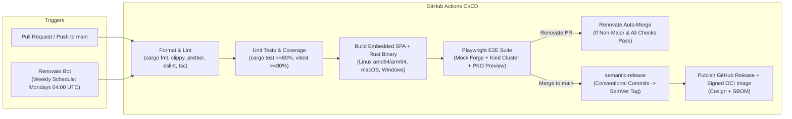

# Spec-Driven Development (SDD) Specification: Keel

**Document Status:** Baseline Engineering Specification v1.1  
**Project Name:** Keel (`keel` CLI & Control-Plane Binary, `keel.io` API Group)  
**Architecture Paradigm:** GitOps-Driven, Self-Bootstrapping Control Plane  
**Primary Stack:** Rust (`axum`, `clap`, `kube-rs`), React (`TypeScript`, `Shadcn UI`, `Tailwind CSS`, `@rjsf/core`), Flux CD, Pulumi Kubernetes Operator (PKO v2), Flagger, Envoy Gateway, Kyverno  

---

## 1. System Overview & Architectural Principles

### 1.1 Core Vision
**Keel** is a self-contained, single-binary self-service portal (exposing both a **React Web GUI** and a **Rust CLI**) for provisioning multi-cloud and on-premises infrastructure and installing applications declaratively. Starting from a compiled `keel` release binary executed on `localhost`, an operator can bootstrap a seed Kubernetes management cluster—locally via **`kind`**, on an **existing Kubernetes cluster (`kubeconfig`)**, on **Proxmox VE**, or directly on a **public cloud (`AWS`, `GCP`, `Azure`, `Hetzner`)**—instantiate or connect a Git repository (including an optional in-cluster Git forge and OIDC provider), and manage all subsequent infrastructure and workloads exclusively through **Pull Requests (PRs)**, **Pulumi Preview reports**, and **Flux CD** reconciliation.

### 1.2 Architectural Tenets
1. **Provider-Agnostic Stage 0 Bootstrapping:** Keel does not require Proxmox VE or any specific hypervisor to start. Stage 0 supports local `kind` clusters, pre-existing `kubeconfig` clusters (`k3s`, `Talos`, managed K8s), Proxmox VE, and public clouds behind a unified `BootstrapTarget` interface.
2. **Out-of-the-Box Upstream Fidelity:** Upstream Kubernetes manifests, Helm charts, and Kustomize overlays must run with zero structural modification. Portal metadata, form schemas, and ingress/progressive-delivery wrappers live in thin sidecar definitions (`catalog.yaml` with `apiVersion: keel.io/v1alpha1`, used strictly as a Git-stored schema rather than a cluster-installed CRD).
3. **CNCF & Open-Source First:** Prefer graduated/incubating CNCF projects (**Flux CD**, **Envoy Gateway**, **Flagger**, **Kyverno**, **Prometheus**, **OpenTelemetry**) and high-momentum open-source tools (**Pulumi / PKO v2**, **SOPS + age**, **Forgejo/Gitea**).
4. **Simplicity & Stateless Control Plane:** Avoid custom Kubernetes operators/CRDs (such as Crossplane XRDs) for infrastructure modeling—use Pulumi's native YAML/HCL runtimes and dynamic OpenTofu/Terraform provider bridge (`pulumi package add terraform-provider`) executed by PKO v2. Keep `keel-server` **stateless** with zero embedded or external databases (no SQLite or Postgres); store runtime state (bootstrap tokens, OIDC signing keys, encrypted user Git credentials) natively in Kubernetes `Secret`s and read desired/live state from Git, Forge APIs, and `kube-rs` CRD caches.
5. **Control Plane vs. Workload Plane Isolation:** In multi-cluster deployments, the seed management cluster hosts strictly control-plane services while tenant applications, databases, and workload clusters run on separately provisioned infrastructure (targeted by Flux via `spec.kubeConfig.secretRef`) to prevent self-mutation lockouts. In single-cluster or local `kind` development mode, tenant workloads may run in isolated `tenant-<tenant-id>` namespaces on the seed cluster guarded by `NetworkPolicy`, `ResourceQuota`, and Kyverno policies.
6. **Latest Compatible Dependency Baseline:** At project initialization, all Rust crates, npm packages, GitHub Actions, container images, and Flux/PKO release manifests must resolve to their **latest compatible stable versions**, maintained continuously via weekly automated **Renovate** updates with auto-merge.

### 1.3 System Architecture Topology



---

## 2. Two-Stage Self-Bootstrapping & Anti-Lockout Architecture

### 2.1 Stage 0: Provider-Agnostic Localhost Bootstrap (PR-Free Initialization)
Because PKO v2 and Flux require a running Kubernetes cluster, Stage 0 executes directly from the `keel` binary on `localhost` without requiring an existing Git forge or PR workflow. Operators select one of three `BootstrapTarget` drivers:

1. **Local Container Cluster (`--target kind`):**
   * Executes the built-in Stage 0 Pulumi program (`deploy/bootstrap/kind/Pulumi.yaml`) using `tehcyx/kind` to provision the `keel-mgmt` management cluster with local ingress port mappings for zero-dependency workstation bootstrapping.
2. **Existing Cluster (`--target kubeconfig`):**
   * Connects directly to any pre-existing Kubernetes cluster (`k3s`, `Talos`, `microk8s`, or pre-provisioned cloud cluster) via `--kubeconfig` / `--context`.
3. **On-Premises Hypervisor (`--target proxmox`):**
   * Executes the built-in Stage 0 Pulumi program (`deploy/bootstrap/proxmox/`) using `bpg/proxmox` to provision `k3s` or `Talos Linux` VMs via `cloud-init`.
4. **Public Cloud (`--target aws|gcp|azure|hetzner`):**
   * Executes a built-in Stage 0 Pulumi program (`deploy/bootstrap/<cloud>/`) to provision either cost-optimized VMs (`k3s`/`Talos`) or a managed Kubernetes cluster (`EKS`/`GKE`/`AKS`) alongside native S3-compatible object storage.

#### Seed Control-Plane Installation (Identical Across All Targets)
Once the seed cluster API is reachable, `keel bootstrap init` performs the exact same installation sequence regardless of target:
1. Installs **Garage/MinIO S3** (or binds the cloud provider's S3-compatible bucket), **Flux CD**, **PKO v2**, **Kyverno**, **Envoy Gateway**, **Prometheus**, **Flagger**, **Dex** (Apache-2.0 in-cluster OIDC provider with username/password DB and extensible Google/Apple/Active Directory connectors, unless `--oidc-issuer` points to an external OIDC provider), and optional in-cluster **Forgejo/Gitea**.
2. Generates a root **`age` keypair**, injects the private key into `flux-system/sops-age`, and writes `.sops.yaml` into the seed Git repository.
3. For `kind`, `proxmox`, and cloud targets, uploads the Stage 0 Pulumi state to `s3://pulumi-state` and imports it into a Flux-managed PKO `Stack` CR (`management-cluster-core`) with `protect: true` enabled.
4. Provisions the initial Dex admin user (`--admin-username` / `--admin-password`, or auto-generated credentials printed once to stdout) as a bcrypt-hashed `staticPasswords` entry in Dex, configures OIDC PKCE for `keel-server`, and exposes the portal on `http://localhost:8080` (via automatic port-forward to the in-cluster `keel-server` pod or cluster ingress).

#### NAT / Firewall & Ephemeral Local Cluster Resilience
* **Outbound Pull-Polling:** Flux `GitRepository` resources default to outbound polling (`interval: 1m`) alongside optional webhook receivers, ensuring local `kind` and home `k3s` management clusters behind NAT/firewalls reconcile external GitHub/GitLab repositories without requiring inbound public ports.
* **Rapid `kind` Recreation:** When paired with an external Git repository and external S3 backend (note: in-cluster `--with-forge` or in-cluster Garage/MinIO inside `kind` is ephemeral with the cluster), deleting and recreating a local `kind` cluster via `keel bootstrap init --target kind` against the same Git repository and S3 backend restores the full control plane in under 60 seconds.

### 2.2 Stage 1: Self-Hosted Pivot & Anti-Lockout Guardrails
Once the management cluster is healthy:
1. **PR Enforcement Activation:** All subsequent infrastructure or application changes—whether triggered via GUI or CLI—create a Git branch, commit encrypted secrets via SOPS, open a PR via `ForgeProvider`, and spin up an ephemeral PKO preview.
2. **Control-Plane Protection:** On `kind`, `proxmox`, and cloud targets, the seed cluster's core PKO `Stack` (`management-cluster-core`) carries `protect: true` flags on all control-plane VMs, clusters, and storage volumes.
3. **Break-Glass Recovery:** If an operator ever damages the management cluster or in-cluster Git forge, `keel bootstrap recover --s3-endpoint <url>` pulls the versioned Pulumi state directly from S3 and executes a local recovery reconciliation.

### 2.3 Bootstrap & Handover Sequence



---

## 3. Git Repository Schema, Git Interface & Forge Abstraction

### 3.1 Canonical Git Repository Layout
Every managed repository follows a deterministic, human-readable directory hierarchy so operators can inspect or edit state directly with standard Git tools:

```text
infra-gitops/
├── .sops.yaml                          # Per-tenant & global age public key rules
├── .keel/
│   └── config.yaml                     # Enabled providers, forge config, OIDC settings
├── clusters/
│   └── management/
│       ├── flux-system/                # Flux bootstrap manifests
│       ├── core-addons/                # PKO v2, Kyverno, Envoy Gateway, Flagger, Prometheus
│       └── management-stack.yaml       # PKO Stack (protect: true) for seed cluster
├── providers/
│   ├── registry.yaml                   # Enabled/disabled providers & versions
│   ├── proxmox/                        # Pulumi YAML/HCL templates (bpg/proxmox)
│   ├── aws/                            # Pulumi YAML/HCL templates
│   ├── gcp/                            # Pulumi YAML/HCL templates
│   ├── azure/                          # Pulumi YAML/HCL templates
│   ├── hetzner/                        # Pulumi YAML/HCL templates
│   ├── cloudflare/                     # Pulumi YAML/HCL templates
│   └── custom/                         # Arbitrary OpenTofu/Terraform bridge templates
├── catalog/
│   ├── apps/
│   │   └── <app-id>/
│   │       ├── catalog.yaml            # Metadata, JSONSchema, companion infra hooks
│   │       └── upstream/               # Unmodified Helm values / Kustomize bases
│   ├── infra/
│   │   └── <blueprint-id>/
│   │       ├── catalog.yaml            # JSONSchema for VM / Cluster / DB inputs
│   │       └── Pulumi.yaml             # Unmodified Pulumi / OpenTofu bridge program
│   └── bundles/
│       └── <bundle-id>/
│           └── catalog.yaml            # Multi-item CatalogBundle with dependsOn DAG
└── tenants/
    └── <tenant-id>/
        ├── rbac.yaml                   # Namespace, ServiceAccount, RoleBindings, Quotas
        ├── secrets.enc.yaml            # SOPS-encrypted tenant credentials
        ├── infra/
        │   └── <stack-name>/
        │       ├── stack.yaml          # PKO Stack CR + Flux GitRepository/Kustomization
        │       └── Pulumi.prod.yaml    # Stack config values
        └── apps/
            └── <release-name>/
                ├── release.yaml        # Flux HelmRelease / Kustomization
                ├── values.yaml         # Generated directly from JSONSchema form
                └── canary.yaml         # Optional Flagger Canary CR
```

### 3.2 Direct `git` CLI Execution & `ForgeProvider` Trait
* **Pure `git` Engine (`keel-git`):** All cloning, fetching, branch creation (`git checkout -b keel/<tenant>/<action>-<timestamp>`), staging, signing, and pushing execute via `tokio::process::Command::new("git")` using argument arrays (zero shell interpolation). User-supplied SSH private keys (`ed25519`/`rsa`) or HTTPS credentials are injected ephemerally per command via `GIT_SSH_COMMAND` or a temporary `GIT_ASKPASS` helper pipe.
* **Minimal `ForgeProvider` Trait:** Because PRs/MRs are forge-specific APIs, a compact Rust trait isolates forge interactions:

```rust
#[async_trait]
pub trait ForgeProvider: Send + Sync {
    async fn create_pull_request(&self, req: CreatePrRequest) -> Result<PullRequestInfo, ForgeError>;
    async fn get_pull_request(&self, pr_id: &str) -> Result<PullRequestInfo, ForgeError>;
    async fn post_preview_comment(&self, pr_id: &str, markdown_report: &str) -> Result<(), ForgeError>;
    async fn list_open_pull_requests(&self, tenant: Option<&str>) -> Result<Vec<PullRequestInfo>, ForgeError>;
    async fn reopen_pull_request(&self, pr_id: &str) -> Result<PullRequestInfo, ForgeError>;
}
```
* **Supported Implementations:** `ForgejoGiteaProvider` (REST v1), `GitHubProvider` (REST v3), `GitLabProvider` (REST v4), and `LocalGitProvider` (emulates PRs via `proposal/*` branches with GUI diff inspection and fast-forward merge for offline/air-gapped repos).

---

## 4. Infrastructure Provisioning & Pre-Merge PKO Preview Engine

### 4.1 Dynamic Provider Extensibility (Proxmox + Multi-Cloud + Future Providers)
* **Built-In Day-1 Provider Blueprints:** Proxmox VE (`bpg/proxmox`), AWS, GCP, Azure, Hetzner Cloud, and Cloudflare.
* **Enable / Disable Toggle:** Providers are enabled or disabled declaratively in `.keel/config.yaml` and `providers/registry.yaml` (via PR), controlling which blueprints appear in the GUI/CLI catalog and which provider plugins Kyverno permits in tenant namespaces.
* **Arbitrary Future Providers:** Any provider published on the OpenTofu Registry (`registry.opentofu.org`) or Terraform Registry can be added without recompiling the Rust backend by adding a blueprint referencing `pulumi package add terraform-provider <namespace>/<name>` inside a Pulumi YAML/HCL stack.

### 4.2 Ephemeral PR Preview Workflow (PKO v2 Preview Mode)
To guarantee operators see exact infrastructure blast radius before merging any PR:
1. When a proposal branch (`keel/<tenant>/<action>-<timestamp>`) is pushed and a PR is opened, the Rust control plane creates two short-lived CRs in the isolated `keel-previews` namespace:
   * A Flux `GitRepository` pinned to `spec.ref.branch: keel/<tenant>/<action>-<timestamp>`.
   * A PKO v2 `Stack` CR configured with `spec.preview: true` and a read-only IAM/Proxmox/Cloud preview ServiceAccount.
2. PKO executes `pulumi preview --json` inside an isolated workspace pod and writes structured resource diffs (`create`, `update`, `delete`, `replace`, `drift`) to the `Stack` status and object store.
3. The Rust backend parses the preview JSON, posts a formatted summary comment back to the PR on the Git forge, and streams the interactive diff tree to both the **React GUI PR Drawer** and **`keel preview status <pr-id>` CLI**.
4. When the PR is merged or closed (detected via forge webhook or background poll), the Rust controller deletes the ephemeral `GitRepository` and preview `Stack` CRs.



---

## 5. Application Catalog, Dynamic Forms & Progressive Delivery

### 5.1 Out-of-the-Box Packaging Contract (`catalog.yaml`)
Applications are never forked or rewritten. Each catalog entry pairs an unmodified upstream artifact (Helm chart repository/OCI ref or Kustomize URL) with a declarative `catalog.yaml` file (using `apiVersion: keel.io/v1alpha1` as a Git-stored catalog schema, not a cluster-installed CRD):

```yaml
apiVersion: keel.io/v1alpha1
kind: CatalogApplication
metadata:
  id: authentik
  name: Authentik Identity Provider
  category: security-identity
  runtime: helm # helm | kustomize
spec:
  upstream:
    chart: authentik
    repoURL: https://charts.goauthentik.io
    version: "2026.10.1"
  progressiveDelivery:
    flaggerSupported: true
    defaultCanary: false
  companionInfrastructure:
    - blueprint: postgres-managed
      bindValues:
        postgresql.enabled: false
        authentik.postgresql.host: "${outputs.db_host}"
        authentik.postgresql.password: "${secrets.db_password}"
  schema:
    type: object
    required: [domain, adminEmail]
    properties:
      domain:
        type: string
        title: Ingress Hostname
        format: hostname
      adminEmail:
        type: string
        title: Bootstrap Admin Email
        format: email
      replicas:
        type: integer
        title: Worker Replicas
        default: 2
        minimum: 1
        maximum: 10
  uiSchema:
    adminEmail:
      ui:help: "Used for initial administrator recovery notifications."
```

* **Dynamic Form Rendering:** The React frontend feeds `spec.schema` and `spec.uiSchema` directly into **`@rjsf/core` (`react-jsonschema-form`)** mapped to **Shadcn UI** widgets (`Input`, `Select`, `Switch`, `Slider`, `SecretInput`). Form submission serializes directly into an unmodified Helm `values.yaml` override.
* **Companion Infrastructure Hooks:** If an app declares `companionInfrastructure` (e.g., an external PostgreSQL database or S3 bucket), submitting the form bundles both the companion PKO `Stack` manifest and the Flux `HelmRelease` into the **same atomic PR**, ordered via Flux `dependsOn`. The PKO `Stack` exports its outputs into a tenant-scoped Kubernetes `Secret` (via PKO output `Secret` bindings), and Keel generates `spec.valuesFrom` (`kind: Secret`) entries on the `HelmRelease` so `bindValues` keys (`${outputs.*}`, `${secrets.*}`) resolve natively inside the cluster without intermediate templating.
* **Multi-Item Bundles (`CatalogBundle`):** For multi-step workflows (e.g., provisioning a workload cluster and installing platform + application charts onto it), `catalog/bundles/<bundle-id>/catalog.yaml` defines `kind: CatalogBundle` (`apiVersion: keel.io/v1alpha1`) with `spec.items[]` (`id`, `kind: infra | app`, `catalogRef`, `dependsOn`, `targetClusterFrom`, `targetNamespace`, `canary`, `bindValues`) and a composite `spec.schema`. Keel validates that `dependsOn` forms an acyclic DAG, synthesizes all item manifests under `tenants/<tenant>/bundles/<instance>/` in a single atomic PR, orders cross-kind dependencies via tenant-scoped Flux `Kustomization` `healthChecks` + `dependsOn` (and `HelmRelease.spec.dependsOn`), wires `targetClusterFrom` to the upstream infra `Stack`'s output `kubeconfig` `Secret`, and marks dependent PKO `Stack` previews as deferred until upstream outputs exist.

### 5.2 Progressive Delivery with Flagger + Envoy Gateway
* For Kubernetes HTTP/gRPC workloads where the operator enables **Canary Rollouts** in the form:
  1. Keel generates a standard **Gateway API `HTTPRoute`** (managed by **Envoy Gateway**) alongside a **Flagger `Canary` CR**.
  2. On subsequent image tag or `values.yaml` PR merges, Flagger automatically shifts traffic (`5% -> 10% -> 25% -> 50% -> 100%`) while querying **Prometheus** for HTTP 5xx error rates and p99 latency.
  3. Any metric breach triggers an automatic rollback to the previous stable revision without human intervention.

---

## 6. Multi-Tenancy, Identity & Secrets Management

### 6.1 OIDC-First Authentication State Machine



### 6.2 Multi-Tenant Isolation Model
* **Tenant Boundary:** Each tenant (`tenants/<tenant-id>/`) maps 1:1 to a dedicated Kubernetes `Namespace` (`tenant-<tenant-id>`) on the management cluster (holding the tenant's Flux `Kustomization`/`HelmRelease`, PKO `Stack`, `ServiceAccount`, `ResourceQuota`, and default-deny `NetworkPolicy`). In multi-cluster mode, tenant `Kustomization` and `HelmRelease` resources target provisioned workload clusters via `spec.kubeConfig.secretRef` stored inside `tenant-<tenant-id>`.
* **Flux Multi-Tenancy Lockdown:** Flux `kustomize-controller` and `helm-controller` execute with `--no-cross-namespace-refs=true` and `spec.serviceAccountName` enforced on every tenant `Kustomization` and `HelmRelease`, preventing a tenant from reading secrets or `GitRepository` sources in `flux-system` or sibling tenant namespaces.
* **Kyverno Policy Enforcement:** Cluster-wide Kyverno policies enforce:
  * `disallow-privileged-containers` and `restricted` Pod Security Standards across all PKO workspace pods and tenant workloads.
  * `restrict-pulumi-providers` verifying that a tenant only instantiates cloud/Proxmox providers explicitly granted to their tenant role.
  * `protect-control-plane` blocking deletion or modification of `management-cluster-core` resources via standard tenant PRs.

### 6.3 Stateless Persistence & Secrets Management (K8s Secrets + SOPS/`age`)
* **Zero Database Architecture:** `keel-server` is completely stateless and uses no SQLite, Postgres, or external database. All runtime state lives natively in Kubernetes `Secret`s, Git, and in-memory `kube-rs` CRD caches:
  * **In-Cluster OIDC Provider (Dex):** Stage 0 deploys Dex (Apache-2.0) with Kubernetes CRD storage and bcrypt-hashed `staticPasswords` (stored in a Kubernetes `Secret` in `keel-system`) for immediate username/password login, with Git-managed connector configuration for future Google, Apple, or Active Directory/LDAP federation.
  * **OIDC Sessions & PKCE State:** Signed and encrypted using a cluster-managed key `Secret` (`keel-system/session-key`) into stateless `HttpOnly`, `Secure`, `SameSite=Strict` cookies (with short-lived K8s `Secret`s or encrypted state cookies for PKCE verifiers).
  * **User Profile Credentials:** Personal Git SSH keys and Forge Personal Access Tokens stored in user profiles are encrypted with `AES-256-GCM` (backed by a cluster root/KMS `Secret` key) and persisted as Kubernetes `Secret`s in `keel-system` keyed by OIDC `sub`. They are never returned over REST APIs or written to logs.
* **Per-Tenant Git Encryption Keys (SOPS + `age`):** Onboarding a new tenant generates a dedicated `age` keypair. The public key is registered in `.sops.yaml` scoped to `path_regex: ^tenants/<tenant-id>/.*\.enc\.yaml$`, and the private key is stored as a Kubernetes `Secret` exclusively inside `tenant-<tenant-id>`.
* **Zero Plaintext in Git:** Secret fields marked with `"writeOnly": true` or `"format": "password"` in `catalog.yaml` are encrypted via `sops --encrypt` in the Rust backend before `git add` ever runs.

---

## 7. Interface Specifications (Rust Backend, CLI & React GUI)

### 7.1 Rust Workspace Architecture
The Rust codebase is organized as a Cargo workspace compiling into a single multi-mode binary (`keel`) that runs either as an interactive CLI or as the long-running web/API control plane (`keel serve`):

```text
crates/
├── keel-core/          # Domain models, JSONSchema validator, catalog parser, SOPS wrapper
├── keel-git/           # Pure git CLI wrapper (SSH/HTTPS) + ForgeProvider trait & adapters
├── keel-pko/           # PKO v2 Stack generator, ephemeral preview manager, diff parser
├── keel-kube/          # kube-rs watchers, SSE event multiplexer, tenant RBAC, K8s Secret state
├── keel-server/        # Stateless axum HTTP/SSE server, OIDC PKCE auth, embedded static React assets
└── keel-cli/           # clap CLI entrypoint (bootstrap, auth, infra, app, preview, serve)
```

### 7.2 CLI Command Contract (`keel`)

| Command | Description | Key Flags |
| :--- | :--- | :--- |
| `keel bootstrap init` | Executes Stage 0 seed cluster bootstrap across local `kind`, existing `kubeconfig`, Proxmox VE, or public cloud targets, installing Flux/PKO, S3/`age`, and Dex OIDC (or external OIDC). | `--target [kind\|kubeconfig\|proxmox\|aws\|gcp\|azure\|hetzner]`, `--kubeconfig`, `--context`, `--proxmox-url`, `--region`, `--distro [k3s\|talos]`, `--with-forge`, `--oidc-issuer`, `--admin-username`, `--admin-password` |
| `keel bootstrap recover` | Break-glass recovery pulling Pulumi state from S3 via `kubeconfig` to repair an unreachable control plane. | `--s3-endpoint`, `--bucket`, `--stack` |
| `keel auth login` | Authenticates the CLI against `keel-server` via OIDC Authorization Code + PKCE (localhost callback). | `--server` |
| `keel serve` | Starts the stateless `axum` API server and serves the embedded React + Shadcn SPA. | `--bind 0.0.0.0:8080`, `--config` |
| `keel infra list` | Lists all PKO `Stack` resources across providers with live drift and sync status. | `--tenant`, `--provider`, `--output [table\|json]` |
| `keel infra provision` | Validates parameters against blueprint JSONSchema and opens a provisioning PR. | `--blueprint`, `--tenant`, `--values-file` |
| `keel app install` | Renders Helm/Kustomize manifests from catalog JSONSchema and opens a PR. | `--app`, `--tenant`, `--values-file`, `--canary` |
| `keel preview status` | Fetches and renders the PKO v2 preview diff (`+`/`~`/`-`) for an open PR in the terminal. | `--pr <id>`, `--watch` |

### 7.3 REST & Server-Sent Events (SSE) API Surface

| Method | Endpoint | Purpose |
| :--- | :--- | :--- |
| `GET` | `/api/v1/auth/login` & `/callback` | OIDC Authorization Code + PKCE login flow (supports browser cookies and CLI localhost callback). |
| `GET` | `/api/v1/catalog` | Returns available applications, infrastructure blueprints (filtered by enabled providers), and multi-item bundles. |
| `POST` | `/api/v1/catalog` | Registers a new `CatalogApplication`, `CatalogInfraBlueprint`, or `CatalogBundle` via a Git PR. |
| `PUT` | `/api/v1/catalog/{kind}/{id}` | Updates an existing `CatalogApplication`, `CatalogInfraBlueprint`, or `CatalogBundle` via a Git PR (preserving or optionally updating `Pulumi.yaml` for infra). |
| `POST` | `/api/v1/catalog/fetch-schema` | Fetches or derives a JSON Schema from an upstream Helm chart (`values.schema.json` or `values.yaml`). |
| `GET` | `/api/v1/proposals` | Lists Pull Requests / proposals across configured `ForgeProvider`s (supports `?status=open\|merged\|closed\|all` and `?tenant=...`). |
| `POST` | `/api/v1/proposals` | Validates JSONSchema payload, SOPS-encrypts secrets, commits to branch, opens PR, and triggers ephemeral PKO preview. |
| `GET` | `/api/v1/proposals/{pr_id}/preview` | Returns parsed PKO v2 preview diff tree, resource change counts, drift alerts, and direct Forge PR URL. |
| `POST` | `/api/v1/proposals/{pr_id}/merge` | Merges an approved PR once PKO preview and policy gates pass (used by `LocalGitProvider` and UI merge action). |
| `POST` | `/api/v1/proposals/{pr_id}/reject` | Closes/rejects an open PR proposal via `ForgeProvider`. |
| `POST` | `/api/v1/proposals/{pr_id}/reopen` | Reopens a previously closed PR proposal via `ForgeProvider`. |
| `GET` | `/api/v1/stacks` | Lists infrastructure stacks across Proxmox, AWS, GCP, Azure, Hetzner, Cloudflare, and custom providers (including `Deleting` stacks). |
| `GET` | `/api/v1/stacks/{namespace}/{name}/config` & `DELETE /api/v1/stacks/{namespace}/{name}` | Fetches persisted stack config for editing or opens a PR to delete an infrastructure stack. |
| `POST` | `/api/v1/stacks/{namespace}/{name}/restart` | Triggers a Kubernetes rollout restart on the stack's PKO v2 `Workspace` StatefulSet. |
| `GET` | `/api/v1/releases` | Lists deployed Helm, Kustomize, and Flagger Canary applications (including `Deleting` releases). |
| `GET` | `/api/v1/releases/{namespace}/{name}/config` & `DELETE /api/v1/releases/{namespace}/{name}` | Fetches persisted release values for editing or opens a PR to delete a release. |
| `POST` | `/api/v1/releases/{namespace}/{name}/reconcile` | Annotates a Flux `HelmRelease` (or `Kustomization`) with `reconcile.fluxcd.io/requestedAt` to trigger immediate reconciliation. |
| `GET` | `/api/v1/bundles/{namespace}/{name}/config` | Fetches combined per-item configuration for a deployed `CatalogBundle`. |
| `GET` | `/api/v1/events/stream` | **SSE stream** pushing real-time `kube-rs` CRD condition transitions (`GitRepository`, `Kustomization`, `HelmRelease`, `Stack`, `Canary`). |
| `PUT` | `/api/v1/profile/git-credentials` | Stores `AES-256-GCM`-encrypted SSH keys or Forge PATs in a Kubernetes `Secret` for the authenticated user's Git operations. |

### 7.4 React + Shadcn + Tailwind GUI Views
1. **Cluster & Provider Topology Map:** Live health view of the management cluster, provisioned workload clusters, Proxmox nodes, and enabled cloud providers—including `Drifted / Error / Deleting` status tracking, `Type` (`management`/`workload`/`cloud`), managed `Resources` count, `Last Synced` timestamps for both stacks and application releases, Bundle grouping, **+ Deploy Stack** / **+ Deploy App** actions, TanStack table sorting/filtering, PR-driven Edit/Delete/Reconcile actions, deduplicated real-time Flux/PKO reconciliation timeline, and Flagger canary traffic-weight gauge + Prometheus error/latency sparklines.
2. **Self-Service Catalog & Dynamic Form Wizard:** Searchable catalog rendering `catalog.yaml` JSONSchemas via `@rjsf/core` + Shadcn components, supporting creating and editing Apps, Infrastructure Blueprints (including authoring and editing `Pulumi.yaml` directly from the GUI), and Multi-Item Bundles via Git PRs, complete with live `values.yaml` diff preview before submission.
3. **PR & PKO Preview Inspector:** Side-by-side view of Open, Merged, Closed, or All Git PRs (with direct external links to Forgejo/Gitea/GitHub/GitLab), resource-level PKO diff trees (`+ Create`, `~ Update`, `- Delete`, `! Replace`), syntax-highlighted unified Git diffs, and policy check status.

---

## 8. Non-Functional Requirements (NFRs)

### 8.1 Security & Multi-Tenant Isolation (`NFR-SEC`)

| ID | Requirement | Verification Criteria & Technical Control |
| :--- | :--- | :--- |
| **NFR-SEC-01** | **OIDC-First Auth & Session Hardening** | Stage 0 provisions an in-cluster Dex OIDC provider (or binds an external OIDC issuer) with bcrypt-hashed admin credentials. All API/UI/CLI sessions enforce OIDC Authorization Code + PKCE and `HttpOnly`, `Secure`, `SameSite=Strict` cookies encrypted with `AES-256-GCM`. |
| **NFR-SEC-02** | **Strict Tenant Blast-Radius Isolation** | Each tenant is confined to `tenants/<tenant>/` and `tenant-<tenant>` namespace. Flux runs with `--no-cross-namespace-refs=true` and tenant `ServiceAccount` impersonation. |
| **NFR-SEC-03** | **PKO Workspace Pod Sandboxing** | All PKO v2 `Workspace` pods enforce Kubernetes `restricted` Pod Security Standards (non-root UID, `drop: ["ALL"]` capabilities, read-only root filesystem, `RuntimeDefault` seccomp) and RBAC-authenticated workspace gRPC endpoints. |
| **NFR-SEC-04** | **Admission Policy Guardrails** | Kyverno policies block privileged workloads, enforce resource quotas, restrict permitted Pulumi/OpenTofu providers per tenant, and protect control-plane stacks from non-admin mutation. |
| **NFR-SEC-05** | **Per-Tenant Secrets Encryption** | All secrets in Git are encrypted via SOPS + `age` using per-tenant public keys. User SSH keys and PATs are encrypted at rest with `AES-256-GCM` and redacted from all logs and API payloads. |
| **NFR-SEC-06** | **Command Injection & Supply-Chain Defense** | External CLI calls (`git`, `sops`, `pulumi`, `kind`) use `tokio::process::Command` argument vectors exclusively (no shell invocation). Container images are signed with **Cosign** and verified prior to deployment. |

### 8.2 Reliability, Resilience & Anti-Lockout (`NFR-REL`)

| ID | Requirement | Verification Criteria & Technical Control |
| :--- | :--- | :--- |
| **NFR-REL-01** | **Control-Plane Anti-Lockout** | Management cluster hosts control-plane components only; core stacks carry `protect: true`; `keel bootstrap recover` restores control-plane state directly from versioned S3 if the cluster or Forge is offline. |
| **NFR-REL-02** | **Mandatory Pre-Merge Preview** | Every infrastructure/app PR triggers an ephemeral PKO v2 `preview: true` run; merge gates remain blocked in the UI until preview execution completes without policy violations. |
| **NFR-REL-03** | **Automated Canary Rollback** | Flagger + Envoy Gateway automatically rolls back K8s HTTP/gRPC releases if HTTP 5xx exceeds `1%` or p99 latency breaches threshold over 5 Prometheus intervals. |
| **NFR-REL-04** | **Graceful State Locking & Termination** | PKO workspace pods handle `SIGTERM` with a 10-minute grace period for clean Pulumi state unlocks; S3 bucket versioning preserves point-in-time state snapshots. |
| **NFR-REL-05** | **Recovery Objectives** | Control-plane **RPO $\le$ 5 minutes** (Git commits + versioned S3 state); full management cluster **RTO $\le$ 15 minutes** from release binary + target provider (or **$\le$ 60 seconds** for local `kind` recreation). |

### 8.3 Performance & Scalability (`NFR-PERF`)

| ID | Requirement | Target Threshold |
| :--- | :--- | :--- |
| **NFR-PERF-01** | **API & Proposal Latency** | Cached catalog/inventory reads **p95 $\le$ 150 ms**; JSONSchema validation + SOPS encryption + Git branch/push + PR creation **p95 $\le$ 2.0 s** (excluding external Forge network RTT). |
| **NFR-PERF-02** | **Real-Time Telemetry Propagation** | Kubernetes CRD condition updates (`Flux`, `PKO`, `Flagger`) reach connected React GUI clients via SSE within **$\le$ 500 ms** of API server watch events. |
| **NFR-PERF-03** | **Concurrent Reconciliations** | PKO v2 per-stack workspace isolation supports **at least 50 concurrent PR previews or stack applies** without degrading Flux controller responsiveness. |
| **NFR-PERF-04** | **Binary & Runtime Footprint** | Single statically-linked Rust release binary **under 45 MB** compressed; idle control-plane server memory footprint **under 80 MB RSS**. |

### 8.4 Observability, Auditability & Provenance (`NFR-OBS`)

| ID | Requirement | Verification Criteria & Technical Control |
| :--- | :--- | :--- |
| **NFR-OBS-01** | **End-to-End Git Audit Trail** | Every mutation records the authenticated OIDC user (`Name <email>`) in the Git commit author, linking UI actions to PR ID, PKO preview report, and active Flux revision SHA. |
| **NFR-OBS-02** | **Metrics & Distributed Tracing** | Structured JSON logs with OpenTelemetry trace correlation across `keel-server`, Flux controllers, and PKO workspace pods; Prometheus metrics exported at `/metrics`. |

### 8.5 Portability, Simplicity & Extensibility (`NFR-EXT`)

| ID | Requirement | Verification Criteria & Technical Control |
| :--- | :--- | :--- |
| **NFR-EXT-01** | **Zero-Patch Upstream Compatibility** | Upstream Helm charts and Kustomize bases require zero structural edits; configuration occurs strictly via `values.yaml` generated from JSONSchema. |
| **NFR-EXT-02** | **Zero-Recompile Provider Addition** | Adding new cloud or on-prem providers via Pulumi's OpenTofu/Terraform bridge requires zero Rust code changes or binary rebuilds. |

### 8.6 Quality Assurance & DevOps (`NFR-QA` & `NFR-DEVOPS`)

| ID | Requirement | Verification Criteria & Technical Control |
| :--- | :--- | :--- |
| **NFR-QA-01** | **Unit Test Coverage** | **At least 80% line coverage** enforced in CI across Rust (`cargo test` / `cargo-llvm-cov`) and React (`vitest`). |
| **NFR-QA-02** | **End-to-End Test Suite** | Mandatory **Playwright** E2E suite testing Stage 0 bootstrap, JSONSchema dynamic forms, PR creation, PKO preview rendering, and Helm/Kustomize deployments on every PR. |
| **NFR-DEVOPS-01** | **Latest Compatible Dependency Baseline** | Initial scaffold resolves latest compatible versions of all Cargo crates, npm packages, GitHub Actions, and CNCF Helm/manifest releases. |
| **NFR-DEVOPS-02** | **Automated Weekly Dependency & Release Hygiene** | GitHub Actions CI/CD drives **`semantic-release`** for automated SemVer versioning, changelogs, and signed artifacts; **Renovate** runs weekly with automated merging upon green CI. |

---

## 9. CI/CD, Release Management & Automated Dependency Updates

### 9.1 CI/CD & Release Pipeline Flow



### 9.2 GitHub Actions Workflows (`.github/workflows/`)
1. **`ci.yml` (Runs on all PRs and pushes to `main`):**
   * **Rust Quality:** `cargo fmt --all -- --check`, `cargo clippy --workspace --all-targets -- -D warnings`, `cargo audit` (vulnerability scan), and `cargo llvm-cov` enforcing $\ge 80\%$ line coverage.
   * **Frontend & E2E Quality:** `prettier --check` (formatting across TypeScript, TSX, JSON, YAML, and Markdown), `eslint` (TypeScript/React/Playwright lint rules), `tsc --noEmit` (strict TypeScript typechecking), and `pnpm --dir ui test:unit --coverage` (`vitest`) enforcing $\ge 80\%$ line coverage.
   * **Playwright E2E (`e2e.yml`):** Spins up an ephemeral `kind` cluster with Flux CD, PKO v2, Kyverno, and a local Gitea container; executes headless Chromium/Firefox Playwright tests verifying end-to-end PR creation, PKO preview diff rendering, and app installation.
2. **`release.yml` (Runs on `main` after `ci.yml` succeeds):**
   * Executes **`semantic-release`** to analyze Conventional Commits (`feat:`, `fix:`, `BREAKING CHANGE:`), bump versions synchronously across `Cargo.toml` workspace members and `ui/package.json`, generate `CHANGELOG.md`, cross-compile static binaries (`x86_64-unknown-linux-musl`, `aarch64-unknown-linux-musl`, `aarch64-apple-darwin`, `x86_64-pc-windows-msvc`), push multi-arch container images to GHCR, attach a CycloneDX SBOM, and sign all artifacts with **Cosign**.

### 9.3 `semantic-release` Configuration (`.releaserc.json`)

```json
{
  "branches": ["main"],
  "plugins": [
    [
      "@semantic-release/commit-analyzer",
      {
        "releaseRules": [{ "breaking": true, "release": "minor" }]
      }
    ],
    "@semantic-release/release-notes-generator",
    "@semantic-release/changelog",
    [
      "@semantic-release/exec",
      {
        "prepareCmd": "cargo set-version ${nextRelease.version} && npm --prefix ui version ${nextRelease.version} --no-git-tag-version && cargo generate-lockfile"
      }
    ],
    [
      "@semantic-release/git",
      {
        "assets": ["CHANGELOG.md", "Cargo.toml", "Cargo.lock", "ui/package.json"],
        "message": "chore(release): ${nextRelease.version} [skip ci]\n\n${nextRelease.notes}"
      }
    ],
    [
      "@semantic-release/github",
      {
        "assets": [
          { "path": "dist/keel-linux-amd64.tar.gz", "label": "Linux amd64 Binary" },
          { "path": "dist/keel-linux-arm64.tar.gz", "label": "Linux arm64 Binary" },
          { "path": "dist/keel-darwin-arm64.tar.gz", "label": "macOS Apple Silicon Binary" },
          { "path": "dist/keel-windows-amd64.zip", "label": "Windows amd64 Binary" },
          { "path": "dist/sbom.cdx.json", "label": "CycloneDX SBOM" }
        ]
      }
    ]
  ]
}
```

### 9.4 Renovate Configuration (`renovate.json`)
Configured to run weekly, group ecosystem updates logically to minimize PR noise, and auto-merge compatible updates once unit and Playwright E2E checks pass:

```json
{
  "$schema": "https://docs.renovatebot.com/renovate-schema.json",
  "extends": [
    "config:recommended",
    ":dependencyDashboard",
    ":semanticCommits",
    ":enableVulnerabilityAlerts"
  ],
  "schedule": ["before 5am on monday"],
  "timezone": "UTC",
  "prConcurrentLimit": 5,
  "automerge": true,
  "automergeType": "pr",
  "platformAutomerge": true,
  "lockFileMaintenance": {
    "enabled": true,
    "schedule": ["before 5am on monday"],
    "automerge": true
  },
  "packageRules": [
    {
      "description": "Group Rust workspace crate updates",
      "matchManagers": ["cargo"],
      "groupName": "rust-dependencies",
      "matchUpdateTypes": ["minor", "patch"],
      "automerge": true
    },
    {
      "description": "Group React, Shadcn, Tailwind, and Playwright updates",
      "matchManagers": ["npm"],
      "groupName": "frontend-dependencies",
      "matchUpdateTypes": ["minor", "patch"],
      "automerge": true
    },
    {
      "description": "Group GitHub Actions updates",
      "matchManagers": ["github-actions"],
      "groupName": "github-actions",
      "automerge": true
    },
    {
      "description": "Require manual review for major breaking dependency upgrades",
      "matchUpdateTypes": ["major"],
      "automerge": false
    }
  ]
}
```

---

## 10. Verification & Testing Strategy

### 10.1 Unit Testing Matrix (`cargo test` & `vitest`)

| Module / Layer | Framework | Verification Scope |
| :--- | :--- | :--- |
| **`keel-git`** | `cargo test` | Branch creation, commit authorship formatting, SSH key temp-pipe cleanup, command injection prevention, and `ForgeProvider` HTTP serialization mocks (Forgejo, GitHub, GitLab, LocalGit). |
| **`keel-core`** | `cargo test` | `catalog.yaml` parsing, JSONSchema validation error reporting, SOPS + `age` encryption/decryption round-trips, `BootstrapTarget` config validation, and Helm `values.yaml` rendering. |
| **`keel-pko`** | `cargo test` | Ephemeral preview CR generation, `pulumi preview --json` diff parser (`create`/`update`/`delete`/`replace`), and preview garbage-collection reconciliation. |
| **`keel-kube`** | `cargo test` | Tenant namespace/RBAC manifest synthesis, K8s `Secret`-backed state persistence, SSE event serialization, and Kyverno policy compliance checks. |
| **React Forms & UI** | `vitest` + React Testing Library | `@rjsf/core` + Shadcn widget rendering for all JSONSchema types (`string`, `integer`, `boolean`, `array`, `object`, `writeOnly` secrets), validation feedback, and SSE store updates. |

### 10.2 Playwright End-to-End Test Matrix (`e2e/tests/*.spec.ts`)
Executed headlessly in GitHub Actions against an isolated test harness (`keel-server` + local Gitea + `kind` cluster with Flux & PKO v2):

1. **`01-bootstrap-and-oidc.spec.ts`:** Verifies Stage 0 login via one-time CLI bootstrap token on a `kind` target, validates rejection of invalid/reused tokens, configures OIDC mock provider via PR, and confirms transition to OIDC PKCE authentication.
2. **`02-catalog-dynamic-forms.spec.ts`:** Loads a complex `catalog.yaml` with nested JSONSchema properties and `writeOnly` secret fields, validates client-side form constraints, submits the form, and verifies the resulting Git PR contains SOPS-encrypted secrets and unmodified upstream Helm `values.yaml`.
3. **`03-pko-preview-and-merge.spec.ts`:** Opens an infrastructure provisioning PR (e.g., Proxmox/Cloud VM + companion PostgreSQL), asserts that the ephemeral PKO preview runs, verifies `+ Create` / `~ Update` / `- Delete` diff nodes render in the GUI with a valid link to the Gitea PR, merges the PR, and verifies ephemeral preview CR cleanup.
4. **`04-canary-lifecycle.spec.ts`:** Deploys a stateless K8s app with Flagger canary enabled, asserts live SSE status transitions (`Progressing` -> `Ready`), and verifies automated rollback behavior upon simulated HTTP 5xx/latency threshold breach.
5. **`05-multi-tenant-isolation.spec.ts`:** Authenticates as `Tenant-A`, attempts to reference a secret or stack in `Tenant-B`, and verifies rejection at both the API layer and Kyverno admission webhook.