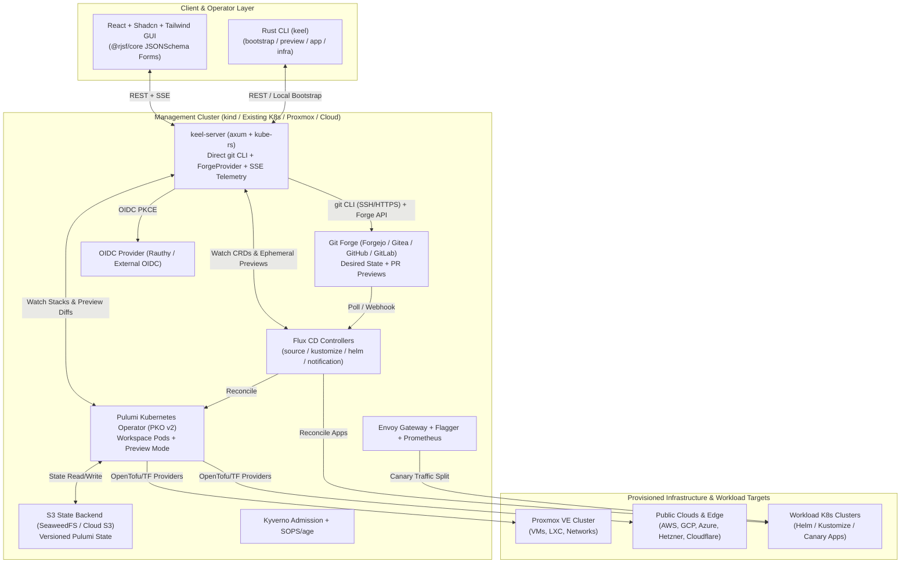
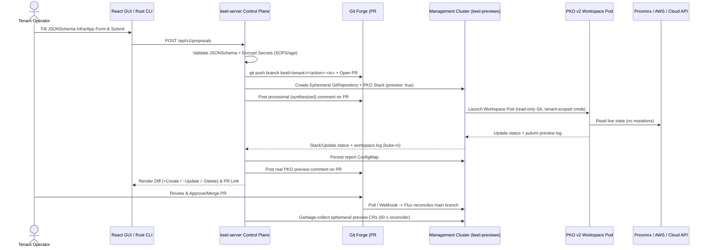
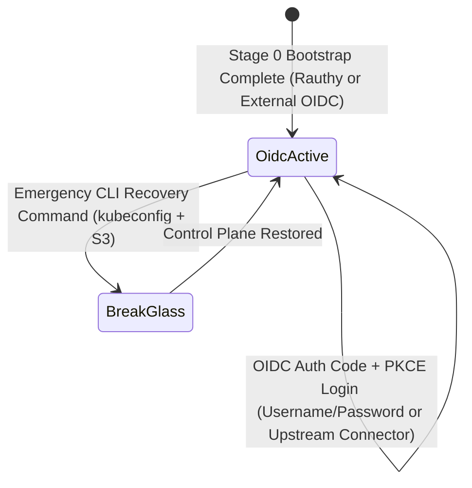
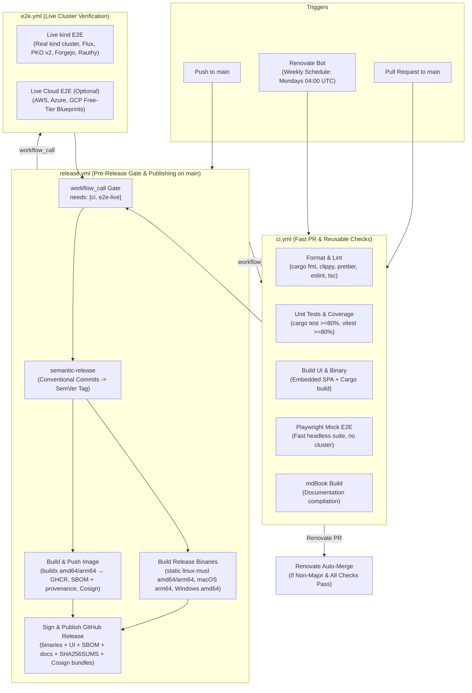

# Spec-Driven Development (SDD) Specification: Keel

**Document Status:** Baseline Engineering Specification v1.1  
**Project Name:** Keel (`keel` CLI & Control-Plane Binary, `keel.io` API Group)  
**Architecture Paradigm:** GitOps-Driven, Self-Bootstrapping Control Plane  
**Primary Stack:** Rust (`axum`, `clap`, `kube-rs`), React (`TypeScript`, `Shadcn UI`, `Tailwind CSS`, `@rjsf/core`), Flux CD, Pulumi Kubernetes Operator (PKO v2), Flagger, Envoy Gateway, Kyverno  

---

## 1. System Overview & Architectural Principles

### 1.1 Core Vision
**Keel** is a self-contained, single-binary self-service portal (exposing both a **React Web GUI** and a **Rust CLI**) for provisioning multi-cloud and on-premises infrastructure and installing applications declaratively. Starting from a compiled `keel` release binary executed on `localhost`, an operator can bootstrap a seed Kubernetes management cluster—locally via **`kind`**, on an **existing Kubernetes cluster (`kubeconfig`)**, on **Proxmox VE**, or directly on a **public cloud (`AWS`, `GCP`, `Azure`, `Hetzner`)**—instantiate or connect a Git repository (including an optional in-cluster Git forge and OIDC provider), and manage all subsequent infrastructure and workloads exclusively through **Pull Requests (PRs)**, **Pulumi Preview reports**, and **Flux CD** reconciliation.

### 1.2 Architectural Tenets
1. **Provider-Agnostic Stage 0 Bootstrapping:** Keel does not require Proxmox VE or any specific hypervisor to start. Stage 0 supports local `kind` clusters, pre-existing `kubeconfig` clusters (`k3s`, `Talos`, managed K8s), Proxmox VE, and public clouds behind a unified `BootstrapTarget` interface.
2. **Out-of-the-Box Upstream Fidelity:** Upstream Kubernetes manifests, Helm charts, and Kustomize overlays must run with zero structural modification. Portal metadata, form schemas, and ingress/progressive-delivery wrappers live in thin sidecar definitions (`catalog.yaml` with `apiVersion: keel.io/v1alpha1`, used strictly as a Git-stored schema rather than a cluster-installed CRD).
3. **CNCF & Open-Source First:** Prefer graduated/incubating CNCF projects (**Flux CD**, **Envoy Gateway**, **Flagger**, **Kyverno**, **Prometheus**, **OpenTelemetry**) and high-momentum open-source tools (**Pulumi / PKO v2**, **SOPS + age**, **Forgejo/Gitea**).
4. **Simplicity & Stateless Control Plane:** Avoid custom Kubernetes operators/CRDs (such as Crossplane XRDs) for infrastructure modeling—use Pulumi's native YAML/HCL runtimes and dynamic OpenTofu/Terraform provider bridge (`pulumi package add terraform-provider`) executed by PKO v2. Keep `keel-server` **stateless** with zero embedded or external databases (no SQLite or Postgres); store runtime state (session/OIDC signing keys, encrypted user Git credentials) natively in Kubernetes `Secret`s and read desired/live state from Git, Forge APIs, and `kube-rs` CRD caches.
5. **Control Plane vs. Workload Plane Isolation:** In multi-cluster deployments, the seed management cluster hosts strictly control-plane services while tenant applications, databases, and workload clusters run on separately provisioned infrastructure (targeted by Flux via `spec.kubeConfig.secretRef`) to prevent self-mutation lockouts. In single-cluster or local `kind` development mode, tenant workloads may run in isolated `tenant-<tenant-id>` namespaces on the seed cluster guarded by `NetworkPolicy`, `ResourceQuota`, and Kyverno policies.
6. **Latest Compatible Dependency Baseline:** At project initialization, all Rust crates, npm packages, GitHub Actions, container images, and Flux/PKO release manifests must resolve to their **latest compatible stable versions**, maintained continuously via weekly automated **Renovate** updates with auto-merge.

### 1.3 System Architecture Topology



---

## 2. Two-Stage Self-Bootstrapping & Anti-Lockout Architecture

### 2.1 Stage 0: Provider-Agnostic Localhost Bootstrap (PR-Free Initialization)
Because PKO v2 and Flux require a running Kubernetes cluster, Stage 0 executes directly from the `keel` binary on `localhost` without requiring an existing Git forge or PR workflow. Stage 0 executes as a two-stack Pulumi sequence (`deploy/bootstrap/<target>/Pulumi.yaml` + `deploy/bootstrap/control-plane/Pulumi.yaml`):

1. **Infrastructure Provisioning Stack (`deploy/bootstrap/<target>/Pulumi.yaml`):**
   * **Local Container Cluster (`--target kind`):** Uses `tehcyx/kind` (`deploy/bootstrap/kind/Pulumi.yaml`) to provision the `keel-mgmt` management cluster with local ingress port mappings for zero-dependency workstation bootstrapping.
   * **Existing Cluster (`--target kubeconfig`):** Connects directly to any pre-existing Kubernetes cluster (`k3s`, `Talos`, `microk8s`, or pre-provisioned cloud cluster) via `--kubeconfig` / `--context` (skips infrastructure provisioning).
   * **On-Premises Hypervisor (`--target proxmox`):** Uses `bpg/proxmox` (`deploy/bootstrap/proxmox/`) to provision the protected seed VM only. Installing `k3s` (with `--disable=traefik`) or `Talos Linux` on it via `cloud-init` is planned but not implemented: today you install the distribution yourself and attach with `--target kubeconfig`.
   * **Public Cloud (`--target aws|gcp|azure|hetzner`):** Uses provider-specific Pulumi programs (`deploy/bootstrap/<cloud>/`) to provision cost-optimized VMs (single-node `k3s` on AWS/GCP/Azure; VM only on Hetzner) or managed Kubernetes (`EKS`/`GKE`/`AKS`) alongside native S3-compatible object storage.
     * The AWS/GCP/Azure programs install single-node `k3s` with `--disable=traefik`, so Envoy Gateway (`keel-ingress`) is the sole ingress/Gateway controller. k3s itself keeps owning ServiceLB, the `local-path` provisioner (default `StorageClass`), `metrics-server`, and CoreDNS; these are not Flux add-ons. The node resource sets `ignoreChanges` on its first-boot install script (`userData` / `metadata["startup-script"]` / `osProfile.customData`), so script edits never restart or replace a protected node during `keel bootstrap recover`. Hetzner and Proxmox provision only the VM and do not install `k3s` (planned, not implemented). `deploy/bootstrap/hetzner/Pulumi.yaml` also exports no `kubeconfig` output (only `clusterName`/`ipv4Address`/`ipv6Address`), so on those hosts you install `k3s --disable=traefik` (or Talos) yourself and attach with `--target kubeconfig` (known gap). Boot scripts escape shell variables as `$${VAR}` because Pulumi YAML interpolates every `${...}` (drift-tested).
2. **Control-Plane Seed Stack (`deploy/bootstrap/control-plane/Pulumi.yaml`):**
   * Installs seed control-plane components as baseline Helm v3 releases directly into the seed cluster API. Once Flux CD is bootstrapped, these Helm v3 releases are handed over in-place to Flux CD (`deploy/seed/core-addons/`) for continuous reconciliation without resource recreation or downtime.
   * **Flux Ownership Handoff:** Every Stage 0 release with a seed Flux `HelmRelease` (same release name, release namespace, version and values; drift-tested) ignores every chart-affecting Pulumi input (`ignoreChanges: [chart, version, values, repositoryOpts, timeout, waitForJobs, createNamespace]`), and the Stage 0 Rauthy Services/StatefulSet (`deploy/bootstrap/control-plane-rauthy/Pulumi.yaml`, all `protect: true`) set `ignoreChanges: [spec, metadata.labels, metadata.annotations]`, so later Pulumi runs (e.g. `keel bootstrap recover`) never run a `helm upgrade` / server-side apply with stale Stage 0 inputs that would revert upgrades or rollbacks Flux applied from Git. Inputs of an adopted Stage 0 resource other than these must not be added or edited after the handoff (any non-ignored input diff re-applies the stale Stage 0 version/values); change the seed Flux object in Git instead. Only the `rauthy-config` Secret (config + first-boot credentials) stays Pulumi-owned and is never written to Git.
   * **Flux Self-Management:** Flux itself is a base addon: `core-addons/flux2.yaml` is a protected `flux-system/flux2` `HelmRelease` (`catalog/core/flux2`, `HelmRepository` `fluxcd-community` `oci://ghcr.io/fluxcd-community/charts`, `kustomize.toolkit.fluxcd.io/prune: disabled`) that adopts the Stage 0 `flux2` release in place (release + storage namespace `flux-system`, same version and values) and upgrades / rolls back Flux from Git. helm-controller upgrades its own Deployment, so `install`/`upgrade`/`rollback` set `disableWait: true`: a waiting `helm upgrade` would be cut off when the new helm-controller pod replaces the old one, leaving the release `pending-upgrade` and getting a healthy upgrade rolled back in a loop. The controller rollouts are the readiness gate (RollingUpdate with `maxUnavailable: 0` keeps the old controllers running when a new one never becomes Ready); rollback is a Git revert (management API rollback PR) applied by the still-running controllers, and `upgrade.remediation` (`retries: 3`, `remediateLastFailure: true`, `strategy: rollback`) rolls back an upgrade whose apply fails. There is no `install.remediation`: Flux install remediation is `helm uninstall`, which would delete Flux itself. The multitenancy values and `crds.annotations: {helm.sh/resource-policy: keep}` (Flux CRDs, and with them every Flux object, survive an uninstall) are locked by the management API allowlist; the catalog schema only exposes `logLevel`. If helm-controller is down, recovery is suspend the HelmRelease + `helm rollback` + Git revert + resume (release still installed) or `keel bootstrap recover` (release missing; `docs/operations/break-glass-recovery.md`).
   * **Optional Forgejo Add-on (`--with-forge`):** Only with `--with-forge`, `keel bootstrap init` writes `core-addons/forgejo.yaml` (an OCI `HelmRepository` `flux-system/forgejo` for `oci://code.forgejo.org/forgejo-helm` plus a protected `flux-system/forgejo` `HelmRelease`, `kustomize.toolkit.fluxcd.io/prune: disabled`, no `install.remediation` because it would `helm uninstall` the forge hosting the GitOps repository) and `catalog/core/forgejo/catalog.yaml`; neither is written without the flag. The HelmRelease adopts the Stage 0 `forgejo` release (`deploy/bootstrap/control-plane-forgejo/Pulumi.yaml`, `protect: true` + the same `ignoreChanges`) in place: same release name, release namespace `keel-system`, chart version and values (drift-tested, catalog == seed == Pulumi version). `gitea.config.server.ROOT_URL` is rendered from `--oidc-public-url` (`https://forgejo.<domain>[:port]/`) for both Git and the Pulumi `forgejoRootUrl` config. The same file carries the `keel-system/forgejo-ingress` HTTPRoute (`${FORGEJO_HOST}`, both `keel-ingress` HTTPS listeners) as a supporting document; Stage 0 applies the identical route whenever `--with-forge` is set (with or without the built-in Rauthy), so the catalog `serviceUrl` always resolves. The management API allowlist (`management_addon_mutable_values("forgejo")`) only permits sizing/scheduling and `persistence.{size,storageClass,accessModes,labels}`, so the admin `existingSecret`, OAuth2 client settings, `ROOT_URL`, database, CA trust, `persistence.enabled` and `persistence.annotations` (`helm.sh/resource-policy: keep` retains the repository PVC) are locked. Persistence stays disabled by default: Forgejo data (the GitOps repository Flux pulls from, the SQLite database and the Keel API token) is ephemeral and lost whenever the pod is replaced. Because any upgrade or rollback can replace the pod, the management API rejects every `forgejo` upgrade and rollback with `400` while the desired HelmRelease does not set `persistence.enabled: true` (`keel_core::ensure_management_addon_upgradable`); operators back up the repository (`forgejo dump` or a pushed mirror) and enable persistence by editing Git directly, and the catalog form never offers the toggle.
   * **Optional In-Cluster keel-server Add-on (`--with-keel-server`):** Opt-in (default off). `keel bootstrap init --with-keel-server` writes `core-addons/keel-server.yaml` (a protected Flux `Kustomization` `flux-system/keel-server`, `kustomize.toolkit.fluxcd.io/prune: disabled`, impersonating `kustomize-controller`), `catalog/core/keel-server/catalog.yaml` (image-based `management-core` app, `upstream.image: ghcr.io/rdylanwalker/keel`) and `clusters/management/addons/keel-server/` (the least-privilege `rbac.yaml` and `deployment.yaml` shared verbatim with the manual `deploy/bootstrap/keel-server/` bundle, a `keel-server-ingress` HTTPRoute for `https://keel.<domain>[:port]` on both `keel-ingress` HTTPS listeners, and a `kustomization.yaml` whose `keel-server-config` `configMapGenerator` carries the cluster-reachable Git remote and HTTPS username, serialized rather than templated). There is no Stage 0 install: Flux is the only owner. The image is pinned through `spec.images[].newTag` to the release tag of the CLI that bootstrapped the cluster (`CARGO_PKG_VERSION`, the `{{version}}` tag `release.yml` publishes; never `latest`), and management API upgrades edit only that tag. The Kustomization deliberately has no `targetNamespace` (the bundle spans `keel-system`, `keel-previews`, `flux-system` and cluster-scoped RBAC, with explicit namespaces) and does not ship the `tenant-default` `RoleBinding`, which `keel-tenants` already owns via `tenants/default/rbac.yaml`. It prunes (stateless, so stale RBAC is garbage-collected). The flag requires `--repo-dir` (the add-on only reaches Git through the seed push) plus either `--with-forge` or an HTTP(S) `--git-url` without embedded credentials, because the pod clones the repository on start; `--with-forge` together with `--git-url` is rejected so the server never pairs Forgejo credentials with an external remote. Secrets never go to Git: `KEEL_GIT_TOKEN` comes from `keel-system/forge-token` (created by Stage 0 with `--with-forge`, or from `--git-token` with `--git-url`; otherwise bootstrap prints the command to create it), and the session key is generated by the server into a Kubernetes Secret. With an external `--oidc-issuer`, bootstrap prints the redirect URIs to register. Release hygiene: semantic-release's `prepareCmd` bumps every pinned keel image tag (`deploy/bootstrap/keel-server/{kustomization,deployment}.yaml`, `deploy/seed/core-addons/keel-server.yaml`, `deploy/catalog/core/keel-server/catalog.yaml`) with the crate version, and a unit test fails on any drift.
   * **Core Add-on Identity:** Flux runs with `--default-service-account=default`, so the core add-on `HelmRelease`s and their `HelmRepository`s live in `flux-system` and impersonate the privileged `helm-controller` `ServiceAccount`, installing into `keel-system` through `targetNamespace` + `storageNamespace` (same Helm release storage as Stage 0). `keel-system` therefore holds no privileged reconciler identity that a namespaced writer there (e.g. `keel-server`) could borrow.
   * **Local-Path Git Limitation:** When the GitOps repository is a local filesystem path (no `--git-url`), in-cluster Flux cannot reach it, so Stage 0 skips the Flux sync manifests and the control-plane add-ons stay Stage 0-only: no Flux reconciliation, no management API upgrades/rollbacks, and (because of the `ignoreChanges` above) re-running `keel bootstrap init`/`recover` with a newer CLI does not apply newer add-on versions. `keel bootstrap init` prints a note; push the repository to a network Git remote and re-run with `--git-url` to hand the add-ons over to Flux.

#### Seed Control-Plane Installation (Identical Across All Targets)
Once the seed cluster API is reachable, `keel bootstrap init` performs the exact same installation sequence regardless of target:
1. Runs `deploy/bootstrap/control-plane/Pulumi.yaml` to install **SeaweedFS S3** (or binds the cloud provider's S3-compatible bucket), **Flux CD**, **PKO v2**, **Kyverno**, **Envoy Gateway**, **Prometheus**, **Flagger**, **Rauthy** (Apache-2.0 lightweight Rust in-cluster OIDC provider with Admin UI for users, groups, and clients, unless `--oidc-issuer` or `--oidc-provider none` is passed), and optional in-cluster **Forgejo/Gitea**, handing management over in-place to Flux CD (`deploy/seed/core-addons/`).
2. Generates a root **`age` keypair**, injects the private key into `flux-system/sops-age`, and writes `.sops.yaml` into the seed Git repository.
3. Keeps durable Stage 0 Pulumi state per cluster under `~/.config/keel/stage0/<cluster>/` (`$KEEL_CONFIG_DIR` or `$XDG_CONFIG_HOME/keel` override): `state/` (local `file://` backend), `programs/<program>/` (materialized `Pulumi.yaml` + encrypted stack config), and a generated `pulumi-passphrase` (`0600`, also stored in `keel-system/keel-stage0-pulumi-passphrase`; a one-time notice instructs the operator to escrow it). Stage 0 stacks are named `stage0-<program>-<cluster>`. When the in-cluster SeaweedFS backend is used, every Stage 0 stack is escrowed to `s3://pulumi-state/stage0/<cluster>/` (checkpoints, programs/config, `manifest.json`) with bucket versioning enabled, falling back to timestamped snapshots (`stage0/<cluster>/snapshots/<stack>/<ts>.json`) when versioning is unavailable. Core Stage 0 resources (namespaces, SOPS `age` key, Flux, Kyverno, PKO, S3 backend) carry `protect: true`; the Flux-managed `management-cluster-core` PKO `Stack` is also `protect: true`.
4. Provisions the initial Rauthy admin user (`--admin-username` / `--admin-password`, or auto-generated credentials printed once to stdout) into `keel-admins` + `rauthy_admin`, configures the `keel-server` OIDC PKCE client (`groups` scope) in `keel-system/rauthy-config`, and exposes Rauthy via Envoy Gateway over HTTPS with a self-signed Stage 0 CA (`keel-system/keel-wildcard-tls`) at `--oidc-public-url` (default `https://idp.keel.local:8888`; issuer `<url>/auth/v1`; Forgejo at `forgejo.<domain>`). With `--with-forge` + Rauthy, a Forgejo OAuth source `rauthy` is registered (secret passed over `kubectl exec` stdin) and the Forgejo admin password is random (or `KEEL_FORGEJO_ADMIN_PASSWORD`) and stored in `keel-system/keel-forgejo-admin`, which the Forgejo chart consumes via `gitea.admin.existingSecret`. The portal is served by `keel serve` (default `http://127.0.0.1:8080`).
5. Purges any control-plane credentials found in `tenant-*` namespaces, provisions `tenant-default`'s scoped S3 identity and read-only Git credential (`KEEL_TENANT_GIT_TOKEN` for external forges), and migrates `tenant-default` state under `tenants/default/`.

#### NAT / Firewall & Ephemeral Local Cluster Resilience
* **Outbound Pull-Polling:** Flux `GitRepository` resources default to outbound polling (`interval: 1m`) alongside optional webhook receivers, ensuring local `kind` and home `k3s` management clusters behind NAT/firewalls reconcile external GitHub/GitLab repositories without requiring inbound public ports.
* **Rapid `kind` Recreation:** When paired with an external Git repository and external S3 backend (note: in-cluster `--with-forge` or in-cluster SeaweedFS inside `kind` is ephemeral with the cluster), deleting and recreating a local `kind` cluster via `keel bootstrap init --target kind` against the same Git repository and S3 backend restores the full control plane in under 60 seconds.

### 2.2 Stage 1: Self-Hosted Pivot & Anti-Lockout Guardrails
Once the management cluster is healthy:
1. **PR Enforcement Activation:** All subsequent infrastructure or application changes—whether triggered via GUI or CLI—create a Git branch, commit encrypted secrets via SOPS, open a PR via `ForgeProvider`, and spin up an ephemeral PKO preview.
2. **Control-Plane Protection & Base Addon Self-Mutation Guardrails:**
   * **Protection Labeling:** Control-plane PKO `Stack` (`management-cluster-core`) and management-plane base addon resources (`flux2`, `rauthy`, `envoy-gateway`, `flagger`, `kyverno`, `pulumi-kubernetes-operator`, `prometheus`, `s3-state-backend`, and the optional `forgejo`) carry the `keel.io/protect: "true"` label.
   * **No-Prune Seed Sync:** The `core-addons` Flux `Kustomization` operates with `prune: false` (`deploy/seed/flux-system/gotk-sync.yaml`) ensuring that removing a base addon manifest from Git never uninstalls live control-plane base addons.
   * **Root Flux Kustomizations:** `deploy/seed/flux-system/gotk-sync.yaml` is the single canonical set of root Flux `Kustomization`s — `flux-system` (`./clusters/management/flux-system`, self-managing, `prune: true`), `core-addons` (`./clusters/management/core-addons`, `prune: false`) and `keel-tenants` (`./tenants`, impersonating `keel-tenant-reconciler`, `dependsOn: core-addons`). `keel bootstrap init` writes it, the root `GitRepository` (`interval: 1m` pull polling) and the tenant reconciler RBAC to `clusters/management/flux-system/` and applies the identical documents in-cluster (skipped only for local filesystem Git paths). All three carry `kustomize.toolkit.fluxcd.io/prune: disabled`, so the prune-enabled `flux-system` Kustomization never garbage-collects one of them (and its whole inventory, e.g. every tenant namespace) when its document is dropped or renamed in Git (`NFR-REL-01`). The Stage 0 CA / wildcard `Certificate` and `keel-ingress` Gateway are applied whether or not the built-in Rauthy is enabled, matching `core-addons/cert-manager.yaml` and `envoy-gateway.yaml`. `flux-system` and `core-addons` run with `wait: false`: they only create Flux objects plus a few supporting documents, and each base addon reports its own health on its own Flux object (`HelmRelease` remediation, Kustomization `healthChecks`), so a broken optional addon never blocks tenant reconciliation, while `keel-tenants` still waits for `core-addons` to be applied (CRDs, HelmRepositories, policies). Everything under `clusters/management/` is rendered at bootstrap time (ingress hosts from `--oidc-public-url`, Kyverno bundle into `core-addons/kyverno-policies.yaml`), and `core-addons/kustomization.yaml` lists exactly the files written.
   * **Plain-Manifest Addons (`clusters/management/addons/<id>/`):** Addons without a Helm chart keep their manifests (with a `kustomization.yaml`) under `clusters/management/addons/<id>/` and are reconciled by a Flux `Kustomization` `flux-system/<id>` in `core-addons/<id>.yaml` (`targetNamespace`, `prune: false`, `serviceAccountName: kustomize-controller`, `healthChecks`), whose version is the image tag pinned in `spec.images[].newTag`. The built-in Rauthy IdP (`catalog/core/rauthy`, `runtime: kustomize`, `spec.upstream.image: ghcr.io/sebadob/rauthy`, version-only upgrades because Hiqlite raft membership is configuration-driven) is the first such addon; its files are written only when the built-in Rauthy is enabled (not with `--oidc-issuer` / `--oidc-provider none`). `CatalogApplication.spec.upstream.image` (repository only, no tag/digest, `runtime: kustomize` and `metadata.category: management-core` only — the self-service tenant install path synthesizes `HelmRelease`/`HelmRepository` objects from `repoURL` — requires `version`) replaces `repoURL` for such image-based addons.
   * **Kyverno Admission Deletion Guard:** The `protect-control-plane` Kyverno `ValidatingPolicy` denies `DELETE` of `management-cluster-core`, of any PKO `Stack` labelled `keel.io/protect: "true"`, and of any `flux-system` `HelmRelease` / Flux `Kustomization` labelled `keel.io/protect: "true"` (deleting `flux2` would `helm uninstall` Flux). Break-glass deletion: suspend the parent Kustomization (`core-addons`/`flux-system`, which would otherwise re-apply the label from Git) or remove the label in Git, then remove the `keel.io/protect` label and delete, and denies any mutation in `flux-system`/`keel-system` by tenant (`tenant-*`) or `keel-previews` ServiceAccounts. The API's `force-delete` refuses `keel.io/protect` stacks as well.
   * **Automated Upgrade Rollback:** Every base addon `HelmRelease` configures `spec.upgrade` with `timeout: 5m` and `remediation.strategy: rollback` (`retries: 1`), automatically reverting failed release upgrades in-cluster (`flux2` uses `retries: 3`, `remediateLastFailure: true` and `timeout: 10m`, see Flux Self-Management).
   * **Management API Upgrade Guardrails:** Each base addon is reconciled by exactly one Flux object whose `metadata.name` equals its `catalog/core` id: a `HelmRelease` for charts or a Flux `Kustomization` (`kustomize.toolkit.fluxcd.io`) for plain-manifest addons. Core addon files may also carry supporting documents (`ClusterIssuer`, `Gateway`, `ServiceAccount`, ...); `POST /api/v1/management/addons/{id}/upgrade` and `/rollback` locate only that Flux object (never a Service/ServiceAccount sharing the name), edit or restore only that document, and write every other document back verbatim. `HelmRelease` upgrades set `spec.chart.spec.version` and deep-merge `spec.values`; Flux `Kustomization` upgrades set `spec.images[].newTag` and reject Helm values. Digest-pinned `spec.images` entries are rejected (kustomize prefers `digest` over `newTag`). Versions must be semver-ish (optional `v` prefix, no whitespace, ≤ 64 chars). Add-on Flux objects must set `metadata.namespace` explicitly (the `core-addons` Kustomization has no `targetNamespace`). Security-critical addons use a per-addon **allowlist** of mutable value paths (`keel_core::management_addon_mutable_values`): for `flux2`, `kyverno`, `s3-state-backend` and `forgejo` only resource sizing / scheduling (and `flux2` `logLevel`, Kyverno controller `replicas`, Forgejo `persistence` sizing; a non-persistent Forgejo is not upgradable at all) may change, so multitenancy, controller args (`additionalArgs`/`extraArgs`), Kyverno `features`/`featuresOverride`/`crds`/`config`, every S3 endpoint/auth setting, and the Forgejo admin `existingSecret`/OAuth2/`ROOT_URL` settings are locked; an upgrade or rollback touching any other path is rejected with `400` and must be made by editing Git directly. Rollbacks re-assert `keel.io/protect: "true"` and re-validate the restored versions. Version-only upgrades edit just the version scalar(s), preserving the document's comments and key order. An id defined by more than one Flux object (within or across files) is flagged `conflict: true` in the listing and returns `409` on upgrade/rollback.
   * **Revert PR Generation:** If an attempted base addon mutation fails preview validation or health checks, Keel GUI/CLI automatically generates a revert PR to restore the known-good Git state.
3. **Break-Glass Recovery:** If an operator ever damages the management cluster or in-cluster Git forge, `keel bootstrap recover --s3-endpoint <url>` reads the escrowed Stage 0 state from `s3://<bucket>/stage0/<cluster>/` (optionally restoring `--state-version` / `--snapshot`), re-materializes each program and encrypted config, and executes `pulumi refresh` + `pulumi up` (default: the `control-plane*` stacks; `--stack stage0-<program>-<cluster>` to select; `--dry-run` / `--list-versions` for inspection). The passphrase comes from `--passphrase-file`, `PULUMI_CONFIG_PASSPHRASE`, or the local file; S3 keys from `AWS_ACCESS_KEY_ID`/`AWS_SECRET_ACCESS_KEY`. All secrets travel via env/stdin, never argv.

### 2.3 Bootstrap & Handover Sequence


---

## 3. Git Repository Schema, Git Interface & Forge Abstraction

### 3.1 Canonical Git Repository Layout
Every managed repository follows a deterministic, human-readable directory hierarchy so operators can inspect or edit state directly with standard Git tools:

```text
infra-gitops/
├── .sops.yaml                          # Per-tenant & global age public key rules
├── .keel/
│   └── config.yaml                     # Enabled providers, forge config, OIDC settings
├── clusters/
│   └── management/
│       ├── flux-system/                # GitRepository, tenant reconciler RBAC, root Kustomizations (gotk-sync.yaml)
│       ├── core-addons/                # One Flux HelmRelease/Kustomization per base addon (+ Kyverno policies)
│       ├── addons/<id>/                # Plain manifests of Kustomize addons (e.g. rauthy), reconciled by flux-system/<id>
│       └── management-stack.yaml       # PKO Stack (protect: true) for seed cluster
├── providers/
│   ├── registry.yaml                   # Enabled/disabled providers & versions
│   ├── proxmox/                        # Pulumi YAML/HCL templates (bpg/proxmox)
│   ├── aws/                            # Pulumi YAML/HCL templates
│   ├── gcp/                            # Pulumi YAML/HCL templates
│   ├── azure/                          # Pulumi YAML/HCL templates
│   ├── hetzner/                        # Pulumi YAML/HCL templates
│   ├── cloudflare/                     # Pulumi YAML/HCL templates
│   └── custom/                         # Arbitrary OpenTofu/Terraform bridge templates
├── catalog/
│   ├── apps/
│   │   └── <app-id>/
│   │       ├── catalog.yaml            # Metadata, JSONSchema, companion infra hooks, defaultEngine
│   │       ├── manifests.yaml          # Raw K8s YAML with ${var} placeholders (runtime: manifest)
│   │       └── upstream/               # Unmodified Helm values / Kustomize bases
│   ├── infra/
│   │   └── <blueprint-id>/
│   │       ├── catalog.yaml            # JSONSchema for VM / Cluster / DB inputs
│   │       └── Pulumi.yaml             # Unmodified Pulumi / OpenTofu bridge program
│   └── bundles/
│       └── <bundle-id>/
│           └── catalog.yaml            # Multi-item CatalogBundle with dependsOn DAG
└── tenants/
    └── <tenant-id>/
        ├── rbac.yaml                   # Namespace, ServiceAccount, RoleBindings, Quotas
        ├── secrets.enc.yaml            # SOPS-encrypted tenant credentials
        ├── infra/
        │   └── <stack-name>/
        │       ├── stack.yaml          # PKO Stack CR + Flux GitRepository/Kustomization
        │       └── Pulumi.prod.yaml    # Stack config values
        └── apps/
            └── <release-name>/
                ├── release.yaml        # Flux HelmRelease / Kustomization (runtime: helm | kustomize)
                ├── values.yaml         # Generated directly from JSONSchema form
                ├── canary.yaml         # Optional Flagger Canary CR
                ├── manifests.yaml      # Rendered multi-doc K8s YAML (runtime: manifest)
                ├── values-configmap.yaml # Non-secret substitution values (runtime: manifest, engine: flux)
                ├── flux-kustomization.yaml # Flux Kustomization with postBuild (runtime: manifest, engine: flux)
                ├── Pulumi.yaml         # ConfigGroup program (runtime: manifest, engine: pulumi)
                └── stack.yaml          # PKO v2 Stack CR with preview: true (runtime: manifest, engine: pulumi)
```

### 3.2 Direct `git` CLI Execution & `ForgeProvider` Trait
* **Pure `git` Engine (`keel-git`):** All cloning, fetching, branch creation (`git checkout -b keel/<tenant>/<action>-<timestamp>`), staging, signing, and pushing execute via `tokio::process::Command::new("git")` using argument arrays (zero shell interpolation). User-supplied SSH private keys (`ed25519`/`rsa`) or HTTPS credentials are injected ephemerally per command. SSH keys go into an ephemeral temp key file referenced by `GIT_SSH_COMMAND` (`StrictHostKeyChecking=yes` with supplied `known_hosts`, otherwise `accept-new`), and the file is removed after the command. HTTPS credentials are injected as an `http.extraHeader: Authorization: Basic ...` through the `GIT_CONFIG_COUNT`/`GIT_CONFIG_KEY_0`/`GIT_CONFIG_VALUE_0` environment variables, so they never reach argv, `.git/config`, or the remote URL, and they are redacted from error output.
* **Minimal `ForgeProvider` Trait:** Because PRs/MRs are forge-specific APIs, a compact Rust trait isolates forge interactions:

```rust
#[async_trait]
pub trait ForgeProvider: Send + Sync {
    async fn create_pull_request(&self, req: CreatePrRequest) -> Result<PullRequestInfo, ForgeError>;
    async fn get_pull_request(&self, pr_id: &str) -> Result<PullRequestInfo, ForgeError>;
    async fn post_preview_comment(&self, pr_id: &str, markdown_report: &str) -> Result<(), ForgeError>;
    async fn list_open_pull_requests(&self, tenant: Option<&str>) -> Result<Vec<PullRequestInfo>, ForgeError>;
    async fn list_pull_requests(&self, tenant: Option<&str>, state: Option<PullRequestState>) -> Result<Vec<PullRequestInfo>, ForgeError>;
    /// `expected_head_sha` pins the merge to the reviewed/verified commit; the forge must refuse
    /// if the PR head moved (Gitea/Forgejo `head_commit_id`, GitHub/GitLab `sha`, local head check).
    async fn merge_pull_request(&self, pr_id: &str, expected_head_sha: Option<&str>) -> Result<PullRequestInfo, ForgeError>;
    async fn close_pull_request(&self, pr_id: &str) -> Result<PullRequestInfo, ForgeError>;
    async fn reopen_pull_request(&self, pr_id: &str) -> Result<PullRequestInfo, ForgeError>;
    /// Ensures the configured repository exists (creating it with the requested visibility);
    /// used by Stage 0 instead of ad-hoc forge REST calls.
    async fn ensure_repository(&self, private: bool) -> Result<RepositoryEnsureOutcome, ForgeError>;
}
```
* **SHA-Pinned Merges:** `POST /api/v1/proposals/{id}/merge` resolves the PR branch head (`git rev-parse origin/<branch>`) exactly once, runs tenant-admin path-scope verification against `origin/main...<sha>` (rejecting `..` traversal, absolute paths, and backslashes), and passes that SHA to `merge_pull_request` so a push between verification and merge is rejected by the forge.
* **Preview Provenance:** `PreviewReport.source` is `pko` for reports parsed from a real `pulumi preview` run and `synthesized` for control-plane simulations derived from proposed manifests/Git diffs; synthesized reports are labelled "Simulated diff — PKO preview not executed" in PR comments and the GUI, and carry no policy verdict.
* **Supported Implementations:** `ForgejoGiteaProvider` (REST v1), `GitHubProvider` (REST v3), `GitLabProvider` (REST v4), and `LocalGitProvider` (emulates PRs via `proposal/*` branches with GUI diff inspection and fast-forward merge for offline/air-gapped repos; proposal metadata (`.keel/proposals/<pr_id>.json`: state, comments, transitions) is committed to a dedicated `keel-proposals` metadata branch in the bare repository, without touching the proposal branch head or `main`).
* **Merge-base diffs:** Proposal diffs use `main...head` (merge-base) for open/closed PRs, so stale PRs never show unrelated or reversed changes.

---

## 4. Infrastructure Provisioning & Pre-Merge PKO Preview Engine

### 4.1 Dynamic Provider Extensibility (Proxmox + Multi-Cloud + Future Providers)
* **Built-In Day-1 Provider Blueprints:** Proxmox VE (`bpg/proxmox`), AWS, GCP, Azure, Hetzner Cloud, and Cloudflare.
* **Enable / Disable Toggle:** Providers are enabled or disabled declaratively in `.keel/config.yaml` and `providers/registry.yaml` (via PR), controlling which blueprints appear in the GUI/CLI catalog and which provider plugins Kyverno permits in tenant namespaces.
* **Arbitrary Future Providers:** Any provider published on the OpenTofu Registry (`registry.opentofu.org`) or Terraform Registry can be added without recompiling the Rust backend by adding a blueprint referencing `pulumi package add terraform-provider <namespace>/<name>` inside a Pulumi YAML/HCL stack.

### 4.2 Ephemeral PR Preview Workflow (PKO v2 Preview Mode)
To guarantee operators see exact infrastructure blast radius before merging any PR:
1. When a proposal branch (`keel/<tenant>/<action>-<timestamp>`) is pushed and a PR is opened for a **Pulumi-backed** change (infra blueprint, or raw-manifest app with `engine: pulumi`), `keel-server` (`keel_server::preview_lifecycle::launch_pko_preview`, `keel_kube::preview_runner`) server-side-applies into `keel-previews`:
   * A Flux `GitRepository` pinned to the proposal commit.
   * A PKO v2 `Stack` with `spec.preview: true`, running as the read-only `keel-previews/keel-preview-readonly` ServiceAccount (TokenReview + `view`, no Secrets), using the tenant state backend with the tenant's **scoped** SeaweedFS identity and **read-only** Git credential mirrored into `keel-previews` (`keel-preview-s3-<tenant>`, `keel-preview-git-<tenant>`). The preview backend is always pinned to the tenant prefix `s3://<bucket>/tenants/<tenant>` (existing and brand-new stacks alike; `keel_pko::tenant_scoped_preview_backend`, re-checked before launch). Cloud provider credentials referenced by the tenant `Stack`'s `envRefs`/`secretsRef` are copied **exactly** (only referenced Secrets and keys; PR-proposed `<instance>-secrets` values for new stacks) into per-preview Secrets `keel-preview-<pr>-<name>` labelled `keel.io/pr-id`/`keel.io/tenant` and owned by the preview `Stack` (GC'd with it), and the preview refs are rewritten to them (`EphemeralPreviewParams::inherit_tenant_credentials`, `PreviewCluster::copy_preview_secrets`); the preview ServiceAccount still cannot read Secrets via the API. If prerequisites are missing (no cluster, no scoped identity), the preview is not executed, and admin keys are never substituted.
2. Keel immediately posts a **provisional** PR comment synthesized from the proposed manifests (`source: synthesized`, "Provisional diff — PKO preview running").
3. PKO runs `pulumi preview` in a workspace pod. PKO v2 persists no per-resource step data for previews, so Keel maps `Stack` conditions + the `auto.pulumi.com/v1alpha1` `Update` (`spec.type: preview`) to `run.phase` (`pending|running|succeeded|failed|notExecuted`) and parses the resource plan from the workspace pod's `pulumi` container log (last 4000 lines) (`keel_pko::run::{map_pko_preview_status, parse_pulumi_console_preview}`).
4. The finished report (`source: pko`) is persisted in a `ConfigMap` owned by the preview `Stack` (`report.json`, plus a `keel.io/preview-reported-commit` annotation), posted as a follow-up PR comment (Markdown cells escaped), streamed over SSE, and served by `GET /api/v1/proposals/{id}/preview` and `keel preview status`.
5. A reconciler (`spawn_preview_reconciler`, every 60 s with jitter) diffs live preview objects against forge PR states. It garbage-collects previews of merged/closed PRs and re-publishes finished runs. Because it holds no in-memory state, it is restart-safe and replica-safe (`NFR-REL-02`). Merge/close through the API also deletes the preview immediately.
6. **Flux-only changes** (Helm/Kustomize apps, `engine: flux`) have no Pulumi program; their report is synthesized from the proposed manifests with `run.phase: notExecuted` and labelled "Simulated diff — PKO preview not executed" (no policy verdict).
7. **Known limitations:** the report only covers what PKO prints in the workspace log (last 4000 lines); a referenced provider Secret/key missing from the tenant namespace makes the preview `notExecuted`.



---

## 5. Application Catalog, Dynamic Forms & Progressive Delivery

### 5.1 Out-of-the-Box Packaging Contract (`catalog.yaml`)
Applications are never forked or rewritten. Each catalog entry pairs an upstream artifact (Helm chart repository/OCI ref, Kustomize URL, or raw/parameterized Kubernetes YAML manifest templates) with a declarative `catalog.yaml` file (using `apiVersion: keel.io/v1alpha1` as a Git-stored catalog schema, not a cluster-installed CRD):

```yaml
apiVersion: keel.io/v1alpha1
kind: CatalogApplication
metadata:
  id: authentik
  name: Authentik Identity Provider
  category: security-identity
  runtime: helm # helm | kustomize | manifest
spec:
  upstream:
    chart: authentik
    repoURL: https://charts.goauthentik.io
    version: "2026.10.1"
  progressiveDelivery:
    flaggerSupported: true
    defaultCanary: false
  companionInfrastructure:
    - blueprint: postgres-managed
      bindValues:
        postgresql.enabled: false
        authentik.postgresql.host: "${outputs.db_host}"
        authentik.postgresql.password: "${secrets.db_password}"
  schema:
    type: object
    required: [domain, adminEmail]
    properties:
      domain:
        type: string
        title: Ingress Hostname
        format: hostname
      adminEmail:
        type: string
        title: Bootstrap Admin Email
        format: email
      replicas:
        type: integer
        title: Worker Replicas
        default: 2
        minimum: 1
        maximum: 10
  uiSchema:
    adminEmail:
      ui:help: "Used for initial administrator recovery notifications."
```

#### Raw Kubernetes Manifest & Template Support (`runtime: manifest`)
Alongside Helm and Kustomize, catalog applications support raw and templated multi-document Kubernetes YAML via `runtime: manifest`. The companion manifest file resides at `catalog/apps/<id>/manifests.yaml` using standard `${var_name}` and `${var_name:=default}` placeholder syntax:

```yaml
apiVersion: keel.io/v1alpha1
kind: CatalogApplication
metadata:
  id: http-echo-manifest
  name: HTTP Echo Server
  category: web
  runtime: manifest
spec:
  defaultEngine: flux # flux | pulumi (default actioning engine)
  schema:
    type: object
    required: [app_name, port, message]
    properties:
      app_name:
        type: string
        title: Application Name
        default: http-echo
      port:
        type: integer
        title: Service Port
        default: 8080
      message:
        type: string
        title: Echo Message
        default: "Hello from Keel Manifest!"
      secret_token:
        type: string
        title: API Secret Token
        format: password
        writeOnly: true # Encrypted via SOPS + age before staging
```

Companion `catalog/apps/<id>/manifests.yaml`:
```yaml
apiVersion: apps/v1
kind: Deployment
metadata:
  name: ${app_name:=http-echo}
spec:
  replicas: 1
  selector:
    matchLabels:
      app: ${app_name:=http-echo}
  template:
    metadata:
      labels:
        app: ${app_name:=http-echo}
    spec:
      containers:
        - name: echo
          image: hashicorp/http-echo:0.2.3
          args:
            - "-listen=:${port:=8080}"
            - "-text=${message:=hello}"
          ports:
            - containerPort: ${port:=8080}
---
apiVersion: v1
kind: Service
metadata:
  name: ${app_name:=http-echo}
spec:
  ports:
    - port: ${port:=8080}
      targetPort: ${port:=8080}
  selector:
    app: ${app_name:=http-echo}
```

* **Auto-Extract Schema Tokens:** In the Web UI Catalog Wizard, pasting or editing raw Kubernetes YAML allows clicking **"Auto-Extract Variables to Schema"**, which scans for `${var_name}` and `${var_name:=default}` tokens and dynamically generates `spec.schema.properties` (with defaults and required flags) so operators avoid hand-crafting JSON Schema.
* **Dual Execution Engines (`actionEngine: "flux" | "pulumi"`):** Operators select the actioning engine either as a catalog default (`spec.defaultEngine`) or at deploy time in the UI Deploy Modal or CLI (`keel app install --engine flux|pulumi`):
  1. **Flux CD Engine (`flux`):** Synthesizes `tenants/<tenant>/apps/<instance>/manifests.yaml`, non-secret substitution values into `values-configmap.yaml` (`kind: ConfigMap`), SOPS+`age`-encrypted secret fields into `secrets.enc.yaml` (`kind: Secret`), and `flux-kustomization.yaml` (`kustomize.toolkit.fluxcd.io/v1` `Kustomization` with `spec.serviceAccountName: tenant-<tenant>-sa` and `spec.postBuild.substituteFrom` referencing the `ConfigMap` and `Secret`).
  2. **Pulumi PKO v2 Engine (`pulumi`):** Synthesizes `tenants/<tenant>/apps/<instance>/Pulumi.yaml` wrapping the rendered Kubernetes YAML in a `kubernetes:yaml/v2:ConfigGroup` program alongside a PKO v2 `Stack` (`stack.yaml`). On PR creation, Keel triggers an ephemeral PKO preview (`spec.preview: true`) in `keel-previews`, streaming exact resource-level diffs (`+ Create`, `~ Update`, `- Delete`) to the UI and CLI before merge.

* **Dynamic Form Rendering:** The React frontend feeds `spec.schema` and `spec.uiSchema` directly into **`@rjsf/core` (`react-jsonschema-form`)** mapped to **Shadcn UI** widgets (`Input`, `Select`, `Switch`, `Slider`, `SecretInput`). Form submission serializes directly into an unmodified Helm `values.yaml` override.
* **Base Addon Catalog Schemas & Upstream Sync Escape Hatch:** Management-plane base addons (`rauthy`, `envoy-gateway`, `flagger`, `kyverno`, `pulumi-kubernetes-operator`, `prometheus`, `s3-state-backend`) ship with curated minimal `catalog.yaml` JSON schemas exposing high-frequency operational fields for simplified UI configuration. For advanced Helm `values.yaml` tuning, the GUI provides a "Sync Upstream Schema" escape hatch that fetches the full upstream chart `values.schema.json` (or parses raw `values.yaml` defaults) to dynamically expand `@rjsf/core` dynamic forms with complete upstream chart parameters.
* **Companion Infrastructure Hooks:** If an app declares `companionInfrastructure` (e.g., an external PostgreSQL database or S3 bucket), submitting the form bundles both the companion PKO `Stack` manifest and the Flux `HelmRelease` into the **same atomic PR**, ordered via Flux `dependsOn`. The PKO `Stack` exports its outputs into a tenant-scoped Kubernetes `Secret` (via PKO output `Secret` bindings), and Keel generates `spec.valuesFrom` (`kind: Secret`) entries on the `HelmRelease` so `bindValues` keys (`${outputs.*}`, `${secrets.*}`) resolve natively inside the cluster without intermediate templating.
* **Multi-Item Bundles (`CatalogBundle`):** For multi-step workflows (e.g., provisioning a workload cluster and installing platform + application charts onto it), `catalog/bundles/<bundle-id>/catalog.yaml` defines `kind: CatalogBundle` (`apiVersion: keel.io/v1alpha1`) with `spec.items[]` (`id`, `kind: infra | app`, `catalogRef`, `dependsOn`, `targetClusterFrom`, `targetNamespace`, `canary`, `bindValues`) and a composite `spec.schema`. Keel validates that `dependsOn` forms an acyclic DAG, synthesizes all item manifests under `tenants/<tenant>/bundles/<instance>/` in a single atomic PR, orders cross-kind dependencies via tenant-scoped Flux `Kustomization` `healthChecks` + `dependsOn` (and `HelmRelease.spec.dependsOn`), wires `targetClusterFrom` to the upstream infra `Stack`'s output `kubeconfig` `Secret`, and marks dependent PKO `Stack` previews as deferred until upstream outputs exist.

### 5.2 Progressive Delivery with Flagger + Envoy Gateway
* For Kubernetes HTTP/gRPC workloads where the operator enables **Canary Rollouts** in the form:
  1. Keel generates a standard **Gateway API `HTTPRoute`** (managed by **Envoy Gateway**) alongside a **Flagger `Canary` CR**.
  2. On subsequent image tag or `values.yaml` PR merges, Flagger automatically shifts traffic (`5% -> 10% -> 25% -> 50% -> 100%`) while querying **Prometheus** for HTTP 5xx error rates and p99 latency.
  3. Any metric breach triggers an automatic rollback to the previous stable revision without human intervention.

---

## 6. Multi-Tenancy, Identity & Secrets Management

### 6.1 OIDC-First Authentication State Machine



**Session & authorization rules (`NFR-SEC`):**
* **Phase-bound sessions:** every `keel_session` / Bearer session token records the `authPhase` it was issued under (issued-at = `exp - 3600`). Requests whose session phase differs from the server's current phase are rejected with `401`, so any phase transition invalidates all outstanding sessions.
* **Break-glass admin:** during `BreakGlass`, cluster-admin is granted **only** to the allowlisted break-glass identity — `KEEL_BREAK_GLASS_ADMINS` (comma-separated OIDC `sub`/`email`, case-insensitive), defaulting to the Stage 0 bootstrap admin `admin@keel.local`. Other users keep their normal group-derived privileges. Outside break-glass, admin requires the `keel-admins` group.
* **Group → tenant mapping:** only explicit IdP groups grant tenant access: `tenant-<id>` (member) and `tenant-<id>-admin` (tenant admin). Bare `<id>` / `<id>-admin` groups are ignored; tenant ids ending in `-admin` are rejected at creation to avoid group-name collisions.
* **OIDC hardening:** the authorization request carries PKCE `S256`, `state`, and a random `nonce`, all sealed in the `AES-256-GCM` `keel_pkce` cookie; the callback requires the `id_token` `nonce` claim to match.
* **CSRF:** cookie-authenticated `POST`/`PUT`/`PATCH`/`DELETE` must carry a same-origin `Origin`, `Referer`, or `Sec-Fetch-Site: same-origin|none`; requests with none of these are rejected. Cookie-authenticated WebSocket upgrades require a same-origin `Origin`. `Authorization: Bearer` (CLI) requests are exempt.

**CLI loopback login (RFC 8252 + PKCE, `keel auth login`):**
1. CLI generates `code_verifier` (43–128 chars `[A-Za-z0-9-._~]`), `code_challenge = BASE64URL(SHA256(code_verifier))`, and a random `state` (8–256 URL-safe chars); it listens on `http://127.0.0.1:<port>/callback` (or `http://[::1]:<port>/callback`, any non-zero port, path exactly `/callback`).
2. CLI opens the browser at `GET /api/v1/auth/cli/login?redirect_uri=<loopback>&state=<state>&code_challenge=<challenge>&code_challenge_method=S256[&prompt=login]`. The server validates the inputs (`400` otherwise) and runs the normal server-side OIDC flow (the IdP always redirects to the server's own `/api/v1/auth/callback`; no IdP client changes needed).
3. After verifying the `id_token`, the server issues **no browser cookie** and responds `302` to `<loopback>?code=<one-time-code>&state=<state>`. The code is an `AES-256-GCM` sealed, 60-second, single-use (per-replica replay cache) token bound to the `code_challenge` and loopback URI.
4. CLI verifies `state`, then `POST /api/v1/auth/cli/exchange` with JSON `{"code","codeVerifier","redirectUri"}` (no cookie). Response `200`: `{"sessionToken","tokenType":"Bearer","expiresAt":<unix-seconds>,"sub","email"?,"phase","isAdmin"}`; any mismatch/expiry/replay returns `401 {"error":"Invalid or expired CLI login code"}`. The CLI sends `Authorization: Bearer <sessionToken>` thereafter (1 h TTL, phase-bound).

### 6.2 Multi-Tenant Isolation Model
* **Tenant Boundary:** Each tenant (`tenants/<tenant-id>/`) maps 1:1 to a dedicated Kubernetes `Namespace` (`tenant-<tenant-id>`) on the management cluster (holding the tenant's Flux `Kustomization`/`HelmRelease`, PKO `Stack`, `ServiceAccount`, `ResourceQuota`, and default-deny `NetworkPolicy`). In multi-cluster mode, tenant `Kustomization` and `HelmRelease` resources target provisioned workload clusters via `spec.kubeConfig.secretRef` stored inside `tenant-<tenant-id>`. Flux impersonates the tenant `ServiceAccount` (`system:serviceaccount:tenant-<tenant-id>:tenant-<tenant-id>-sa`) for both local and remote reconciliation; for remote targets the impersonation is evaluated by the workload cluster's API server. Every cluster blueprint (`kind-cluster`, `aws-eks-cluster`, `gcp-gke-cluster`, `azure-aks-cluster`) therefore creates, on the cluster it provisions, the `keel-tenant-flux` `ClusterRoleBinding` granting `cluster-admin` to that identity (the tenant owns the workload cluster outright), and writes a kubeconfig `Secret` with inline credentials only: managed-cloud blueprints mint a `kube-system/keel-flux` `ServiceAccount` token bound to `cluster-admin` because Flux controllers cannot run `exec` credential plugins. A bring-your-own workload-cluster kubeconfig must grant the same: inline credentials allowed to impersonate `ServiceAccount`s, plus RBAC for `tenant-<tenant-id>/tenant-<tenant-id>-sa` on the target cluster.
* **Flux Multi-Tenancy Lockdown:** Flux `kustomize-controller` and `helm-controller` execute with `--no-cross-namespace-refs=true` and `spec.serviceAccountName` enforced on every tenant `Kustomization` and `HelmRelease`, preventing a tenant from reading secrets or `GitRepository` sources in `flux-system` or sibling tenant namespaces. The root `keel-tenants` Kustomization (applying `tenants/`) does **not** run as cluster-admin `kustomize-controller`; it impersonates the confined `flux-system/keel-tenant-reconciler` `ServiceAccount` (`deploy/seed/flux-system/tenant-reconciler-rbac.yaml`, mirrored by `keel_kube::tenant::build_tenant_reconciler_rbac`), whose `ClusterRole` covers only the kinds Keel writes under `tenants/` and may only bind `ClusterRole/admin` (namespaced), `ClusterRole/keel-server-tenant` (to `keel-system/keel-server` only), or `ClusterRole/system:auth-delegator`. Every generated tenant bundle (`tenants/<id>/rbac.yaml`) includes the `keel-server` `RoleBinding` to `keel-server-tenant`, giving an in-cluster `keel-server` (`deploy/bootstrap/keel-server/`, or the Flux-managed `keel-server` add-on from `--with-keel-server`; least-privilege RBAC with no cluster-wide Secret access) exactly the tenant-scoped access it needs.
* **Kyverno Policy Enforcement:** Cluster-wide Kyverno policies enforce:
  * `disallow-privileged-containers` and `restricted` Pod Security Standards across all PKO workspace pods and tenant workloads.
  * `restrict-pulumi-providers` verifying that a tenant only instantiates cloud/Proxmox providers explicitly granted to their tenant role.
  * `protect-control-plane` blocking deletion or modification of `management-cluster-core` resources via standard tenant PRs, deletion of protected Flux objects, and any `UPDATE` by `keel-system/keel-server` to Flux `Kustomization`/`HelmRelease`/source objects or PKO `Stack`s in `flux-system`/`keel-system` other than the reconcile-request annotations (`reconcile.fluxcd.io/requestedAt`, `pulumi.com/reconcile-request`). Those objects are applied by the cluster-admin `kustomize-controller`, so the server's `patch` grant must not become a privilege-escalation path (`NFR-SEC-04`); add-on changes go through Git PRs. The server's `pods/exec` grant in `keel-system` is limited by `resourceNames` to the SeaweedFS filer pod.
  * `restrict-tenant-reconciler` (`ValidatingPolicy`, `failurePolicy: Fail`) confining every write by `keel-tenant-reconciler` to `tenant-*` namespaces (or `tenant-*` `Namespace` objects), allowing cluster-scoped `ClusterRoleBinding`s only to `system:auth-delegator` for tenant `ServiceAccount`s, and rejecting tenant `RoleBinding`s that reference `ServiceAccount`s from other namespaces.
  * No policy or controller clones control-plane SeaweedFS admin keys or Git admin tokens into tenant namespaces; `keel bootstrap init` purges any such credentials found in `tenant-*` namespaces.
* **Least-Privilege Tenant Credentials:** Tenants never receive control-plane credentials (`NFR-SEC-02`, `NFR-SEC-05`):
  * **Scoped S3 state identity:** Each tenant gets a dedicated SeaweedFS IAM identity `keel-tenant-<id>` limited to `Read`/`Write`/`List` on `<bucket>/tenants/<id>/*`, stored in `tenant-<id>/keel-tenant-s3-credentials` (`accessKey`, `secretKey`, `stateBackendUrl`) and mirrored to `tenant-<id>/keel-s3-credentials` for PKO `Stack.spec.envRefs`. Tenant PKO `Stack`s use the tenant state prefix `s3://<bucket>/tenants/<id>?<query>` (`keel_kube::tenant::tenant_s3_backend_url`); management/core stacks keep the base backend; ephemeral `keel-previews` stacks inherit the tenant backend and use mirrored tenant-scoped credentials (§4.2). Identities are created by `keel bootstrap init` (for `tenant-default`, via `kubectl exec -i` into the SeaweedFS filer) and by `keel-server` (`keel_kube::s3_identity::SeaweedFsTenantS3Provisioner`, kube-rs `pods/exec` with the `weed shell` `s3.configure` script on **stdin**) on tenant creation and lazily on the first tenant Stack proposal once `tenant-<id>` exists. Provisioning is idempotent (existing keys are reused; new keys are persisted create-if-absent with a `keel.io/s3-identity-pending` annotation until SeaweedFS accepts them), and keys never appear in argv, logs, or API responses. If a tenant has no usable scoped identity, `POST /api/v1/proposals` fails closed with `409 Conflict` instead of committing a Stack that cannot reach its backend; admin keys are never substituted.
  * **Read-only tenant Git credential:** `tenant-<id>/git-credentials` holds a read-only token for the tenant Flux `GitRepository`. With the in-cluster Forgejo, Stage 0 mints a dedicated `read:repository` token; with external forges (`--git-url`/`--git-token`) the operator token is **not** shared and a read-only token must be supplied via `KEEL_TENANT_GIT_TOKEN`.

### 6.3 Stateless Persistence & Secrets Management (K8s Secrets + SOPS/`age`)
* **Untrusted workload kubeconfigs:** tenant `*-kubeconfig` Secrets are read only from the owning tenant namespace and rejected if they contain `exec`/`auth-provider` plugins or file-path credentials (`tokenFile`, `client-certificate`, `client-key`, `certificate-authority`); only inline credential data is accepted (`keel_kube::live::validate_untrusted_kubeconfig`).
* **Zero Database Architecture:** `keel-server` is completely stateless and uses no SQLite, Postgres, or external database. All runtime state lives natively in Kubernetes `Secret`s, Git, and in-memory `kube-rs` CRD caches:
  * **In-Cluster OIDC Provider (Rauthy):** Stage 0 deploys Rauthy (Apache-2.0) with embedded Hiqlite storage and first-boot JSON seeding (`keel-system/rauthy-config`) for immediate username/password login, Admin UI user/group management (`keel-admins`, `tenant-<id>-admin`, `tenant-<id>`), and `keel-server` PKCE client registration.
  * **OIDC Sessions & PKCE State:** Signed and encrypted using a cluster-managed key `Secret` (`keel-system/session-key`) into stateless `HttpOnly` cookies: `keel_session` is `SameSite=Strict`; the encrypted `keel_pkce` cookie (verifier, state, nonce) is `SameSite=Lax`, scoped to `/api/v1/auth` so it survives the IdP redirect. `Secure` is set except on loopback HTTP. The CLI uses Bearer tokens instead (§6.1).
  * **User Profile Credentials:** Personal Git SSH keys and Forge Personal Access Tokens stored in user profiles are encrypted with `AES-256-GCM` (backed by a cluster root/KMS `Secret` key) and persisted as Kubernetes `Secret`s in `keel-system` keyed by OIDC `sub`. They are never returned over REST APIs or written to logs.
* **Per-Tenant Git Encryption Keys (SOPS + `age`):** Onboarding a new tenant generates a dedicated `age` keypair. The public key is registered in `.sops.yaml` scoped to `path_regex: ^tenants/<tenant-id>/.*\.enc\.yaml$`, and the private key is stored as a Kubernetes `Secret` exclusively inside `tenant-<tenant-id>`.
* **Per-Tenant Pulumi State Encryption:** Every PKO v2 `Stack` workspace sources `PULUMI_CONFIG_PASSPHRASE` via `valueFrom.secretKeyRef` from the namespace-local `Secret` `keel-pulumi-passphrase` (key `passphrase`); a literal or empty passphrase is never synthesized. Each `tenant-<id>` gets its own generated passphrase (≥256-bit CSPRNG, base64url), created idempotently alongside the tenant's scoped S3 identity (`keel bootstrap init` for `tenant-default`, `keel-server` tenant creation and lazy provisioning) and never rotated automatically. Management Stacks use `flux-system/keel-pulumi-passphrase` and `keel-system/keel-pulumi-passphrase`, created at bootstrap. Ephemeral previews receive a per-preview copy (`keel-previews/keel-preview-<pr>-keel-pulumi-passphrase`, ownerReference to the preview `Stack`). Stack proposals for a tenant without a usable passphrase fail closed with `409 Conflict`. `keel tenant migrate-state` reads the tenant passphrase from the cluster and passes it to `pulumi` via the environment only.
* **Zero Plaintext in Git:** Secret fields marked with `"writeOnly": true` or `"format": "password"` in `catalog.yaml` are encrypted via `sops --encrypt` in the Rust backend before `git add` ever runs.

---

## 7. Interface Specifications (Rust Backend, CLI & React GUI)

### 7.1 Rust Workspace Architecture
The Rust codebase is organized as a Cargo workspace compiling into a single multi-mode binary (`keel`) that runs either as an interactive CLI or as the long-running web/API control plane (`keel serve`):

```text
crates/
├── keel-core/          # Domain models, JSONSchema validator, catalog parser, SOPS wrapper
├── keel-git/           # Pure git CLI wrapper (SSH/HTTPS) + ForgeProvider trait & adapters
├── keel-pko/           # PKO v2 Stack generator, ephemeral preview manager, diff parser
├── keel-kube/          # kube-rs watchers, SSE event multiplexer, tenant RBAC, K8s Secret state, scoped tenant S3 identities
├── keel-server/        # Stateless axum HTTP/SSE server, OIDC PKCE auth, embedded static React assets
└── keel-cli/           # clap CLI entrypoint (bootstrap, auth, infra, app, preview, serve)
```

### 7.2 CLI Command Contract (`keel`)

Global options (every subcommand): `--server <URL>` / `KEEL_SERVER` (default `http://127.0.0.1:8080`), `-v`/`-vv` (full error cause chain; errors are one line by default), `-h`. `-V/--version` is top-level only. `--tenant` always takes a bare tenant id (`default`); a `tenant-` prefix is stripped. The authoritative contract is `keel <cmd> --help`; the user-facing reference is `docs/reference/cli.md`.

| Command | Description | Key Flags |
| :--- | :--- | :--- |
| `keel bootstrap init` | Stage 0 seed bootstrap across `kind`, existing `kubeconfig`, Proxmox VE, or public cloud targets (§2.1). | `--target [kind\|kubeconfig\|proxmox\|aws\|gcp\|azure\|hetzner]`, `--cluster-name` (default `keel-mgmt`), `--kubeconfig`, `--context`, `--proxmox-url`, `--region`, `--distro [k3s\|talos]`, `--with-forge`, `--with-keel-server`, `--git-url`, `--forge-type [local\|github\|gitlab\|forgejo\|gitea]`, `--forge-api-url`, `--git-token`/`KEEL_GIT_TOKEN`, `--oidc-provider [rauthy\|none]`, `--oidc-issuer`, `--oidc-client-id`, `--oidc-public-url` (default `https://idp.keel.local:8888`), `--admin-username`, `--admin-password`/`KEEL_ADMIN_PASSWORD`, `--local-dev-docker-socket-exception`, `--repo-dir`, `--skip-core-install`, `--pulumi-program-dir`; env `KEEL_TENANT_GIT_TOKEN`, `KEEL_FORGEJO_ADMIN_PASSWORD`, `KEEL_CONFIG_DIR` |
| `keel bootstrap recover` | Break-glass: re-applies escrowed Stage 0 state from S3 (`pulumi refresh` + `up`) (§2.2). | `--s3-endpoint` (required), `--bucket` (`pulumi-state`), `--region` (`us-east-1`), `--cluster-name`, `--stack stage0-<program>-<cluster>` (repeatable), `--kubeconfig`, `--context`, `--passphrase-file`, `--state-version`, `--snapshot`, `--list-versions`, `--skip-refresh`, `--dry-run` |
| `keel auth login` | RFC 8252 loopback OIDC + PKCE login (§6.1); stores a 1 h Bearer token (`0600`) in `<config>/credentials.json`, keyed by normalized server URL. | `--no-browser`, `--force-prompt`, `--timeout-secs` (default `300`) |
| `keel auth status` / `keel auth logout` | Show stored session + server-reported identity / remove stored token. | — |
| `keel serve` | Starts the stateless `axum` API/SSE server and embedded SPA. | `--bind` (default `127.0.0.1:8080`), `--repo-dir`, `--bare-repo`, `--config`, `--git-token`/`KEEL_GIT_TOKEN`, `--git-url`/`KEEL_GIT_URL` + `--git-username`/`KEEL_GIT_USERNAME` (stateless/in-cluster mode: clone `--repo-dir` from the remote when empty, otherwise fetch and sync `main`; token injected ephemerally, never in argv/URL/logs) |
| `keel proposal list\|show\|merge\|close` | List / inspect / merge (server pins to reviewed head SHA) / close proposals. | `list`: `--tenant`, `--status [open\|merged\|closed\|all]`, `--output [table\|json]`; others: `<PR>`, `--output` |
| `keel preview status` | Renders the preview diff (`+`/`~`/`-`/`!`) with source (`pko`/`synthesized`) and run phase. | `--pr <id>`, `--watch` |
| `keel catalog list\|show` | Browse catalog apps, blueprints, bundles / show one entry incl. JSON Schema. | `list`: `--tenant`, `--output`; `show`: `<ID>`, `--output` |
| `keel app install` | Validates values against the catalog JSON Schema and opens a deployment PR. | `--app`, `--tenant`, `--values-file`, `--canary`, `--engine [flux\|pulumi]` |
| `keel app list` | Lists deployed releases (Flux `HelmRelease`/`Kustomization`). | `--tenant`, `--output` |
| `keel infra list` | Lists PKO `Stack`s with live status. | `--tenant`, `--provider`, `--output [table\|json]` |
| `keel infra provision` | Validates values against a blueprint JSON Schema and opens a provisioning PR. | `--blueprint`, `--tenant`, `--values-file` |
| `keel infra ssh` | Prints VM SSH connection info or runs `ssh` directly (`tokio::process::Command::new("ssh")`); 404 for unknown / non-VM stacks. | `<stack>`, `--tenant` (default `default`), `--user`, `--port`, `-i`, `--exec`, `--output [table\|json\|command]` |
| `keel infra force-delete` | Clears finalizers and force-deletes a stuck `Stack` (tenant admin; refuses `keel.io/protect`). | `<stack>`, `--tenant` (default `default`), `--namespace`, `--output` |
| `keel infra unlock` | Cancels a stale Pulumi state lock and requests reconciliation (tenant admin). | `<stack>`, `--tenant`, `--namespace`, `--output` |
| `keel tenant migrate-state` | Moves tenant Pulumi state from the bucket root to `tenants/<id>/` (idempotent; bucket-root copies left in place). Direct cluster access via `kubectl` + `pulumi`. | `--tenant`, `--dry-run`, `--kubeconfig`, `--context` |

### 7.3 REST & Server-Sent Events (SSE) API Surface

| Method | Endpoint | Purpose |
| :--- | :--- | :--- |
| `GET` | `/api/v1/auth/login` & `/callback` | OIDC Authorization Code + PKCE + `nonce` login flow (browser `keel_session` cookie). |
| `GET` | `/api/v1/auth/cli/login` | CLI loopback login entrypoint (RFC 8252): validates `redirect_uri=http://127.0.0.1:<port>/callback`, `state`, `code_challenge` (S256) and starts OIDC; the callback redirects to the loopback URI with a one-time code (§6.1). |
| `POST` | `/api/v1/auth/cli/exchange` | Redeems `{code, codeVerifier, redirectUri}` for `{sessionToken, tokenType: "Bearer", expiresAt, sub, phase, isAdmin}` (single-use, 60 s). |
| `GET` | `/api/v1/auth/status` | Reports current auth phase, OIDC availability, and authenticated session claims. |
| `POST` | `/api/v1/auth/logout` | Clears the stateless `HttpOnly` `keel_session` and `keel_pkce` cookies (`Max-Age=0`). |
| `GET` | `/healthz` | Unauthenticated liveness/readiness probe. |
| `GET` | `/metrics` | Unauthenticated Prometheus metrics. |
| `GET` | `/api/v1/catalog` | Returns available applications, infrastructure blueprints (filtered by enabled providers), and multi-item bundles. |
| `POST` | `/api/v1/catalog` | Registers a new `CatalogApplication`, `CatalogInfraBlueprint`, or `CatalogBundle` via a Git PR. |
| `PUT` | `/api/v1/catalog/{kind}/{id}` | Updates an existing `CatalogApplication`, `CatalogInfraBlueprint`, or `CatalogBundle` via a Git PR (preserving or optionally updating `Pulumi.yaml` for infra). |
| `DELETE` | `/api/v1/catalog/{kind}/{id}` | Opens a PR removing a catalog entry (refused for protected entries). |
| `POST` | `/api/v1/catalog/fetch-schema` | Fetches or derives a JSON Schema from an upstream Helm chart (`values.schema.json` or `values.yaml`). Admin or tenant-admin only; HTTP(S) repos are fetched in-process with DNS resolved once and pinned (private/loopback/link-local/mapped addresses rejected, redirects re-validated per hop), size-capped index/archive/unpacked bytes and no temp files; OCI repos use `helm pull` with a killed-on-timeout child. |
| `GET` / `POST` | `/api/v1/tenants` | Lists tenants visible to the caller / creates a tenant via PR (cluster admin; ids ending in `-admin` rejected; provisions the scoped S3 identity). |
| `DELETE` | `/api/v1/tenants/{id}` | Opens a PR removing a tenant (cluster admin; `default` cannot be deleted). |
| `GET` | `/api/v1/providers` | Lists providers from `providers/registry.yaml` with enablement state. |
| `PUT` | `/api/v1/providers/{id}` | Enables/disables a provider via PR (cluster admin). On merge, `restrict-pulumi-providers` is regenerated from the registry by one shared helper, and Pulumi built-ins including `kubernetes` are always allowed. |
| `GET` | `/api/v1/proposals` | Lists Pull Requests / proposals across configured `ForgeProvider`s (supports `?status=open\|merged\|closed\|all` and `?tenant=...`). Forge listings are fully paginated (`Link: rel="next"` / full pages, capped at 40×50 with a warning). Proposal objects are `camelCase` (`sourceBranch`, `headSha`, `mergeCommitSha`, ...). PR titles are Conventional Commits generated server-side (`feat(<tenant>): deploy\|provision\|update <name>`, `chore(<tenant>): delete ...`); a non-conforming client title is moved into the body. |
| `POST` | `/api/v1/proposals` | Validates JSONSchema payload, SOPS-encrypts secrets, commits to branch, opens PR, and triggers ephemeral PKO preview. Tenant PKO Stacks use the tenant state prefix (`tenants/<id>`) and scoped identity; returns `409` if the tenant has no scoped state credentials. |
| `GET` | `/api/v1/proposals/{pr_id}/preview` | Returns parsed PKO v2 preview diff tree, resource change counts, drift alerts, and direct Forge PR URL. `gitDiff` is the merge-base diff (`target...head`) for open/closed PRs and the recorded-base / merge-commit first-parent diff for merged PRs; it is read from refs (no checkout) after a debounced (10 s), timeout-bounded fetch into `refs/keel-read/origin/*` outside the global git lock. |
| `POST` | `/api/v1/proposals/{pr_id}/merge` | Merges an approved PR once PKO preview and policy gates pass (used by `LocalGitProvider` and UI merge action). Live `Stack` deletions are derived from the PR diff (`tenants/<id>/**/stack.yaml` removed between merge-base and the pinned head, `metadata.name`, namespace must equal `tenant-<id>`), never from the title. Create/merge/close/reopen are audit-logged (`target: keel::audit`, user `sub`, tenant, PR id). |
| `POST` | `/api/v1/proposals/{pr_id}/reject` | Closes/rejects an open PR proposal via `ForgeProvider`. |
| `POST` | `/api/v1/proposals/{pr_id}/reopen` | Reopens a previously closed PR proposal via `ForgeProvider`. |
| `GET` | `/api/v1/stacks` | Lists infrastructure stacks across Proxmox, AWS, GCP, Azure, Hetzner, Cloudflare, and custom providers (including `Deleting` stacks). |
| `GET` | `/api/v1/stacks/{namespace}/{name}/config` | Fetches persisted stack config for editing or opens a PR to delete an infrastructure stack. |
| `GET` | `/api/v1/stacks/{namespace}/{name}/ssh-info` | Resolves VM SSH connection metadata (`sshHost`, `sshUser`, `sshPort`, provider) and copy-ready CLI/SSH commands from stack output Secret without exposing private keys. |
| `GET` | `/api/v1/stacks/{namespace}/{name}/ssh/ws` | Opt-in interactive browser SSH terminal over WebSocket bridge using pure-Rust `russh` PTY streaming with saved profile or ephemeral SSH keys. |
| `POST` | `/api/v1/stacks/{namespace}/{name}/restart` | Triggers a Kubernetes rollout restart on the stack's PKO v2 `Workspace` StatefulSet (tenant admin). |
| `POST` | `/api/v1/stacks/{namespace}/{name}/reconcile` | Annotates the `Stack` with `pulumi.com/reconcile-request` (tenant member). |
| `POST` | `/api/v1/stacks/{namespace}/{name}/force-delete` | Clears finalizers and deletes a stuck `Stack` (tenant admin; `404` if missing; refuses `keel.io/protect`). |
| `POST` | `/api/v1/stacks/{namespace}/{name}/unlock` | Cancels a stale Pulumi lock and requests reconciliation (tenant admin). |
| `GET` | `/api/v1/stacks/{namespace}/{name}/diagnostics` & `/api/v1/releases/{namespace}/{name}/diagnostics` | Conditions, events, and workspace/controller log excerpts for the inspector. |
| `GET` | `/api/v1/releases` | Lists deployed Helm, Kustomize, and Flagger Canary applications (including `Deleting` releases), filtered to the caller's tenants. For **cluster admins only**, the protected management add-ons from `clusters/management/core-addons/` are appended when no `tenant` filter is set, and `?tenant=management` (admin-only, `403` otherwise; `management` is a reserved tenant id) returns only those add-ons. Add-on entries carry `tenant: "management"`, `managementAddon: true`, `protected: true`, `catalogId`, `addonKind` (`HelmRelease`/`Kustomization`), `desiredVersion` and `conflict`, with live Flux status matched by `(kind, namespace, name)`; tenant entries omit these fields. Infrastructure root Kustomizations (`flux-system`, `core-addons`, `keel-tenants`) are never listed. |
| `GET` | `/api/v1/releases/{namespace}/{name}/config` | Fetches persisted release values for editing. Management add-ons (`flux-system`/`keel-system`) return `409` pointing to `/api/v1/management/addons/{id}/upgrade` / `rollback` (`403` for non-admins); `POST /api/v1/proposals` with `tenant: "management"` is likewise refused with `409`. |
| `POST` | `/api/v1/releases/{namespace}/{name}/reconcile` | Annotates a Flux `HelmRelease` (or `Kustomization`) with `reconcile.fluxcd.io/requestedAt` to trigger immediate reconciliation. Tenant namespaces need tenant access; any other namespace (management add-ons in `flux-system`) requires cluster admin. keel-server's `flux-system` Role and the Kyverno `protect-control-plane` policy permit only this annotation patch on control-plane Flux objects. Release diagnostics are admin-only outside tenant namespaces and inspect pods/events in the Flux object's `spec.targetNamespace` (or health-check namespace) as well as its own namespace only for management add-ons (object in `flux-system`/`keel-system`, no `spec.kubeConfig`, resolved namespace itself `flux-system`/`keel-system`); tenant releases are always inspected strictly within their own `tenant-<id>` namespace, so tenant-controlled `targetNamespace`/`healthChecks` can never widen the read scope (NFR-SEC-02). |
| `GET` | `/api/v1/bundles/{namespace}/{name}/config` | Fetches combined per-item configuration for a deployed `CatalogBundle`. |
| `GET` | `/api/v1/events/stream` | **SSE stream** pushing real-time `kube-rs` CRD condition transitions (`GitRepository`, `Kustomization`, `HelmRelease`, `Stack`, `Canary`). |
| `GET` | `/api/v1/management/addons` | Admin-only, read-only management core add-on status: desired Flux `HelmRelease`s and Flux `Kustomization`s from `clusters/management/core-addons/*.yaml` (`keel-system`/`flux-system`) overlaid with live Flux status matched strictly by `(kind, namespace, name)` (never by chart name). Returns `{addons:[{id,name,namespace,kind,chart?,desiredVersion?,status?,tracked,lastSynced?}], liveStatusAvailable}` where `kind` is `HelmRelease` or `Kustomization` and `desiredVersion` is the chart version or the first `spec.images[].newTag`; `tracked: false` means no live Flux object was observed (UI: "Not tracked (installed by bootstrap)"); `conflict: true` marks ids defined by more than one Flux object. The infrastructure root Kustomizations (`flux-system`, `core-addons`, `keel-tenants`) are never returned, even if placed under `core-addons/`. |
| `POST` | `/api/v1/management/addons/{id}/upgrade` & `/rollback` | Admin-only: opens a PR that updates (upgrade: `{version?, values?}`) or restores the most recent differing earlier Git revision of (rollback) only the add-on's Flux object inside its multi-document core add-on file under `clusters/management/core-addons/`, preserving all other documents. Invalid versions, values on Flux `Kustomization` add-ons, digest-pinned images, and value changes outside the add-on's allowlist return `400`; duplicate add-on definitions return `409` (see §2.2). |
| `DELETE` | `/api/v1/stacks/{namespace}/{name}` & `/api/v1/releases/{namespace}/{name}` | Opens a removal PR (live `Stack` deletion on merge is derived from deleted `stack.yaml` files). Releases in `flux-system`/`keel-system`/`kyverno` (management add-ons) and tenant releases whose Flux object is labelled `keel.io/protect: "true"` are refused with `403`. |
| `PUT` | `/api/v1/profile/git-credentials` | Stores `AES-256-GCM`-encrypted SSH keys or Forge PATs in a Kubernetes `Secret` for the authenticated user's Git operations. |

**Cross-cutting API rules:** errors use the envelope `{error, details?, correlationId?}`; 5xx bodies are generic (no git/helm/kube stderr or paths) and carry a `correlationId` matching the server log. Every response carries `Content-Security-Policy: default-src 'self'; script-src 'self' 'wasm-unsafe-eval'; style-src 'self' 'unsafe-inline'; img-src 'self' data:; connect-src 'self'; font-src 'self' data:; frame-ancestors 'none'; base-uri 'self'; form-action 'self' <issuer-origin>`, `X-Content-Type-Options: nosniff`, `Referrer-Policy: no-referrer`, and `X-Frame-Options: DENY` (`keel_server::security`). Cookie-authenticated mutations and WebSocket upgrades are subject to the same-origin CSRF rules in §6.1.

### 7.4 React + Shadcn + Tailwind GUI Views
GUI conventions: Shadcn UI (`ui/components.json`, Radix primitives in `ui/src/components/ui/`) for all dialogs (Escape, focus trap/return, close on hash-route change) and the `@rjsf/core` widget/template registry; role-aware controls mirror server `AuthSession` checks (cluster admin, tenant admin, tenant member) but the server stays authoritative; the UI never fabricates state (the management row/strip renders only from API data); live updates use the SSE CRD stream with backoff polling only while SSE is disconnected; API errors are parsed from the `{error, details?, correlationId?}` envelope (correlation id shown for 5xx); hash routes `#preview/<id>` and `#catalog/<kind>` are deep-linkable and preserved across OIDC login (sessionStorage); `?demo=true` fixture mode is available only in dev builds or builds with `VITE_ENABLE_DEMO=true`, never makes live API calls, and shows a persistent "DEMO DATA" banner.

1. **Cluster & Provider Topology Map & VM SSH Access:** Live health view of the management cluster, provisioned workload clusters, Proxmox nodes, and enabled cloud providers—including `Drifted / Error / Deleting` status tracking, `Type` (`management`/`workload`/`cloud`), managed `Resources` count, `Last Synced` timestamps for both stacks and application releases, Bundle grouping, **+ Deploy Stack** / **+ Deploy App** actions, TanStack table sorting/filtering, PR-driven Edit/Delete/Reconcile actions, a cluster-admin-only **Management Plane** group in *Deployed Application Releases* listing the protected management add-ons returned by `GET /api/v1/releases` (`managementAddon: true`; live Flux status refreshed by the SSE stream, `Protected` badge, desired version, `conflict` warning that disables Upgrade/Rollback, and Diagnostics / Reconcile / PR-driven Upgrade (version + `catalog/core` schema values form via `@rjsf/core`) / Rollback through `/api/v1/management/addons/{id}`, never Edit or Delete; shown in every tenant view, fetched with `?tenant=management` alongside the tenant filter when one is selected; the **Control Plane & Providers** tab keeps only the management cluster health summary and provider enablement), deduplicated real-time Flux/PKO reconciliation timeline, Flagger canary traffic-weight gauge + Prometheus error/latency sparklines, and direct **VM SSH Access** (Connection Information modal with copyable `ssh` / `keel infra ssh` commands and an opt-in **"Launch Browser Terminal"** over an authenticated WebSocket bridge, rendered with **wterm** (`@wterm/dom` 0.6, Apache-2.0, Vercel Labs: a small WASM VT core + DOM renderer, ~50 KB gz JS + ~32 KB gz lazily-loaded WASM vs. xterm.js ~89 KB gz; DOM output is selectable, browser-findable, and screen-reader friendly; requires CSP `'wasm-unsafe-eval'`), with the SSH host-key `SHA256:` fingerprint and a verified/unverified badge).
2. **Self-Service Catalog & Dynamic Form Wizard:** Searchable catalog rendering `catalog.yaml` JSONSchemas via `@rjsf/core` + Shadcn components, supporting creating and editing Apps (Helm, Kustomize, and Raw Kubernetes Manifests with **"Auto-Extract `${var}` Fields"** and Flux vs. Pulumi engine selection), Infrastructure Blueprints (including authoring and editing `Pulumi.yaml` directly from the GUI), and Multi-Item Bundles via Git PRs, complete with live `values.yaml` diff preview before submission.
3. **PR & PKO Preview Inspector:** Side-by-side view of Open, Merged, Closed, or All Git PRs (with direct external links to Forgejo/Gitea/GitHub/GitLab), resource-level PKO diff trees (`+ Create`, `~ Update`, `- Delete`, `! Replace`), syntax-highlighted unified Git diffs, and policy check status.

---

## 8. Non-Functional Requirements (NFRs)

### 8.1 Security & Multi-Tenant Isolation (`NFR-SEC`)

| ID | Requirement | Verification Criteria & Technical Control |
| :--- | :--- | :--- |
| **NFR-SEC-01** | **OIDC-First Auth & Session Hardening** | Stage 0 provisions an in-cluster Rauthy OIDC provider (or binds an external OIDC issuer) with seeded admin credentials in `keel-admins`. All API/UI/CLI sessions use OIDC Authorization Code + PKCE (+ `nonce`). Browser sessions use `HttpOnly` `SameSite=Strict` `keel_session` cookies (`Secure` except on loopback HTTP), encrypted with `AES-256-GCM`. CLI sessions use phase-bound Bearer tokens from the RFC 8252 loopback flow. All responses carry a strict CSP and anti-framing headers (§7.3). |
| **NFR-SEC-02** | **Strict Tenant Blast-Radius Isolation** | Each tenant is confined to `tenants/<tenant>/` and `tenant-<tenant>` namespace. Flux runs with `--no-cross-namespace-refs=true` and tenant `ServiceAccount` impersonation. |
| **NFR-SEC-03** | **PKO Workspace Pod Sandboxing** | All PKO v2 `Workspace` pods enforce Kubernetes `restricted` Pod Security Standards (non-root UID, `drop: ["ALL"]` capabilities, read-only root filesystem, `RuntimeDefault` seccomp) and RBAC-authenticated workspace gRPC endpoints. |
| **NFR-SEC-04** | **Admission Policy Guardrails** | Kyverno policies block privileged workloads, enforce resource quotas, restrict permitted Pulumi/OpenTofu providers per tenant, and protect control-plane stacks from non-admin mutation. |
| **NFR-SEC-05** | **Per-Tenant Secrets Encryption** | All secrets in Git are encrypted via SOPS + `age` using per-tenant public keys. User SSH keys and PATs are encrypted at rest with `AES-256-GCM` and redacted from all logs and API payloads. |
| **NFR-SEC-06** | **Command Injection & Supply-Chain Defense** | External CLI calls (`git`, `sops`, `pulumi`, `kind`) use `tokio::process::Command` argument vectors exclusively (no shell invocation). Release container images and binaries are **Cosign** keyless-signed (§9.2); verifying image signatures at admission before deployment is a target *(not yet implemented, see §9.5)*. |

### 8.2 Reliability, Resilience & Anti-Lockout (`NFR-REL`)

| ID | Requirement | Verification Criteria & Technical Control |
| :--- | :--- | :--- |
| **NFR-REL-01** | **Control-Plane Anti-Lockout** | Management cluster hosts control-plane components only; core stacks (and Stage 0 control-plane resources in `deploy/bootstrap/control-plane/Pulumi.yaml`) carry `protect: true`, so intentional Stage 0 teardown via Pulumi requires an explicit `pulumi state unprotect --all` first (or deleting the cluster); `keel bootstrap recover` restores control-plane state directly from versioned S3 if the cluster or Forge is offline. |
| **NFR-REL-02** | **Mandatory Pre-Merge Preview** | Every Pulumi-backed infrastructure/app PR triggers an ephemeral PKO v2 `preview: true` run in `keel-previews` (§4.2); Flux-only changes receive a clearly labelled synthesized diff. Previews are garbage-collected by a restart-safe 60 s reconciler on PR merge/close. |
| **NFR-REL-03** | **Automated Canary Rollback** | Flagger + Envoy Gateway automatically rolls back K8s HTTP/gRPC releases if HTTP 5xx exceeds `1%` or p99 latency breaches threshold over 5 Prometheus intervals. |
| **NFR-REL-04** | **Graceful State Locking & Termination** | PKO workspace pods handle `SIGTERM` with a 10-minute grace period for clean Pulumi state unlocks; S3 bucket versioning preserves point-in-time state snapshots. |
| **NFR-REL-05** | **Recovery Objectives** | Control-plane **RPO $\le$ 5 minutes** (Git commits + versioned S3 state); full management cluster **RTO $\le$ 15 minutes** from release binary + target provider (or **$\le$ 60 seconds** for local `kind` recreation). |

### 8.3 Performance & Scalability (`NFR-PERF`)

| ID | Requirement | Target Threshold |
| :--- | :--- | :--- |
| **NFR-PERF-01** | **API & Proposal Latency** | Cached catalog/inventory reads **p95 $\le$ 150 ms**; JSONSchema validation + SOPS encryption + Git branch/push + PR creation **p95 $\le$ 2.0 s** (excluding external Forge network RTT). |
| **NFR-PERF-02** | **Real-Time Telemetry Propagation** | Kubernetes CRD condition updates (`Flux`, `PKO`, `Flagger`) reach connected React GUI clients via SSE within **$\le$ 500 ms** of API server watch events. |
| **NFR-PERF-03** | **Concurrent Reconciliations** | PKO v2 per-stack workspace isolation supports **at least 50 concurrent PR previews or stack applies** without degrading Flux controller responsiveness. |
| **NFR-PERF-04** | **Binary & Runtime Footprint** | Single statically-linked Rust release binary **under 45 MB** compressed; idle control-plane server memory footprint **under 80 MB RSS**. |

### 8.4 Observability, Auditability & Provenance (`NFR-OBS`)

| ID | Requirement | Verification Criteria & Technical Control |
| :--- | :--- | :--- |
| **NFR-OBS-01** | **End-to-End Git Audit Trail** | Every mutation records the authenticated OIDC user (`Name <email>`) in the Git commit author, linking UI actions to PR ID, PKO preview report, and active Flux revision SHA. |
| **NFR-OBS-02** | **Metrics & Distributed Tracing** | Structured JSON logs with OpenTelemetry trace correlation across `keel-server`, Flux controllers, and PKO workspace pods; Prometheus metrics exported at `/metrics`. |

### 8.5 Portability, Simplicity & Extensibility (`NFR-EXT`)

| ID | Requirement | Verification Criteria & Technical Control |
| :--- | :--- | :--- |
| **NFR-EXT-01** | **Zero-Patch Upstream Compatibility** | Upstream Helm charts and Kustomize bases require zero structural edits; configuration occurs strictly via `values.yaml` generated from JSONSchema. |
| **NFR-EXT-02** | **Zero-Recompile Provider Addition** | Adding new cloud or on-prem providers via Pulumi's OpenTofu/Terraform bridge requires zero Rust code changes or binary rebuilds. |

### 8.6 Quality Assurance & DevOps (`NFR-QA` & `NFR-DEVOPS`)

| ID | Requirement | Verification Criteria & Technical Control |
| :--- | :--- | :--- |
| **NFR-QA-01** | **Unit Test Coverage** | **At least 80% line coverage** enforced in CI across Rust (`cargo test` / `cargo-llvm-cov`) and React (`vitest`). |
| **NFR-QA-02** | **End-to-End Test Suite** | Mandatory **Playwright** E2E suite testing Stage 0 bootstrap, JSONSchema dynamic forms, PR creation, PKO preview rendering, and Helm/Kustomize deployments on every PR. |
| **NFR-DEVOPS-01** | **Latest Compatible Dependency Baseline** | Initial scaffold resolves latest compatible versions of all Cargo crates, npm packages, GitHub Actions, and CNCF Helm/manifest releases. |
| **NFR-DEVOPS-02** | **Automated Weekly Dependency & Release Hygiene** | GitHub Actions CI/CD drives **`semantic-release`** for automated SemVer versioning, changelogs, and signed artifacts; **Renovate** runs weekly with automated merging upon green CI. |

---

## 9. CI/CD, Release Management & Automated Dependency Updates

### 9.1 CI/CD & Release Pipeline Flow



### 9.2 GitHub Actions Workflows (`.github/workflows/`)
1. **`ci.yml` (Fast PR Checks & Reusable Verification):**
   * Triggered on all pull requests to `main` and callable via `workflow_call` by `release.yml`.
   * **Rust Quality:** `cargo fmt --all -- --check`, `cargo clippy --workspace --all-targets -- -D warnings`, and `cargo llvm-cov` enforcing $\ge 80\%$ line coverage.
   * **Frontend & E2E Static Quality:** `prettier --check` (formatting across TypeScript, TSX, JSON, YAML, and Markdown), `eslint` (TypeScript/React/Playwright lint rules), `tsc --noEmit` (strict TypeScript typechecking), and `pnpm --dir ui test:unit --coverage` (`vitest`) enforcing $\ge 80\%$ line coverage.
   * **Mocked Playwright E2E:** Executes headless Chromium Playwright tests (`pnpm --dir e2e test`) verifying catalog wizards, dynamic forms, PR proposals, diff viewer, and UI routes with zero cluster overhead.
   * **Documentation:** `mdbook build` ensuring the user guide compiles (link checking is not automated; see §9.5).
   * **SOPS/age:** installs pinned, checksum-verified `sops` (`v3.13.3`) and `age` (`v1.3.2`) and runs the Rust tests with `KEEL_REQUIRE_SOPS=1`, so the real SOPS round-trip test cannot silently skip.
   * **Container:** builds the `Dockerfile` (`linux/amd64`, static musl via `cargo-zigbuild`, no push) and smoke-tests `keel --version` and `git --version` in the image, so Dockerfile/musl breakage is caught before a release is tagged.
2. **`e2e.yml` (Live Cluster & Cloud Verification):**
   * Callable via `workflow_call` and manually via `workflow_dispatch`; the live kind job runs only when the explicit `run_live` input is `true` (`release.yml` passes `run_live: true`).
   * **`e2e-live-kind`:** Spins up an ephemeral `kind` cluster with Flux CD, PKO v2, Kyverno, SeaweedFS, Envoy Gateway, Flagger, Rauthy OIDC, and local Forgejo; executes live end-to-end browser and CLI tests verifying Stage 0 bootstrap, OIDC PKCE login, PR creation, live PKO diff streaming, and progressive canary rollouts.
   * **`e2e-live-cloud` (Optional / Dual-Guard):** Runs `08-cloud-free-tier-live-e2e.spec.ts` against real AWS, Azure, and GCP APIs using cloud VM blueprints (`aws-vm`, `azure-vm`, `gcp-vm`, defaulting to free-tier sizes) when provider toggles (`KEEL_E2E_CLOUD_<PROVIDER>=1` / `KEEL_E2E_CLOUD_ALL=1`) and credentials are configured.
3. **`release.yml` (Pre-Release Gate & Publishing on `main`):**
   * Triggered exclusively on `push: branches: [main]`; workflow-level `permissions: {}` with per-job least privilege.
   * Invokes `ci.yml` (Job `ci`) and `e2e.yml` (Job `e2e-live`) via `workflow_call`.
   * The `release` job declares `needs: [ci, e2e-live]`, ensuring releases are strictly gated behind 100% green checks on `main`.
   * The `release` job installs the pinned toolchain from `release/package.json` + `release/package-lock.json` (`npm ci`) and runs **`semantic-release`** (Conventional Commits → SemVer tag; pre-1.0 `BREAKING CHANGE` maps to a **minor** bump), which bumps `Cargo.toml`/`ui/package.json`, updates only the workspace entries of `Cargo.lock` (`cargo update --workspace`, verified with `cargo metadata --locked`), writes `CHANGELOG.md`, and creates a **draft** GitHub Release.
   * When a release was cut:
     * `build-ui` builds the SPA once (`pnpm install --frozen-lockfile`).
     * `build-binaries` builds `keel` with `--locked` per target: `x86_64-unknown-linux-musl` and `aarch64-unknown-linux-musl` as **fully static** binaries via `cargo-zigbuild` (static linkage asserted with `file`), plus `aarch64-apple-darwin` and `x86_64-pc-windows-msvc`.
     * `image` builds the repository `Dockerfile` with buildx for `linux/amd64,linux/arm64`, pushes `ghcr.io/<owner>/keel:<version>` and `:latest` with SBOM and `mode=max` provenance attestations, and **Cosign keyless**-signs the pushed digest (`id-token: write`).
     * `publish-release` builds the mdBook HTML archive and a CycloneDX source SBOM (`anchore/sbom-action`), writes `keel-image.txt` (image reference with digest) and `SHA256SUMS`, `cosign sign-blob --bundle`s every asset into `<asset>.sigstore.json`, uploads `keel-{linux-amd64,linux-arm64,darwin-arm64}.tar.gz`, `keel-windows-amd64.zip`, `keel-ui.tar.gz`, `keel-docs.tar.gz`, `keel-sbom.cdx.json`, `keel-image.txt`, `SHA256SUMS`, and the bundles, then un-drafts the release. All assets are attached by this one job; any failure leaves the release as a draft.
   * **Container image (`Dockerfile`):** multi-stage: `ui-build` (Node + pnpm, frozen lockfile) → `rust-build` (static musl `keel` cross-compiled with `cargo-zigbuild` on the build platform, `--locked`) → default `runtime` target on Chainguard `wolfi-base` as UID/GID `65532` with the `git`, `ssh`, `sops`, and `age-keygen` CLIs `keel serve` invokes. `ENTRYPOINT ["/usr/local/bin/keel"]`, default `CMD ["serve","--bind","0.0.0.0:8080"]` (overridable). A binary-only `static` target (`gcr.io/distroless/static:nonroot`) is available for CLI use; it cannot run `keel serve`. `ci.yml` builds and smoke-tests the `linux/amd64` image on every PR.
   * **Supply-chain pinning:** all actions are pinned to full commit SHAs with `# vX.Y.Z` comments; base images are pinned by digest; release tools (mdbook, cargo-edit, cargo-zigbuild, Zig, Cosign, pnpm) are pinned to exact versions; `.github/actionlint.yaml` configures `actionlint`.
4. **`docs.yml`:** deploys the mdBook site to GitHub Pages on pushes to `main` touching `docs/**`, `book.toml`, or `mermaid*.js` (and on `workflow_dispatch`).

### 9.3 `semantic-release` Configuration (`.releaserc.json`)

```json
{
  "branches": ["main"],
  "plugins": [
    [
      "@semantic-release/commit-analyzer",
      {
        "releaseRules": [{ "breaking": true, "release": "minor" }]
      }
    ],
    "@semantic-release/release-notes-generator",
    "@semantic-release/changelog",
    [
      "@semantic-release/exec",
      {
        "prepareCmd": "cargo set-version ${nextRelease.version} && cargo update --workspace && cargo metadata --locked --format-version 1 > /dev/null && npm --prefix ui version ${nextRelease.version} --no-git-tag-version"
      }
    ],
    [
      "@semantic-release/git",
      {
        "assets": ["CHANGELOG.md", "Cargo.toml", "Cargo.lock", "ui/package.json"],
        "message": "chore(release): ${nextRelease.version} [skip ci]\n\n${nextRelease.notes}"
      }
    ],
    [
      "@semantic-release/github",
      {
        "draftRelease": true
      }
    ]
  ]
}
```

### 9.4 Renovate Configuration (`renovate.json`)
Configured to run weekly, group ecosystem updates logically to minimize PR noise, and auto-merge compatible updates once unit and Playwright E2E checks pass. `helpers:pinGitHubActionDigests` keeps SHA-pinned actions (and their `# vX.Y.Z` comments) current, `docker:pinDigests` does the same for `Dockerfile` base images, and a regex custom manager updates `# renovate: datasource=... depName=...` annotated tool versions in workflows and the `Dockerfile`:

```json
{
  "$schema": "https://docs.renovatebot.com/renovate-schema.json",
  "extends": [
    "config:recommended",
    ":dependencyDashboard",
    ":semanticCommits",
    ":enableVulnerabilityAlerts",
    "helpers:pinGitHubActionDigests",
    "docker:pinDigests"
  ],
  "schedule": [
    "before 5am on monday"
  ],
  "timezone": "UTC",
  "prConcurrentLimit": 5,
  "automerge": true,
  "automergeType": "pr",
  "platformAutomerge": true,
  "lockFileMaintenance": {
    "enabled": true,
    "schedule": [
      "before 5am on monday"
    ],
    "automerge": true
  },
  "packageRules": [
    {
      "description": "Group non-breaking Rust patch updates (>= 0.1.0)",
      "matchManagers": [
        "cargo"
      ],
      "groupName": "rust-dependencies",
      "matchCurrentVersion": "!/^0\\.0\\./",
      "matchUpdateTypes": [
        "patch"
      ],
      "automerge": true
    },
    {
      "description": "Group non-breaking Rust minor updates (>= 1.0.0)",
      "matchManagers": [
        "cargo"
      ],
      "groupName": "rust-dependencies",
      "matchCurrentVersion": "!/^0\\./",
      "matchUpdateTypes": [
        "minor"
      ],
      "automerge": true
    },
    {
      "description": "Require manual review for pre-1.0 Rust minor updates and 0.0.x patches (SemVer breaking)",
      "matchManagers": [
        "cargo"
      ],
      "matchCurrentVersion": "/^0\\./",
      "matchUpdateTypes": [
        "minor"
      ],
      "automerge": false
    },
    {
      "description": "Require manual review for 0.0.x Rust patch updates (SemVer breaking)",
      "matchManagers": [
        "cargo"
      ],
      "matchCurrentVersion": "/^0\\.0\\./",
      "matchUpdateTypes": [
        "patch"
      ],
      "automerge": false
    },
    {
      "description": "Group tightly coupled Kubernetes Rust crates",
      "matchManagers": [
        "cargo"
      ],
      "matchPackageNames": [
        "kube",
        "k8s-openapi"
      ],
      "groupName": "rust-kube",
      "automerge": false
    },
    {
      "description": "Group React, Shadcn, Tailwind, and Playwright updates",
      "matchManagers": [
        "npm"
      ],
      "groupName": "frontend-dependencies",
      "matchUpdateTypes": [
        "minor",
        "patch"
      ],
      "automerge": true
    },
    {
      "description": "Group GitHub Actions updates (SHA digests pinned via helpers:pinGitHubActionDigests)",
      "matchManagers": [
        "github-actions"
      ],
      "groupName": "github-actions",
      "automerge": true
    },
    {
      "description": "Group container base images (Dockerfile digests) and annotated release tooling",
      "matchManagers": [
        "dockerfile",
        "custom.regex"
      ],
      "groupName": "release-tooling",
      "automerge": true
    },
    {
      "description": "Pinned semantic-release toolchain (release/package.json + package-lock.json)",
      "matchManagers": [
        "npm"
      ],
      "matchFileNames": [
        "release/package.json"
      ],
      "groupName": "release-tooling",
      "automerge": true
    },
    {
      "description": "Require manual review for major breaking dependency upgrades",
      "matchUpdateTypes": [
        "major"
      ],
      "automerge": false
    }
  ],
  "customManagers": [
    {
      "customType": "regex",
      "description": "Pinned tool versions annotated with `# renovate: datasource=... depName=...` in workflows and the Dockerfile",
      "managerFilePatterns": [
        "/^\\.github/workflows/[^/]+\\.ya?ml$/",
        "/(^|/)Dockerfile$/"
      ],
      "matchStrings": [
        "# renovate: datasource=(?<datasource>[a-z-]+?) depName=(?<depName>\\S+?)(?: versioning=(?<versioning>\\S+?))?\\s+(?:ARG )?[A-Z0-9_]+(?:=|: )\"?(?<currentValue>[^\\s\"]+)\"?"
      ]
    }
  ]
}
```

### 9.5 Known Gaps (Release & Supply Chain)
Tracked against the target design above; not yet implemented:
* **No admission-time signature verification:** release images are Cosign-signed, but no Kyverno `verifyImages` policy enforces signatures before deployment (NFR-SEC-06).
* **Live E2E installers are not pinned:** `e2e.yml` installs `kind`/`kubectl` "latest", Helm via the `main`-branch `get-helm-3` script, Pulumi via `get.pulumi.com`, and an older `sops` without checksum verification.
* **Zig is bumped manually** (its SHA-256s live in the `Dockerfile`), not by Renovate.
* **No automated docs link check** in CI.

---

## 10. Verification & Testing Strategy

### 10.1 Unit Testing Matrix (`cargo test` & `vitest`)

| Module / Layer | Framework | Verification Scope |
| :--- | :--- | :--- |
| **`keel-git`** | `cargo test` | Branch creation, commit authorship formatting, SSH key temp-pipe cleanup, command injection prevention, and `ForgeProvider` HTTP serialization mocks (Forgejo, GitHub, GitLab, LocalGit). |
| **`keel-core`** | `cargo test` | `catalog.yaml` parsing, JSONSchema validation error reporting, SOPS + `age` encryption/decryption round-trips, `BootstrapTarget` config validation, and Helm `values.yaml` rendering. |
| **`keel-pko`** | `cargo test` | Ephemeral preview CR generation, PKO `Stack`/`Update` status → `run.phase` mapping, `pulumi preview` console-log plan parser (`create`/`update`/`delete`/`replace`), Markdown escaping of PR comment cells, and preview GC/refresh planning. |
| **`keel-kube`** | `cargo test` | Tenant namespace/RBAC manifest synthesis, K8s `Secret`-backed state persistence, idempotent tenant S3 identity provisioning (mocked exec seam), SSE event serialization, and Kyverno policy compliance checks. |
| **React Forms & UI** | `vitest` + React Testing Library | `@rjsf/core` + Shadcn widget rendering for all JSONSchema types (`string`, `integer`, `boolean`, `array`, `object`, `writeOnly` secrets), validation feedback, and SSE store updates. |

### 10.2 Playwright End-to-End Test Matrix (`e2e/tests/*.spec.ts`)
The mocked suite (`pnpm --dir e2e test`) runs headless Chromium against a locally started `keel serve` (`e2e/scripts/start-test-server.mjs`, no cluster). The live suites are opt-in (`KEEL_E2E_LIVE=1`).

| Spec | Current coverage |
| :--- | :--- |
| `00-smoke.spec.ts` | Test-server/base-URL reachability and landing-page smoke check. |
| `01-bootstrap-and-oidc.spec.ts` | OIDC-only authentication (no bootstrap-token login; `POST /api/v1/auth/bootstrap-login` returns `404`/`405`): `/healthz` + `/api/v1/auth/status` report `oidc-active`; protected APIs reject unauthenticated and forged sessions with `401`; `/api/v1/auth/login` starts an Authorization Code + PKCE `S256` + `nonce` + `state` redirect (`keel_pkce` cookie); GUI login through the IdP, then logout clears the session; CLI loopback login (RFC 8252) rejects non-loopback/portless/wrong-path redirect URIs and short `state`, and issues a single-use code bound to the PKCE verifier and redirect URI; IdP groups map to roles (tenant member ≠ admin); the CSRF guard rejects cookie-authenticated cross-site mutations. |
| `02-catalog-dynamic-forms.spec.ts` | Unauthenticated `401` on catalog/proposal APIs; SPA catalog entrypoint. |
| `03-pko-preview-and-merge.spec.ts` | Unauthenticated `401` on proposal list/preview/merge/reopen APIs. |
| `04-canary-lifecycle.spec.ts` | Unauthenticated `401` on releases and SSE; `/metrics` served without auth. |
| `05-multi-tenant-isolation.spec.ts` | Unauthenticated `401` on stacks/releases/proposals. |
| `06-full-gui-workflow.spec.ts` | Full GUI journey against the test server (Chromium only): OIDC PKCE login → create tenant → create `kind` cluster → install app → verify status; fails on any CSP violation. |
| `07-kind-live-e2e.spec.ts` (`test:live`) | Live `kind` bootstrap (Flux, PKO v2, Rauthy, Forgejo), CLI + GUI proposals, previews, merge, workload `kind` cluster, `podinfo` canary. `KEEL_E2E_REUSE_CLUSTER=0` forces a fresh cluster. |
| `08-cloud-free-tier-live-e2e.spec.ts` (`test:live:cloud`) | AWS/Azure/GCP free-tier VM blueprints, dual-guarded by `KEEL_E2E_CLOUD_<PROVIDER>=1` / `KEEL_E2E_CLOUD_ALL=1` plus credentials. |

**Gaps vs. target:** specs 02–05 only assert authentication boundaries. The intended scenarios (SOPS-encrypted `writeOnly` values in the PR, real PKO preview + GC, canary rollback on SLO breach, cross-tenant rejection at API and Kyverno) are currently exercised only partially by the live suite (07) and unit tests, and should be added as dedicated mocked/live specs.
