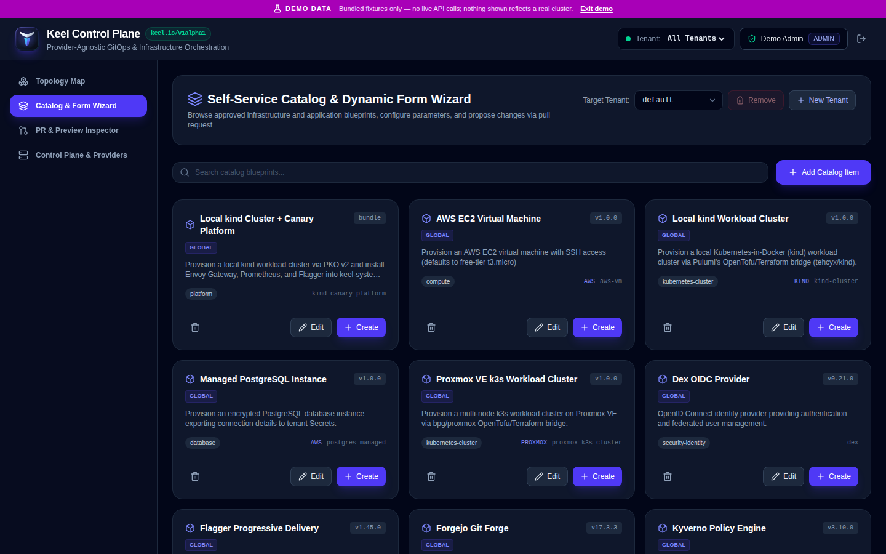

# Catalog & Blueprint Overview

Keel's self-service catalog is stored directly in your GitOps repository under `catalog/`:

```text
catalog/
├── infra/
│   └── <blueprint-id>/
│       ├── catalog.yaml    # CatalogInfraBlueprint (keel.io/v1alpha1)
│       └── Pulumi.yaml     # Pulumi YAML / OpenTofu program
├── apps/
│   └── <app-id>/
│       └── catalog.yaml    # CatalogApplication (keel.io/v1alpha1)
└── bundles/
    └── <bundle-id>/
        └── catalog.yaml    # CatalogBundle (keel.io/v1alpha1)
```

## Built-in Starter Applications

On a fresh repository (one without its own `catalog/apps/`, `catalog/infra/` or `catalog/bundles/`), `keel bootstrap init` seeds the whole built-in catalog shipped in the Keel source tree under `deploy/catalog/`: every app below into `catalog/apps/`, every infrastructure blueprint into `catalog/infra/` and every bundle into `catalog/bundles/`. Any tenant can install the apps from **Catalog & Form Wizard**:

| ID | Name | Runtime | Notes |
| :--- | :--- | :--- | :--- |
| `podinfo` | Podinfo Microservice | `helm` | Canary-capable demo app (Flagger + Envoy Gateway) |
| `cert-manager` | cert-manager | `helm` | Workload clusters only (`scope: cluster`) |
| `dex` | Dex OIDC Provider | `helm` | Tenant-owned Dex. Workload clusters only (`scope: cluster`): the chart renders a `ClusterRole`/`ClusterRoleBinding` |
| `rauthy` | Rauthy OIDC Provider | `manifest` (Flux) | Tenant-owned single-node Rauthy. Four required secret fields are SOPS-encrypted per tenant. Exposed through an `HTTPRoute` on the shared `keel-ingress` Gateway ([walkthrough](../getting-started/things-to-try.md#8-deploy-a-self-service-rauthy-oidc-provider-rauthy)) |
| `forgejo` | Forgejo Git Forge | `helm` | Tenant-owned Forgejo (one rootless replica, SQLite, persistent volume on by default). Required admin password and optional OIDC login sources (client secrets) are SOPS-encrypted. Optional `HTTPRoute` on `keel-ingress` |
| `seaweedfs` | SeaweedFS S3 Storage | `helm` | Tenant-owned S3 storage (master, volume, filer and authenticated S3 gateway on PVCs). Required S3 admin keys are SOPS-encrypted. Optional buckets and S3 `HTTPRoute` on `keel-ingress` |
| `kyverno` | Kyverno Policy Engine | `helm` | Workload clusters only (`scope: cluster`). Kyverno for the cluster's own policies, CEL `policies.kyverno.io` CRDs only |
| `pulumi-kubernetes-operator` | Pulumi Kubernetes Operator | `helm` | Workload clusters only (`scope: cluster`). PKO v2 for the cluster's own Pulumi `Stack`s |
| `flux2` | Flux CD | `helm` | Workload clusters only (`scope: cluster`). Flux for a cluster that runs its own GitOps, multi-tenancy lockdown on by default |
| `envoy-gateway` | Envoy Gateway | `helm` | Workload clusters only (`scope: cluster`). Gateway API implementation used for canary traffic shifting |
| `prometheus` | Prometheus | `helm` | Workload clusters only (`scope: cluster`). Metrics for Flagger canary analysis |
| `flagger` | Flagger Progressive Delivery | `helm` | Workload clusters only (`scope: cluster`). Canary controller (Envoy Gateway + Prometheus) |
| `authentik` | Authentik Identity Provider | `helm` | Tenant-owned authentik. Workload clusters only (`scope: cluster`): the chart renders a `ClusterRole`/`ClusterRoleBinding` |
| `http-echo-manifest` | HTTP Echo Raw Manifest | `manifest` | Parameterized raw Kubernetes manifest template, deployable with the Flux or Pulumi engine ([walkthrough](../getting-started/things-to-try.md#6-deploy-a-parameterized-kubernetes-manifest-template-http-echo-manifest)) |
| `keel-server` | Keel Control Plane (Workload Cluster) | `manifest` (Flux) | Workload clusters only (`scope: cluster`). A separate Keel (API, portal, PR + preview workflow) for a team's own GitOps repository, OIDC client and admin group. Git token and OIDC client secret are SOPS-encrypted. See [Keel Control Plane for a Workload Cluster](keel-server.md) |

The seeded infrastructure blueprints are `kind-cluster`, `proxmox-k3s-cluster`, `aws-eks-cluster`, `gcp-gke-cluster`, `azure-aks-cluster`, `aws-vm`, `gcp-vm`, `azure-vm`, `postgres-managed` and `canary-gateway-config`. A blueprint only appears in the catalog once its provider is enabled (see [How Provider Blueprints Work](#how-provider-blueprints-work)); blueprints using the built-in `kubernetes` provider, such as `canary-gateway-config`, are always listed. The seeded bundles are `kind-with-podinfo`, `kind-canary-platform` and `canary-core-addons`.

The tenant `rauthy`, `forgejo` and `seaweedfs` apps are separate from Keel's own management plane. `catalog/core/rauthy`, `catalog/core/forgejo` and `catalog/core/s3-state-backend` describe the protected management-plane IdP, forge and state backend in `keel-system`. Admins manage them from the Topology Map, and they never appear in the tenant catalog. Each tenant app reuses its management twin's known-good install config, adapted for a `restricted` tenant namespace, and pins the same version (`ghcr.io/sebadob/rauthy` tag, `forgejo` chart `17.3.3`, `seaweedfs` chart `4.54.0`). Tests fail when a pair drifts, so a version bump updates `catalog/core/<id>`, `catalog/apps/<id>`, the seed Flux object in `deploy/seed/core-addons/` and the Stage 0 Pulumi program together.

The `kyverno`, `pulumi-kubernetes-operator` and `flux2` apps are workload-cluster twins of the management operators of the same ID in `catalog/core/`. They pin the same chart version (`kyverno` `3.10.0`, `pulumi-kubernetes-operator` `2.10.1`, `flux2` `2.20.0`) and reuse the seed install config. Each installs cluster-wide CRDs, `ClusterRole`s and, for Kyverno, admission webhooks, so it is `scope: cluster`: pick a workload cluster. Each one always installs into its own dedicated namespace (`spec.placement.namespace`: `kyverno`, `pulumi-kubernetes-operator`, `flux-system`), which the Deploy dialog shows read-only. Any other `targetNamespace`, including the tenant's shared `tenant-<id>`, is rejected (`400`). In `tenant-<id>` the Flux chart's namespace-wide `NetworkPolicy`s would cut off ingress to the tenant's other apps, and Kyverno would exempt every other workload there from its policies. The form is the whole interface: every other chart value is rejected (`400`).

The `cert-manager`, `envoy-gateway`, `flagger` and `prometheus` apps (the last three are what the `kind-canary-platform` and `canary-core-addons` bundles install) are workload-cluster twins of the management add-ons of the same ID. They pin the same chart version (`cert-manager` `v1.21.3`, `envoy-gateway` `v1.10.0`, `flagger` `1.45.0`, `prometheus` `29.48.0`), and their form defaults mirror the management install values in `deploy/seed/core-addons/`. Envoy Gateway and Flagger ship their CRDs in the chart's `crds/` directory, so both entries set `spec.crdPolicy: CreateReplace`, like the management `HelmRelease`s. A version bump then also updates the CRDs of existing installs. Every Helm twin's four version pins carry a `# renovate:` annotation, so one Renovate PR per chart bumps them together.

The `keel-server` app is the workload-cluster twin of `catalog/core/keel-server`. It pins the same `ghcr.io/rdylanwalker/keel` release (the `keel` crate version; semantic-release bumps `catalog/core/keel-server`, `catalog/apps/keel-server` and its `manifests.yaml` together in the Keel source tree, and a test fails on drift) and reuses the management add-on's RBAC, Deployment and HTTPRoute, with Kyverno writes narrowed and a native admission policy in place of Keel's Kyverno `protect-control-plane` rule. Your GitOps repository keeps the copy seeded at bootstrap, so a Keel release does not upgrade installed instances by itself: see [Upgrade](keel-server.md#upgrade). Its prerequisites (Flux and PKO on the workload cluster, the team's Keel GitOps repository, a Gateway, an OIDC client) are listed on [its page](keel-server.md).

- **One install per cluster.** Each operator owns its CRDs cluster-wide and watches every namespace. Do not install a second instance on the same cluster, and do not install one on a cluster that already runs that operator (for example a cluster bootstrapped with `flux bootstrap`, or a managed Kyverno add-on). For Kyverno and Flux, Helm refuses to adopt CRDs owned by another release. PKO's CRDs come from the chart's `crds/` directory with `CreateReplace`, so a second PKO install silently overwrites the existing PKO CRDs with its own version, and both operators reconcile the same `Stack`s.
- **Kyverno:** only the CEL `policies.kyverno.io` CRDs are installed, as on the management cluster. The deprecated `kyverno.io` `ClusterPolicy`/`Policy` kinds are not. Keel's own policies are not installed: the cluster's teams bring theirs. `PolicyException`s are off by default. When on, Kyverno only accepts them from its own `kyverno` namespace (a locked value, not a form field, so it can never be empty or `*`, which would accept exceptions from every namespace). Anyone who can write there can exempt workloads from policies, so keep that namespace admin-only. Kyverno never enforces policies in its own namespace (`config.excludeKyvernoNamespace`), so run nothing else there. Use 3 admission controller replicas for high availability.
- **Pulumi Kubernetes Operator:** the operator runs with the management plane's hardened container security context (no privilege escalation, all capabilities dropped, `RuntimeDefault` seccomp, non-root). Its CRDs are in the chart's `crds/` directory, so the entry sets `spec.crdPolicy: CreateReplace` and a version bump also updates them. Keel's management-only parts (preview ServiceAccounts, the `restrict-pulumi-providers` policy, the S3 state backend) are not installed. `Stack`s on the workload cluster need their own state backend and credentials.
- **Flux CD:** use it when a workload cluster runs its own GitOps for the teams on it: their `GitRepository`, `Kustomization` and `HelmRelease` objects, reconciled inside that cluster from their own repositories. Keel's management Flux keeps managing this release from the management cluster through the tenant's kubeconfig Secret. It never creates Flux objects on the workload cluster (remote `HelmRelease`s and `Kustomization`s stay on the management cluster), so the two Flux installs do not share CRDs or objects. The release only installs the controllers: add a sync (`GitRepository` + `Kustomization`) yourself. The multi-tenancy lockdown is on by default, like on the management cluster: every Flux controller gets `--no-cross-namespace-refs=true`, and the kustomize and helm controllers also get `--default-service-account=default`. The controllers keep cluster-admin (`privileged: true`) so they can impersonate each team's ServiceAccounts. *Enable Multi-Tenancy Lockdown* is a required field: Keel does not fill in schema defaults on the server, so an API or CLI request must send `multitenancy.enabled` (`422` otherwise). Turn it off only on single-team clusters. The chart's default `NetworkPolicy`s (`allow-egress`, `allow-scraping`, `allow-webhooks`) apply to every pod in `flux-system`, which is Flux's standard layout. The Flux CRDs keep `helm.sh/resource-policy: keep`, so removing the app leaves them, and every Flux object on the cluster, in place. Delete them by hand if you want them gone.

Notes on the Helm twins:

- **Forgejo:** Forgejo reserves the username `admin`. Leave *Public Root URL* empty to derive `https://<hostname>`; on the local `kind` Gateway set `https://git-<tenant>.keel.local:8888/`. The *OpenID Connect Login Sources* list is one secret field (it carries client secrets): on **Edit**, leave it empty to keep the stored sources or re-enter all of them. The discovery URL must be reachable from the pod and serve a certificate the Forgejo image trusts; the local `kind` CA is not trusted, and tenant hostnames are not resolvable inside the cluster unless your DNS resolves them.
- **SeaweedFS:** generate keys with `openssl rand -hex 10` (access key) and `openssl rand -base64 30` (secret key). Inside the cluster the S3 endpoint is `http://<fullname>-s3.tenant-<tenant>.svc:8333`. `<fullname>` is the instance name, followed by `-seaweedfs` unless the name already contains `seaweedfs` (the default instance `seaweedfs` serves `seaweedfs-s3`). Through the optional route it is `https://<hostname>`. Change *ServiceAccount Name* when running a second instance in the same tenant namespace.
  - On the management cluster, Keel's NetworkPolicy admits any pod of the same tenant namespace to port 8333. The tenant namespace denies all egress by default, though, so a consumer pod also needs its own egress rule to the S3 pods on 8333 (Keel only generates egress rules for apps whose catalog entry declares them). Other tenants cannot reach the endpoint.
  - Only the S3 gateway can be routed. The master, filer, volume and admin APIs have no authentication, so their routes and ingresses stay off, as do the optional admin, SFTP, worker, COSI and vector components.
- **Both apps:**
  - The form is the whole interface. Keel rejects (`400`) values that the catalog schema does not declare, such as `extraDeploy`, sidecars, extra routes or a ServiceAccount override, and any value naming the tenant reconciler ServiceAccount `tenant-<id>-sa`.
  - Volume sizes, storage classes and the Forgejo claim name are fixed after install. Kubernetes cannot change StatefulSet volume claim templates, and a PVC can only grow on a StorageClass with `allowVolumeExpansion`. An **Edit** that changes them is rejected (`400`). To grow a volume, expand the PersistentVolumeClaim by hand (`kubectl -n tenant-<tenant> patch pvc <claim> -p '{"spec":{"resources":{"requests":{"storage":"30Gi"}}}}'`) and keep the form value unchanged.
  - Routes attach to the management cluster's `keel-ingress` Gateway. When installing into a remote workload cluster, turn the route off (Keel rejects an enabled route there with `400`) and expose the app through that cluster's own ingress.
  - Both charts keep their PersistentVolumeClaims when the app is removed (Forgejo: `helm.sh/resource-policy: keep`; SeaweedFS: StatefulSet volume claims). SeaweedFS also keeps the `<fullname>-s3-secret` Secret, which holds the admin and read-only S3 keys in plaintext. Delete the claims and that Secret by hand. The chart recreates the Secret on every upgrade: the admin identity comes from your keys and stays the same, but the read-only identity gets new random keys each time.

## How Provider Blueprints Work

Enabling a provider on the **Control Plane & Providers** tab updates `providers/registry.yaml`. That registry acts as an allowlist:

- `GET /api/v1/catalog` scans `catalog/infra/*/catalog.yaml` and returns only blueprints whose `metadata.provider` is `enabled: true` in `providers/registry.yaml`.
- Enabling a provider does **not** auto-generate blueprints; you add the exact `CatalogInfraBlueprint` compositions (`catalog.yaml` + `Pulumi.yaml`) your organization wants to offer.



## `CatalogInfraBlueprint` Schema (`keel.io/v1alpha1`)

```yaml
apiVersion: keel.io/v1alpha1
kind: CatalogInfraBlueprint
metadata:
  id: my-blueprint
  name: Human-Readable Name
  description: Short description shown in the catalog
  category: kubernetes-cluster # or database, networking, compute, edge
  provider: aws # must match a provider id in providers/registry.yaml
spec:
  pulumiRuntime: yaml
  entrypoint: Pulumi.yaml
  protectByDefault: false
  outputs:
    - endpoint
  schema:
    type: object
    required:
      - name
    properties:
      name:
        type: string
        title: Resource Name
        default: prod-cluster
      apiToken:
        type: string
        title: API Token
        format: password
        writeOnly: true # encrypted with SOPS + age before committing
  uiSchema:
    apiToken:
      ui:widget: password
```

### Secret Partitioning (`writeOnly: true` / `format: password`)

Any schema property marked with `writeOnly: true` or `format: password` is automatically partitioned out of plaintext `values.yaml` / `Stack.spec.config` and encrypted into a SOPS-encrypted Kubernetes `Secret` (named `<instance-name>-secrets`) using the tenant's `age` public key before staging to Git. Infrastructure blueprints commit it as `secret.enc.yaml`; Helm apps as `secrets.enc.yaml` (see [Helm app secrets](#helm-app-secrets-routes-and-networkpolicy)); Flux manifest apps as `config/secrets.enc.yaml`.

For infrastructure blueprints (`CatalogInfraBlueprint`), Keel also binds each partitioned secret key to `Stack.spec.envRefs` using the **exact schema property name** as the environment variable name inside the PKO v2 workspace pod. Name credential properties after the environment variable expected by the Pulumi/OpenTofu provider (for example, `AWS_ACCESS_KEY_ID`, `AWS_SECRET_ACCESS_KEY`, `GOOGLE_CREDENTIALS`, `HCLOUD_TOKEN`, or `CLOUDFLARE_API_TOKEN`).

## `CatalogApplication` Schema (`keel.io/v1alpha1`)

Upstream Helm charts, Kustomize bases, and raw Kubernetes manifest templates work **without structural modification**. A thin `catalog.yaml` sidecar defines the source and a JSON Schema that renders into standard `values.yaml` overrides or manifest template variables:

```yaml
apiVersion: keel.io/v1alpha1
kind: CatalogApplication
metadata:
  id: podinfo
  name: Podinfo
  category: web
  runtime: helm # helm | kustomize | manifest
spec:
  upstream:
    repoUrl: https://stefanprodan.github.io/podinfo
    chart: podinfo
    version: 6.7.1
  progressiveDelivery:
    supported: true
    defaultPort: 9898
  schema:
    type: object
    properties:
      replicaCount:
        type: integer
        title: Replicas
        default: 2
```

### Placement (`spec.placement.scope`)

`spec.placement.scope` declares where an application may be installed:

| Scope | Meaning | Allowed targets |
| :--- | :--- | :--- |
| `namespaced` (default when `placement` is omitted) | The app creates only namespaced objects. | The tenant namespace on the management cluster, or a remote workload cluster. |
| `cluster` | The app installs cluster-scoped resources: CRDs, `ClusterRole`/`ClusterRoleBinding`s or admission webhooks. | Remote workload clusters only (`targetCluster`). |

```yaml
spec:
  placement:
    scope: cluster # namespaced | cluster
    namespace: flux-system # optional, scope: cluster only
```

`spec.placement.namespace` gives a `scope: cluster` app a dedicated install namespace on the workload cluster, for operators that must not share a namespace with other apps. A proposal or bundle item without `targetNamespace` installs there, and any other `targetNamespace` is rejected (`400`). It must be a DNS label and cannot be a `tenant-` namespace. The Deploy dialog shows it read-only.

`spec.placement.additionalNamespaces` (`runtime: manifest` only, requires `namespace`) lists further namespaces a manifest app spans on the workload cluster, for example the built-in `keel-server` (`namespace: keel-system`, `additionalNamespaces: [keel-previews, flux-system]`). Keel then creates every listed namespace before the app and sets no Flux `targetNamespace`, which would otherwise move every object into one namespace. In exchange, every namespaced object of the rendered manifests must set `metadata.namespace` to one of the listed namespaces: a proposal with any other or a missing namespace is rejected (`400`). Entries must be DNS labels, unique, and not `tenant-` namespaces. Only the Flux engine supports such apps (`400` for `actionEngine: pulumi`).

Cluster-scoped apps never target the management cluster. Its tenant namespaces run under namespace-scoped RBAC, and the management plane already runs its own copy of these controllers from `catalog/core/` (two cert-manager or Envoy Gateway installs would fight over the same CRDs and webhooks).

Placement is a declarative guard declared by the catalog author. It gives early, clear `400`s and UX hints, but it is not the security boundary: a tenant admin can author their own app without `placement`. What actually blocks cluster-scoped objects on the management cluster is that tenant Flux and PKO objects impersonate `tenant-<id>-sa`, which only holds a namespace-scoped `ClusterRole/admin` RoleBinding (see [Flux multitenancy lockdown](../operations/security-and-tenancy.md#multi-tenant-isolation)).

- **Proposals** (`POST /api/v1/tenants/{tenant}/proposals`) for a `scope: cluster` app without a remote `targetCluster` (absent, empty or `local`) are rejected with `400`.
- **Manifest apps:** a `scope: namespaced` `runtime: manifest` app whose `manifests.yaml` declares well-known cluster-scoped kinds (`Namespace`, `CustomResourceDefinition`, `ClusterRole`/`ClusterRoleBinding`, admission webhooks and policies, `PriorityClass`, `StorageClass`, `IngressClass`, `GatewayClass`, ...) is rejected with `400` when registered or edited (set `placementScope: cluster`). A Git-authored one is rejected at proposal time, after rendering, when it targets the management cluster.
- **Bundles:** a `scope: cluster` app item needs `targetClusterFrom` or a remote request `targetCluster`. Otherwise the proposal is rejected with `400`. Registering or editing a bundle through the catalog API requires `targetClusterFrom` on such items (`400` otherwise), because the GUI deploys bundles without a request `targetCluster`. The seeded `canary-core-addons` bundle (Envoy Gateway, Prometheus, Flagger without a cluster item) can therefore only be proposed through the API with a remote `targetCluster`. Use `kind-canary-platform` from the GUI.
- **Deploy dialog:** a cluster-scoped app does not offer *Management Cluster (local)*. Only the target tenant's workload clusters are listed, since a remote `kubeConfig.secretRef` resolves in the release's own `tenant-<id>` namespace. Switching tenant clears a cluster that belongs to another tenant. New deployments preselect the tenant's first workload cluster. Edits never preselect one, so a release without a recorded target is never silently moved. The dialog explains why and blocks submission until a remote cluster or custom kubeconfig Secret is chosen.
- **Catalog Wizard:** tick *Installs cluster-scoped resources* to author `scope: cluster`.

The built-in `cert-manager`, `envoy-gateway`, `flagger`, `prometheus`, `dex`, `authentik`, `kyverno`, `pulumi-kubernetes-operator`, `flux2` and `keel-server` apps are `scope: cluster`. `helm template` of their pinned charts with default values shows they install CRDs, webhooks or `ClusterRole`s (`keel-server` ships its `ClusterRole`s in `manifests.yaml`). Prometheus has no CRDs, but its server and kube-state-metrics both create `ClusterRole`/`ClusterRoleBinding`s for cluster-wide scraping. Dex (`rbac.createClusterScoped: true`, used by its Kubernetes CRD storage) and authentik (`serviceAccount.create: true`, used by managed outposts) each render a `ClusterRole`/`ClusterRoleBinding`; turning those off would break those features.

### Helm App Secrets, Routes and NetworkPolicy

These apply to `runtime: helm` apps (single apps and bundle items):

- **Secret fields** are committed as `secrets.enc.yaml` in the app directory: one key per submitted secret field, named after its dot path (for example `gitea.admin.password`) and holding a Helm values fragment. The file is listed in the tenant repository's `tenants/<id>/kustomization.yaml`, so the tenant's `keel-tenant-root` Kustomization decrypts it with the tenant's `sops-age` key and applies it in the tenant namespace on the management cluster. The `HelmRelease` merges each key through `spec.valuesFrom` (`valuesKey: <path>`), so neither Git nor the `HelmRelease` object ever holds the plaintext, and remote workload clusters work too. A secret field left blank on **Edit** keeps its stored value. Secret fields inside lists are rejected; mark the whole list `writeOnly` instead.
- **`spec.gatewayRoutes`** declares the Gateway API routes the chart renders from its own values:

  ```yaml
  spec:
    gatewayRoutes:
      - enabledValue: httpRoute.enabled      # optional boolean value path
        hostnamesValue: httpRoute.hostnames  # string or list of hostnames
        parentRefsValue: httpRoute.parentRefs
  ```

  An enabled route needs at least one hostname (a route without hostnames would catch every host on the shared listeners). Hostnames get the same checks as manifest app routes: platform hosts are rejected (`400`) and hostnames already routed by another app are rejected (`409`). Keel overwrites `parentRefsValue` with both HTTPS listeners of `keel-system/keel-ingress` and records the hostnames in the `keel.io/route-hostnames` annotation of the `HelmRelease`.
  Routes only exist on the management cluster: an enabled route on a remote `targetCluster` is rejected (`400`).
- **`spec.networkPolicy`** makes Keel commit `networkpolicy.yaml` for the release's pods (`app.kubernetes.io/instance: <release>`) through the tenant's `default-deny-all`. DNS egress is always allowed. Installs on a remote workload cluster get no policy. The options are:
  - `gatewayIngressPorts`: ingress from the Envoy proxies in `keel-system` on these ports.
  - `namespaceIngressPorts`: ingress from any pod of the same tenant namespace on these ports. The consumer pods still need their own egress rule.
  - `releaseTraffic`: traffic between the release's own pods.
  - `gatewayEgress`: egress to the `keel-ingress` Envoy proxy pods only (label `gateway.envoyproxy.io/owning-gateway-name: keel-ingress`, container ports 10080, 10443 and 8888), for example to reach an OIDC issuer routed there. Other `keel-system` workloads, such as the state backend or the management forge, stay unreachable.
  - `publicEgress`: egress to public IPv4 addresses on TCP 80 and 443. Private (RFC 1918), CGNAT, link-local, loopback, `0.0.0.0/8`, multicast and reserved ranges are excluded.
- **`spec.lockedValues`** are chart values merged over the form values into `HelmRelease.spec.values`. Use them for settings the form must not drop or change, such as restricted Pod Security contexts or turning off cluster-scoped RBAC. `values.yaml` keeps only the form values.
- **Strict values:** an entry with `spec.lockedValues` or `spec.gatewayRoutes` only accepts values its schema declares. Every object schema counts as `additionalProperties: false` unless it sets `additionalProperties` itself. Anything else is rejected (`400`), because upstream charts accept far more values than the form exposes (extra routes, `extraDeploy`, sidecars, ServiceAccounts). Every Helm app also rejects values naming the tenant reconciler ServiceAccount `tenant-<id>-sa`.
- **`spec.immutableValues`** lists create-only value paths, such as volume sizes and storage classes that end up in StatefulSet `volumeClaimTemplates`. An **Edit** that changes one of them compared to the committed `values.yaml` is rejected (`400`) instead of committing an upgrade that can never succeed.
- **`spec.crdPolicy`** (`Skip`, `Create` or `CreateReplace`) sets `install.crds` and `upgrade.crds` of the generated `HelmRelease`. It only affects CRDs in the chart's `crds/` directory. Without it, Flux creates them on install and never updates them on upgrade, so charts that ship CRDs there (like the Pulumi Kubernetes Operator) declare `CreateReplace`.

## Raw Kubernetes Manifests & Templates (`runtime: manifest`)

For teams deploying raw Kubernetes manifests or parameterized YAML templates instead of packaging a Helm chart, Keel provides native `runtime: manifest` catalog entries.

### Directory Layout & Schema

A raw manifest catalog entry is stored under `catalog/apps/<id>/` with two files:

```text
catalog/apps/http-echo-manifest/
├── catalog.yaml       # CatalogApplication metadata, defaultEngine & JSON Schema
└── manifests.yaml     # Multi-document Kubernetes YAML with ${var} placeholders
```

#### `catalog.yaml`
```yaml
apiVersion: keel.io/v1alpha1
kind: CatalogApplication
metadata:
  id: http-echo-manifest
  name: HTTP Echo Server
  description: Parameterized HTTP echo deployment and service template
  category: web
  runtime: manifest
spec:
  defaultEngine: flux # flux | pulumi
  schema:
    type: object
    required: [app_name, port, message]
    properties:
      app_name:
        type: string
        title: Application Name
        default: http-echo
      port:
        type: integer
        title: Service Port
        default: 8080
      message:
        type: string
        title: Echo Message
        default: "Hello from Keel Manifest!"
      secret_api_key:
        type: string
        title: Secret API Key
        format: password
        writeOnly: true # Encrypted via SOPS + age before staging
```

#### `manifests.yaml`
```yaml
apiVersion: apps/v1
kind: Deployment
metadata:
  name: ${app_name:=http-echo}
spec:
  replicas: 1
  selector:
    matchLabels:
      app: ${app_name:=http-echo}
  template:
    metadata:
      labels:
        app: ${app_name:=http-echo}
    spec:
      containers:
        - name: echo
          image: hashicorp/http-echo:0.2.3
          args:
            - "-listen=:${port:=8080}"
            - "-text=${message:=hello}"
          ports:
            - containerPort: ${port:=8080}
---
apiVersion: v1
kind: Service
metadata:
  name: ${app_name:=http-echo}
spec:
  ports:
    - port: ${port:=8080}
      targetPort: ${port:=8080}
  selector:
    app: ${app_name:=http-echo}
```

### Template Placeholder Syntax (`${var_name}` / `${var_name:=default}`)
- `${var_name}`: Replaced by the variable value provided in the dynamic form or CLI.
- `${var_name:=default_value}`: Replaced by the variable value if provided, or falls back to `default_value`.
- This placeholder syntax matches standard Kubernetes `envsubst` and Flux CD post-build variable substitution, ensuring portability across execution engines.

### Auto-Extracting Schema Fields in the Catalog Wizard
In the Web UI (**Catalog & Form Wizard → + Add Catalog Item → Application → Manifest**), you can paste or type your raw Kubernetes YAML directly into the manifest editor and click **"Auto-Extract Variables to Schema"**. Keel scans the YAML tokens, finds all `${var_name}` and `${var_name:=default}` patterns, and automatically populates `spec.schema.properties` with appropriate types, titles, and defaults—instantly generating a Shadcn UI form without writing JSON Schema by hand.

### SOPS Secret Partitioning
Properties marked `"writeOnly": true` or `"format": "password"` are automatically partitioned from non-secret variables:
- In the **Flux engine path**, non-secret variables are written to `config/values-configmap.yaml` (`kind: ConfigMap`, `<instance>-values`), while secret variables are encrypted with the tenant's `age` key into `config/secrets.enc.yaml` (`kind: Secret`, `<instance>-secrets`). A separate `<instance>-config` Flux `Kustomization` (`config-kustomization.yaml`) applies both in the tenant namespace of the management cluster, decrypting the Secret with the tenant `sops-age` Secret (`spec.decryption`, `provider: sops`). The app `Kustomization` (`flux-kustomization.yaml`) `dependsOn` `<instance>-config` and substitutes from both with `optional: false`, so the values exist before the first reconcile. Leave secret placeholders (`${secretField}`) in the template: Flux substitutes them at reconcile time, so they never appear in Git. Secret fields in manifest templates are supported only by the Flux engine (Keel rejects `engine: pulumi`). Remote `targetCluster`s work: the Secret stays on the management cluster, but the substituted values reach the workload cluster inside the rendered manifests, as Helm values would. Remote apps also get a `namespace.yaml` that creates the target namespace first. Plaintext secret values must not contain `${`, since Flux also substitutes the decrypted Secret. On **Edit**, a secret field left blank keeps its stored value (Keel keeps or re-encrypts the committed Secret); fill in only the secrets you want to change. Bundle items that reference a manifest app cannot set `canary: true` or `bindValues` (Helm apps only).
- **Instance names:** Keel derives Flux `Kustomization` names from instance names (`<name>`, `<name>-config` for manifest apps and bundle items, `<name>-canary`, and `<bundle>-<item>` for bundle items). A proposal is rejected with `409` when one of them is already used by another instance of the tenant, or when a new instance is named `<other>-config`/`<other>-canary` of an existing instance (or the other way round).
- **Route hostnames:** a manifest app's `HTTPRoute`/`GRPCRoute` hostnames must be concrete at proposal time, must not be (or wildcard-cover) a platform host (`idp.`/`keel.`/`forgejo.` under the Keel domain or the configured IdP host), and must not already be routed by another committed app (in any tenant's repository; if a tenant repository cannot be read, the proposal fails with `503` and can be retried). The Kyverno policy `restrict-tenant-route-hostnames` enforces the platform-host rule at admission. Tenant ServiceAccounts get `httproutes`/`grpcroutes` through `ClusterRole/keel-tenant-gateway-routes` (aggregated into `admin`).
- In the **Pulumi engine path**, secret variables are encrypted into `secrets.enc.yaml` and bound via `Stack.spec.envRefs`.

### Choosing Between Execution Engines (`Flux` vs. `Pulumi`)
Operators can define `spec.defaultEngine: flux | pulumi` in `catalog.yaml` and override the engine at deploy time in the UI Deploy Modal or CLI (`keel app install --engine flux|pulumi`):

| Feature | Flux CD Engine (`flux`) | Pulumi PKO v2 Engine (`pulumi`) |
| :--- | :--- | :--- |
| **Generated Manifests** | `manifests.yaml`, `config/values-configmap.yaml`, `config/secrets.enc.yaml`, `config-kustomization.yaml`, `flux-kustomization.yaml` | `Pulumi.yaml` (`ConfigGroup`), `stack.yaml`, `secrets.enc.yaml` |
| **Reconciler** | `kustomize-controller` via `postBuild.substituteFrom` | `pulumi-kubernetes-operator` (PKO v2) |
| **Pre-Merge Previews** | Git unified diff in PR | Ephemeral PKO `Stack` (`spec.preview: true`) with exact resource-level diffs (`+`/`~`/`-`) |
| **Tenant Git source** | The app `Kustomization`s use the tenant's `tenant-<id>/keel-gitops` `GitRepository`, which points at the tenant's own repository | The `Stack` clones the tenant's own repository (PKO `gitSource`) with the tenant's read-only credential |
| **Best For** | Lightweight, direct Kubernetes reconciliation with zero IaC runner overhead | Applications requiring pre-merge Kubernetes resource diff previews or unified multi-cloud coordination |

Every tenant, including those created through `POST /api/v1/tenants`, has its own repository and Git source, so both engines work for every tenant. Only the development-only Local Git provider gives API-created tenants no Git source; there they can install Helm apps only (see [Pre-Merge PKO Previews](../getting-started/previews.md#limitations)).

## `CatalogBundle` Schema (`keel.io/v1alpha1`)

A `CatalogBundle` composes multiple infrastructure blueprints and applications into an ordered dependency graph deployed atomically in a single PR. Flux `Kustomization` `dependsOn` + `healthChecks` ensure downstream items wait until upstream infrastructure is `Ready`, and `targetClusterFrom` wires an application's `kubeConfig` directly to a provisioned workload cluster `Secret`:

```yaml
apiVersion: keel.io/v1alpha1
kind: CatalogBundle
metadata:
  id: kind-with-podinfo
  name: Kind Cluster + Podinfo
  description: Provision a local kind workload cluster and deploy Podinfo onto it
  category: Platform
spec:
  items:
    - id: cluster
      kind: infra
      catalogRef: kind-cluster
    - id: app
      kind: app
      catalogRef: podinfo
      dependsOn:
        - cluster
      targetClusterFrom: cluster
      targetNamespace: apps
```

## Adding & Editing Catalog Items

You can register or update blueprints, applications, and bundles in two ways:

1. **Web UI (+ Add Catalog Item / Edit):**
   - In **Catalog & Form Wizard**, click **+ Add Catalog Item**, choose **Application (Helm / Kustomize)**, **Infrastructure Blueprint (PKO v2)**, or **Multi-Item Bundle (Infra + Apps)**, and fill in the fields. For infrastructure blueprints, you can paste or generate `Pulumi.yaml`, click **Derive from Pulumi.yaml** to auto-populate form fields from `config:`, click **+ Add \<provider\> Credentials** to add `writeOnly: true` / `format: password` credential fields, and customize fields in the **Form Fields** builder or **JSON Schema** editor before opening the PR.
   - Select any existing catalog item and click **Edit** in the item header to update its metadata, upstream/provider settings, bundle steps, optional JSON Schema, or—for infrastructure blueprints—its `Pulumi.yaml` program via a Git PR (`PUT /api/v1/catalog/{kind}/{id}`). Leave **Pulumi.yaml Program** blank when editing to preserve the existing `Pulumi.yaml`.
2. **Direct Git PR:** Commit `catalog/infra/<id>/catalog.yaml` (+ `Pulumi.yaml`), `catalog/apps/<id>/catalog.yaml`, or `catalog/bundles/<id>/catalog.yaml` (see [Provider Blueprint Examples](provider-examples.md)) on a feature branch and open a PR.
