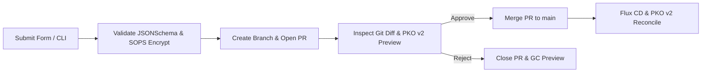
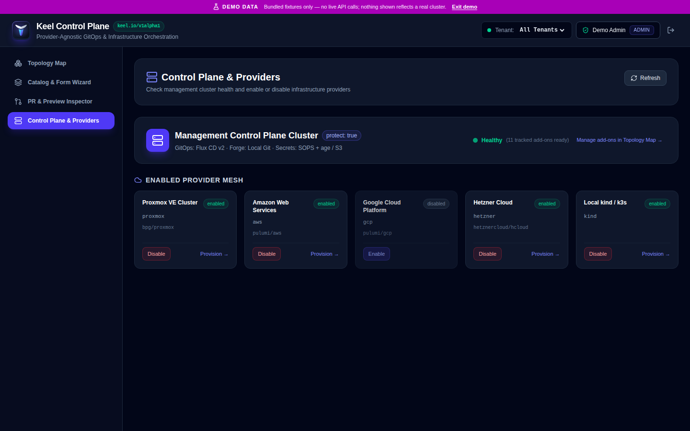
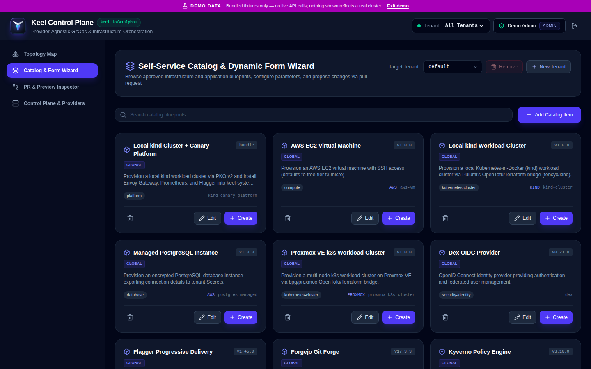
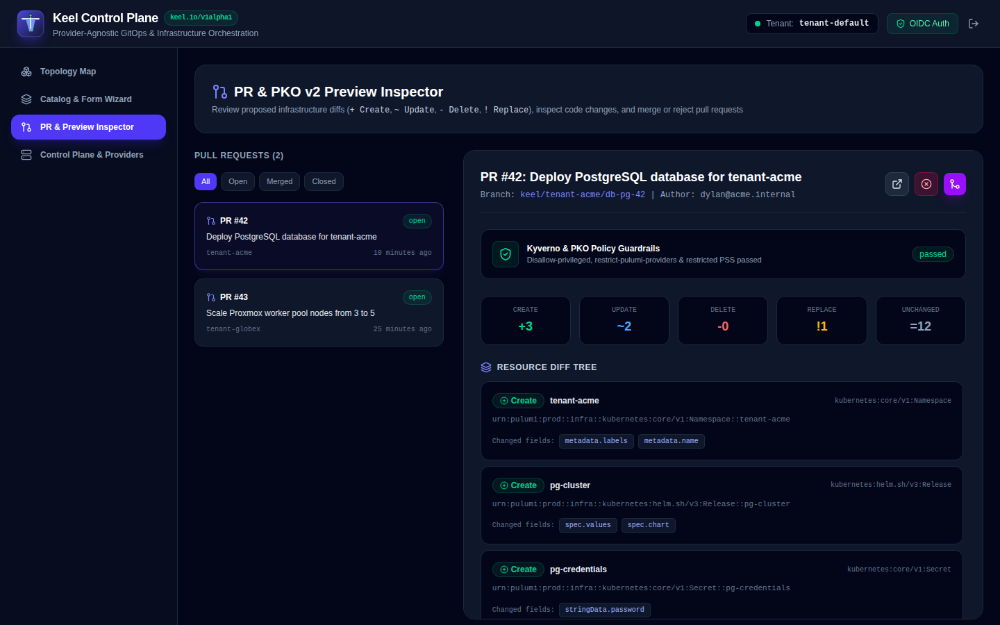
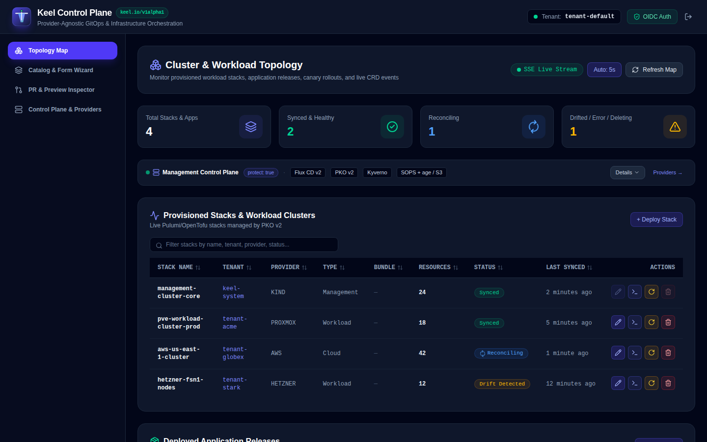

# Provisioning Workflow

After Stage 0 bootstrap, **every** infrastructure, provider, tenant, catalog, and application mutation follows a **PR-first GitOps workflow**. The control plane never commits directly to `main`.



## 1. Enable an Infrastructure Provider

Infrastructure blueprints in `catalog/infra/` are gated by `providers/registry.yaml`.

1. Open **Control Plane & Providers** in the web portal.
2. Locate the provider card (for example, **kind**, **Proxmox VE**, **AWS**, **GCP**, **Azure**, **Hetzner**, or **Cloudflare**).
3. Click **Enable** to open a PR updating `providers/registry.yaml`.
4. Click **Go to PR** and merge the PR in **PR & Preview Inspector**.

> **Tip — Local `kind` provider:** `kind` is enabled by default in `providers/registry.yaml` so you can provision local workload `kind` clusters immediately.



## 2. Create a Tenant

Stage 0 creates the `default` tenant (`tenant-default`), which the examples below use. To add another tenant (cluster admin only):

1. Open **Catalog & Form Wizard**.
2. Click **+ New Tenant**, enter a DNS-compatible tenant ID such as `platform-team`, and submit. IDs ending in `-admin` are rejected.
3. Merge the generated PR (`tenants/platform-team/rbac.yaml`). It contains the namespace, the quota and LimitRange, the tenant ServiceAccount and its RoleBindings, the `keel-server` RoleBinding, and the `default-deny-all` and `allow-pko-workspace` NetworkPolicies. All of these objects are labelled `keel.io/platform-owned`, and Kyverno stops tenant identities from changing them. `keel-server` provisions the tenant's scoped SeaweedFS identity.
4. In your IdP, create the groups `tenant-platform-team` (members) and `tenant-platform-team-admin` (tenant admins) and assign users to them. Users must sign in again to pick up new groups.

> **Current limit:** a tenant created this way doesn't have its own Git source (`tenants/<id>/git-repository.yaml`, Flux `GitRepository` `tenant-<id>/keel-gitops`) yet. It can install Helm apps, but Pulumi blueprints and Pulumi-engine apps are refused with `409 Conflict`, and Flux-engine manifest apps don't reconcile. The Stage 0 `default` tenant has a source. See [Pre-Merge PKO Previews](previews.md#limitations).

## 3. Provision Infrastructure

### Via Web UI

1. Open **Catalog & Form Wizard** and select your **Target Tenant**.
2. Choose an infrastructure blueprint (for example, **Local kind Workload Cluster**).
3. Fill in the generated form parameters and click **Submit & Open Git PR Proposal**.
4. Click **Go to PR** to open **PR & Preview Inspector**.



### Via CLI

```bash
cat <<'EOF' > /tmp/workload-dev.yaml
clusterName: workload-dev
kubernetesVersion: v1.35.8
workerCount: 1
EOF

keel infra provision \
  --blueprint kind-cluster \
  --tenant default \
  --values-file /tmp/workload-dev.yaml \
  --server http://127.0.0.1:8080
```

### Bring Your Own Workload Cluster

Cluster blueprints write a `<instance>-kubeconfig` Secret into `tenant-<id>` and prepare the new cluster for Flux. To target a cluster Keel did not provision, store its kubeconfig under the `kubeconfig` key of a Secret in `tenant-<id>` and select that Secret as the target cluster. The kubeconfig must:

- **Use inline credentials only:** `token` or `client-certificate-data`/`client-key-data`, plus `certificate-authority-data`. `exec` plugins, `auth-provider`, and file paths are rejected, and Flux controllers cannot run cloud CLIs such as `aws`, `gcloud`, or `kubelogin`.
- **Be reachable from the management cluster:** the `server` URL must resolve from the Flux controller pods.
- **Allow impersonation:** Flux impersonates `system:serviceaccount:tenant-<id>:tenant-<id>-sa` on the target cluster, so the kubeconfig identity needs `impersonate` on `serviceaccounts` (`cluster-admin` covers this).
- **Grant the tenant identity access on the target cluster:** bind `ServiceAccount tenant-<id>/tenant-<id>-sa` to the role it needs there, as the blueprints do with the `keel-tenant-flux` ClusterRoleBinding:

```bash
kubectl --context <workload-cluster> create clusterrolebinding keel-tenant-flux \
  --clusterrole=cluster-admin \
  --serviceaccount=tenant-<id>:tenant-<id>-sa
```

The namespace and ServiceAccount need not exist on the workload cluster; RBAC matches the impersonated username.

## 4. Inspect Previews & Merge

In **PR & Preview Inspector** (or via CLI):

```bash
keel preview status --pr 1 --tenant default --watch --server http://127.0.0.1:8080
```

- Review the **Git Diff** (the exact YAML manifests proposed under `tenants/<tenant>/infra/`, `tenants/<tenant>/apps/`, or `tenants/<tenant>/bundles/`).
- Review the **Resource Diff Tree** (`+ Create`, `~ Update`, `- Delete`, `! Replace`). A **source** badge shows whether it came from a real `pulumi preview` (`pko`) or was simulated (`synthesized`), and the run status shows whether the PKO preview is still pending or running. See [Pre-Merge PKO Previews](previews.md).
- Merging requires cluster admin or `tenant-<id>-admin`. The server pins the merge to the head SHA it verified.
- Click **Merge PR** to merge into `main`, or **Reject PR** to close the proposal and garbage-collect ephemeral preview resources.
- If a proposal was closed by mistake, select it (e.g., under the **Closed** or **All** tab) and click **Reopen PR** to reopen it.
- Use the status filter tabs (**Open**, **Merged**, **Closed**, **All**) to browse PR history directly from your configured Git forge.



## 5. Deploy an Application (Helm, Kustomize, or Raw Manifests)

Once a workload cluster or tenant namespace is ready:

1. Select an application blueprint (such as **Podinfo** for Helm or **HTTP Echo Server** for raw manifests) in **Catalog & Form Wizard**.
2. Configure form parameters. For raw manifest templates (`runtime: manifest`), select the **Action Engine (`Flux CD Kustomization` vs. `Pulumi PKO Stack`)** in the deploy modal.
3. Submit and merge the PR—or run via CLI:

#### Helm Chart with Canary Rollout
```bash
cat <<'EOF' > podinfo-values.yaml
replicaCount: 2
ingressHost: podinfo.keel.local
apiToken: demo-podinfo-token
EOF

keel app install \
  --app podinfo \
  --tenant default \
  --values-file ./podinfo-values.yaml \
  --canary \
  --server http://127.0.0.1:8080
```

#### Raw Kubernetes Manifest Template (`--engine flux` or `--engine pulumi`)
```bash
cat <<'EOF' > echo-values.yaml
app_name: echo-demo
port: 8080
message: "Hello from Keel Manifest Template!"
EOF

# Deploy via Flux CD Kustomization with postBuild substitution
keel app install \
  --app http-echo-manifest \
  --tenant default \
  --values-file ./echo-values.yaml \
  --engine flux \
  --server http://127.0.0.1:8080

# Or deploy via Pulumi ConfigGroup with pre-merge resource diffs
keel app install \
  --app http-echo-manifest \
  --tenant default \
  --values-file ./echo-values.yaml \
  --engine pulumi \
  --server http://127.0.0.1:8080
```

Monitor deployment progress, Flagger canary weights, and live SSE events in **Topology Map**.



> **Status Lifecycle (`Pending` → `Reconciling` → `Synced` / `Ready` → `Deleting`):** When `keel serve` is connected to a bootstrapped management cluster (via `KUBECONFIG` or in-cluster config), it overlays live Flux CD and PKO v2 CRD conditions onto the Git state. If no cluster is reachable (for example, `just serve` without a cluster) or Flux/PKO has not reconciled the resource yet, stacks and releases remain `Pending`. Resources removed from `main` whose Kubernetes objects are still terminating remain visible as `Deleting` until cluster cleanup completes.

## 6. Edit, Reconcile, or Delete Deployed Resources

From **Topology Map**:

- **Edit:** Click **Edit** on any infrastructure stack or application release to load its persisted configuration into **Catalog & Form Wizard** and open an update PR.
- **Reconcile / Restart:** Click **Reconcile Now** on an infrastructure stack (annotates the PKO v2 `Stack` with `pulumi.com/reconcile-request`) or on an application release (annotates the Flux CD resource with `reconcile.fluxcd.io/requestedAt`) to trigger immediate reconciliation. To restart a wedged PKO v2 `Workspace` pod, open **Inspect** → **Advanced** → **Restart Workspace**. Restart, force-delete (`keel infra force-delete`), and unlock (`keel infra unlock`) require tenant admin.
- **Delete:** Click **Delete** on any stack or release to open a removal PR. After merging, the resource transitions to `Deleting` until Flux CD and PKO v2 finish tearing down the underlying cluster/cloud resources.

## 7. Direct VM SSH Access (Web Portal & CLI)

Keel resolves SSH connection metadata (`sshHost`, `sshUser`, `sshPort`) directly from provisioned PKO v2 stack outputs, allowing immediate access without digging through cloud consoles.

### Access via Web Portal
1. In **Topology Map** or inside **Stack Inspector**, click the **SSH** action button on any provisioned VM stack card (e.g., `aws-vm`, `azure-vm`, `gcp-vm`).
2. **SSH Connect: `<stack>` modal:** Displays host, username, port, and one-click copyable commands:
   - `ssh -p <port> <user>@<host>`
   - `keel infra ssh <stack-name> --tenant <tenant>`
   - `keel infra ssh <stack-name> --tenant <tenant> --exec`
3. **Interactive Browser Terminal:** Click **"Launch Browser Terminal"** to open an in-browser terminal session (rendered with [wterm](https://wterm.dev), a small WASM terminal core with a DOM renderer, over an authenticated WebSocket bridge `GET /api/v1/stacks/{ns}/{name}/ssh/ws`). The terminal shows the server's host-key fingerprint, marked **verified** only when the stack publishes `sshHostKeyFingerprint` / `sshHostKey` outputs. You can authenticate using your saved profile SSH key (decrypted in memory from `AES-256-GCM`) or paste an ephemeral private key.

### Access via Keel CLI (`keel infra ssh`)
The `keel infra ssh` command resolves stack connection details via the API:

```bash
# Default: Prints connection summary table and copy-ready ssh command
keel infra ssh my-free-vm --tenant default

# Output raw command string (useful for shell scripting or piping)
keel infra ssh my-free-vm --tenant default --output command

# Output structured JSON
keel infra ssh my-free-vm --tenant default --output json

# Direct interactive session attached to your terminal
keel infra ssh my-free-vm --tenant default --exec

# Override user, port, or specify custom identity file
keel infra ssh my-free-vm --tenant default -i ~/.ssh/id_ed25519 --user admin --exec
```

> **Security Note:** `--exec` executes `tokio::process::Command::new("ssh")` with an explicit argument array attached to the current process terminal—guaranteeing zero shell interpolation. Plaintext private keys are never exposed over REST.
