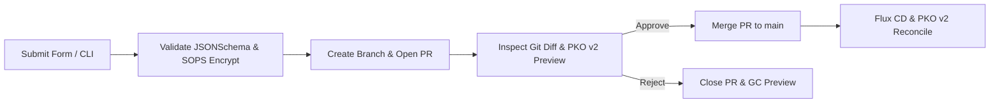

# Provisioning Workflow

After Stage 0 bootstrap, **every** infrastructure, provider, tenant, catalog, and application mutation follows a **PR-first GitOps workflow**. The control plane never commits directly to `main`.



## 1. Enable an Infrastructure Provider

Infrastructure blueprints in `catalog/infra/` are gated by `providers/registry.yaml`.

1. Open **Topology Map** in the web portal.
2. Locate the provider card (for example, **kind**, **Proxmox VE**, **AWS**, **GCP**, **Azure**, **Hetzner**, or **Cloudflare**).
3. Click **Enable Provider** to open a PR updating `providers/registry.yaml`.
4. Click **Go to PR** and merge the PR in **PR & Preview Inspector**.

> **Tip — Local `kind` provider:** `kind` is enabled by default in `providers/registry.yaml` so you can provision local workload `kind` clusters immediately.

## 2. Create a Tenant

1. Open **Catalog & Form Wizard**.
2. Click **+ New Tenant**, enter a DNS-compatible tenant ID (such as `platform-team`), and submit.
3. Merge the generated PR (`tenants/platform-team/rbac.yaml`).

## 3. Provision Infrastructure

### Via Web UI

1. Open **Catalog & Form Wizard** and select your **Target Tenant**.
2. Choose an infrastructure blueprint (for example, **Local kind Workload Cluster**).
3. Fill in the generated form parameters and click **Submit & Open Git PR Proposal**.
4. Click **Go to PR** to open **PR & Preview Inspector**.

### Via CLI

```bash
keel infra provision \
  --blueprint kind-cluster \
  --tenant platform-team \
  --values-file ./deploy/catalog/infra/kind-cluster/values.example.yaml \
  --server http://127.0.0.1:8080
```

## 4. Inspect Previews & Merge

In **PR & Preview Inspector** (or via CLI):

```bash
keel preview status --pr 1 --watch --server http://127.0.0.1:8080
```

- Review the **Git Diff** (the exact YAML manifests proposed under `tenants/<tenant>/infra/` or `tenants/<tenant>/apps/`).
- Review the **PKO v2 Diff** (`+ Create`, `~ Update`, `- Delete`, `! Replace`).
- Click **Merge PR Proposal** to merge into `main`, or **Reject PR** to close the proposal and garbage-collect ephemeral preview resources.

## 5. Deploy an Application

Once a workload cluster or tenant namespace is ready:

1. Select an application blueprint (such as **Podinfo**) in **Catalog & Form Wizard**.
2. Configure Helm `values.yaml` parameters and optionally enable **Flagger Canary Rollout**.
3. Submit and merge the PR—or run via CLI:

```bash
keel app install \
  --app podinfo \
  --tenant platform-team \
  --values-file ./deploy/catalog/apps/podinfo/upstream/values.yaml \
  --canary \
  --server http://127.0.0.1:8080
```

Monitor deployment progress and live events in **GitOps & Canary Console**.

> **Status Lifecycle (`Pending` → `Reconciling` → `Synced` / `Ready`):** When `keel serve` is connected to a bootstrapped management cluster (via `KUBECONFIG` or in-cluster config), it overlays live Flux CD and PKO v2 CRD conditions onto the Git state. If no cluster is reachable (for example, `just serve` without a cluster) or Flux/PKO has not reconciled the resource yet, stacks and releases remain `Pending`.
