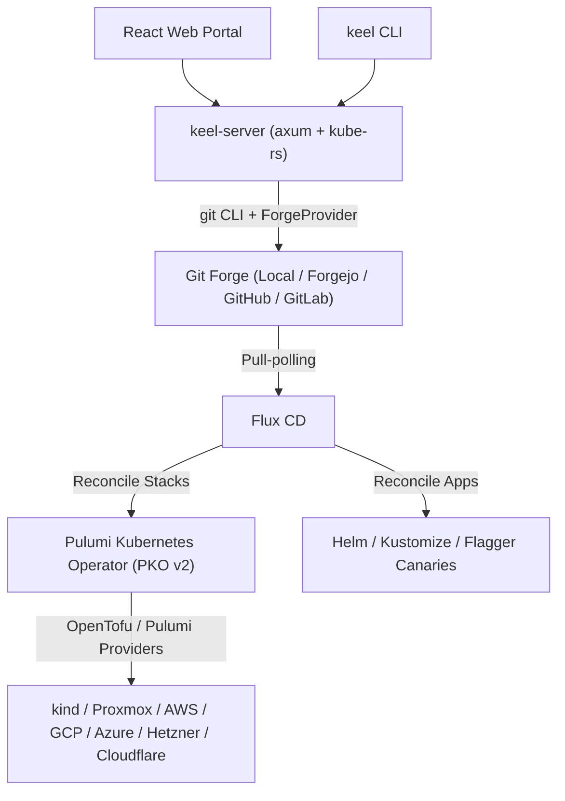

# Keel Control Plane

**Keel** is a single-binary **Rust** control plane and **React** web portal for provider-agnostic, PR-driven GitOps infrastructure and application orchestration.

Keel uses **Git** as the single source of truth for desired state, **Flux CD** for Kubernetes GitOps reconciliation, **Pulumi Kubernetes Operator (PKO v2)** for infrastructure provisioning across clouds and hypervisors, and Kubernetes-native `Secret`s and CRD watchers for runtime state (with zero external databases).

## Architecture Overview



## Documentation Guide

1. **[Stage 0 Bootstrap](getting-started/bootstrap.md)** — Initialize a management cluster (`kind`, `kubeconfig`, Proxmox, or cloud), start `keel serve`, and authenticate via OIDC.
2. **[Provisioning Workflow](getting-started/provisioning.md)** — Enable providers, create tenants, submit infrastructure & application PRs, inspect Git + PKO v2 diffs, and merge changes.
3. **[Things to Try](getting-started/things-to-try.md)** — Hands-on walkthroughs starting from a local `kind` management cluster (second `kind` cluster, `podinfo` canary rollout, minimal AWS EKS, and custom blueprints).
4. **[Catalog Overview](catalog/overview.md)** — Understand `CatalogInfraBlueprint` and `CatalogApplication` (`keel.io/v1alpha1`), JSON Schema forms, and SOPS/`age` secret encryption.
5. **[Provider Blueprint Examples](catalog/provider-examples.md)** — Ready-to-use `catalog.yaml` + `Pulumi.yaml` blueprints for **kind**, **AWS (EKS)**, **GCP (GKE)**, **Azure (AKS)**, **Proxmox VE (k3s)**, **Hetzner Cloud**, and **Cloudflare**.
6. **[Security, Tenancy & Canary](operations/security-and-tenancy.md)** — Namespace isolation, Kyverno policies, SOPS + `age` encryption, anti-lockout guardrails, and Flagger canary rollouts.

## Previewing Docs Locally

```bash
cargo install mdbook mdbook-mermaid
mdbook serve
```

Then open `http://127.0.0.1:3000` in your browser.
