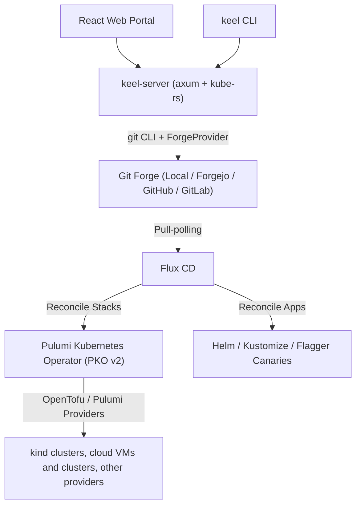
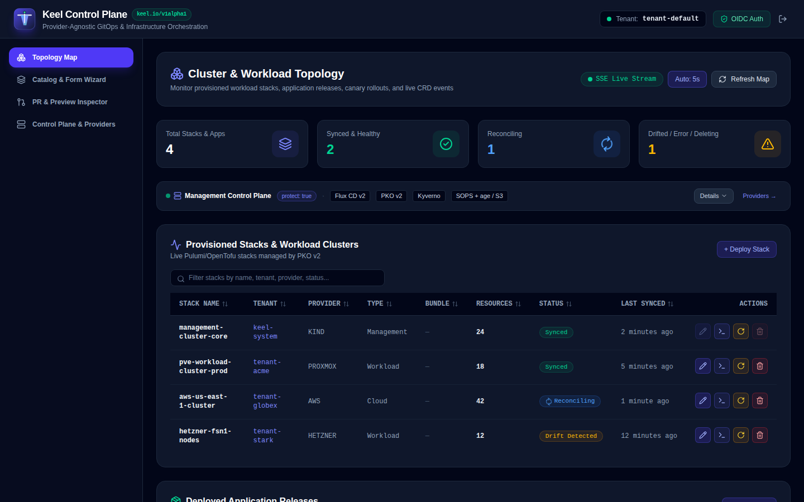

# Keel Control Plane

**Keel** is a single `keel` binary (CLI, API server and embedded web UI) that bootstraps a Flux CD + Pulumi Kubernetes Operator control plane and turns every infrastructure or application change into a pull request with a pre-merge preview.

> **Alpha.** Only the local `kind` path with the in-cluster Forgejo is tested end to end, and breaking releases have no upgrade path. Read [Known Limitations](reference/known-limitations.md) before you start.

Keel uses **Git** as the single source of truth for desired state, **Flux CD** for Kubernetes GitOps reconciliation, **Pulumi Kubernetes Operator (PKO v2)** for infrastructure provisioning (only local `kind` clusters are tested), and Kubernetes `Secret`s and watches of upstream CRDs for runtime state. `keel-server` has no database of its own; bundled components such as Forgejo, Rauthy and SeaweedFS keep their own storage.

## Architecture Overview



## Web Portal



## Documentation Guide

1. **[Stage 0 Bootstrap](getting-started/bootstrap.md)** — Initialize a management cluster (local `kind` is the tested target; existing clusters and cloud VMs are experimental), start `keel serve`, and authenticate via OIDC.
2. **[Provisioning Workflow](getting-started/provisioning.md)** — Enable providers, create tenants, submit infrastructure & application PRs, inspect Git + PKO v2 diffs, and merge changes.
3. **[Things to Try](getting-started/things-to-try.md)** — Hands-on walkthroughs starting from a local `kind` management cluster (second `kind` cluster, `podinfo` canary rollout, AWS EKS, and custom blueprints).
4. **[Catalog Overview](catalog/overview.md)** — Understand `CatalogInfraBlueprint` and `CatalogApplication` (`keel.io/v1alpha1`), JSON Schema forms, and SOPS/`age` secret encryption.
5. **[Provider Blueprint Examples](catalog/provider-examples.md)** — Ready-to-use `catalog.yaml` + `Pulumi.yaml` blueprints for **kind**, **AWS (EKS)**, **GCP (GKE)**, **Azure (AKS)**, a **Proxmox VE** VM (k3s not installed), a **Hetzner Cloud** server, and a **Cloudflare** DNS record. Only the `kind` blueprint is tested end to end.
6. **[Pre-Merge PKO Previews](getting-started/previews.md)**: how real `pulumi preview` runs work, what `source` / `run.phase` mean, and their limitations.
7. **[Web Portal](getting-started/web-ui.md)**: views, schema-driven forms, role-aware controls, the SSH terminal, and demo mode.
8. **[Security, Tenancy & Canary](operations/security-and-tenancy.md)**: least-privilege tenant credentials, IdP group mapping, Kyverno policies, SSH host-key verification, and Flagger canary rollouts.
9. **[Break-Glass Recovery](operations/break-glass-recovery.md)**: the Stage 0 state escrow and the recovery runbook.
10. **[Running keel-server In-Cluster](operations/in-cluster-server.md)**: the Kustomize bundle and its RBAC.
11. **[CLI Reference](reference/cli.md)**: every `keel` command and flag.
12. **[Known Limitations](reference/known-limitations.md)**: open bugs, untested paths and workarounds.
13. **[FAQ](reference/faq.md)**: why Flux and Pulumi, footprint, security, AI-assisted development and license.

## Previewing Docs Locally

```bash
cargo install mdbook
mdbook serve
```

Then open `http://127.0.0.1:3000` in your browser.
